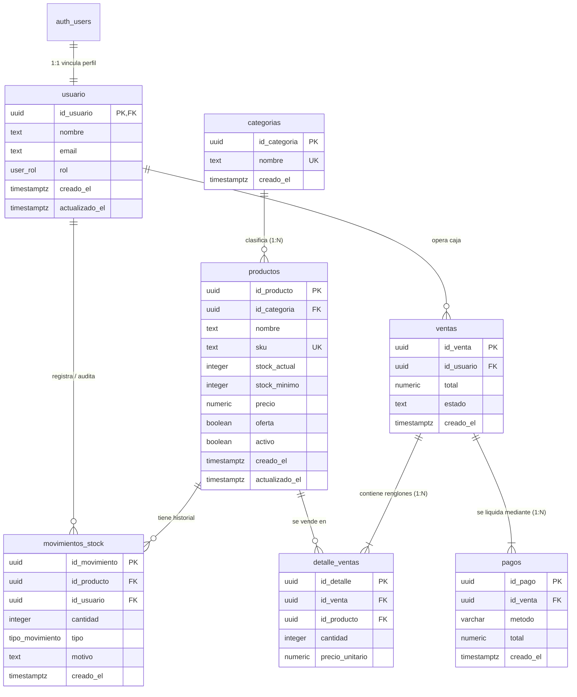

# Análisis Técnico del Esquema de Base de Datos (Supabase / PostgreSQL)

**Proyecto:** miStock — Sistema de Gestión de Inventario y Punto de Venta (POS)  
**Ubicación del Archivo de Migración:** [`mistock/supabase/migrations/schema.sql`](file:///b:/Programas/Github/m.i-stock/mistock/supabase/migrations/schema.sql)  
**Motor de Persistencia:** PostgreSQL 15+ administrado mediante Supabase  
**Fecha de Análisis:** Septiembre 2026  

---

## 1. Resumen Ejecutivo y Propósito

El esquema SQL define la arquitectura relacional y el modelo de datos central para el sistema **miStock**. Su diseño está enfocado en una operatoria comercial para **comercio minorista, locales comerciales o almacenes**, soportando dos flujos críticos:
1. **Administración de Catálogo e Inventario Físico:** Clasificación taxonómica de productos, alertas de stock mínimo, auditoría histórica de entradas/salidas mediante un patrón de libro mayor (*ledger*).
2. **Operación de Caja y Punto de Venta (POS):** Registro de tickets de venta, congelamiento de precios históricos, soporte para pagos divididos (*split payments*) y trazabilidad del empleado responsable.
3. **Autenticación e Identidad Robusta:** Integración directa con `auth.users` de Supabase, asignación de roles de negocio (`admin`, `vendedor`, `no_rol`) y control granular de acceso a nivel de fila (**Row Level Security - RLS**).

---

## 2. Diagrama Entidad-Relación (ER)



---

## 3. Desglose Estructural de Tablas y Tipos de Datos

### 3.1. Tipos Personalizados (ENUMs)

* `public.user_rol`: Define el rol operativo del personal dentro del sistema:
  - `'admin'`: Acceso total para dar de alta/modificar/eliminar productos, cambiar roles de usuarios y configurar el sistema.
  - `'vendedor'`: Acceso a cobro en el POS, consulta de productos y registro de movimientos de stock estándar.
  - `'no_rol'`: Rol de seguridad asignado por defecto a usuarios recién autenticados (impide que usuarios externos no autorizados ejecuten acciones hasta que un administrador les otorgue permisos explícitos).
* `public.tipo_movimiento`: Clasificación semántica de las alteraciones del stock:
  - `'compra'`: Entrada de mercadería por parte de proveedores (+).
  - `'venta'`: Salida de mercadería por facturación (-).
  - `'ajuste'`: Corrección manual por inventario físico, rotura, merma o extravío (+/-).
  - `'devolucion'`: Reintegro de productos al inventario (+).

---

### 3.2. Módulo de Usuarios y Seguridad

#### Tabla: `public.usuario`
Extiende el esquema interno de Supabase (`auth.users`) almacenando metadatos de los empleados.
* **`id_usuario` (UUID, PK):** Clave primaria que apunta directamente a `auth.users(id) ON DELETE CASCADE`. Si el usuario es eliminado de la autenticación de Supabase, su registro público se elimina en cascada.
* **`rol` (`user_rol`):** Por defecto `'no_rol'`. Evita la escalada de privilegios inadvertida tras el primer login con Google u OAuth.
* **Trazabilidad:** Marcas de tiempo `creado_el` y `actualizado_el` con zona horaria (`timestamptz`).

---

### 3.3. Módulo de Catálogo e Inventario

#### Tabla: `public.categorias`
Agrupación taxonómica para organizar productos.
* **`id_categoria` (UUID, PK):** Generado automáticamente mediante `gen_random_uuid()`.
* **`nombre` (TEXT, UNIQUE, NOT NULL):** Garantiza que no existan categorías duplicadas (ej: "Almacén", "Bebidas").

#### Tabla: `public.productos`
Entidad principal del catálogo comercial.
* **Identificadores y Taxonomía:**
  - `id_producto` (UUID, PK).
  - `id_categoria` (UUID, FK): Apunta a `public.categorias(id_categoria) ON DELETE SET NULL`.
  - `sku` (TEXT, UNIQUE): Código de barras o código interno de inventario único.
* **Control de Existencias:**
  - `stock_actual` (INTEGER): Existencias físicas actuales. Restricción `CHECK (stock_actual >= 0)` que impide stock negativo a nivel de motor.
  - `stock_minimo` (INTEGER, Default: 5): Umbral de seguridad para disparar alertas de stock crítico y órdenes de reposición.
* **Comercialización y Borrado Lógico:**
  - `precio` (NUMERIC(10,2)): Precio de venta al público con 2 decimales.
  - `oferta` (BOOLEAN): Flag promocional.
  - `activo` (BOOLEAN, Default: true): **Soft Delete (Borrado Lógico)**. Permite dar de baja un producto comercialmente sin romper las referencias históricas de tickets de ventas pasadas.

#### Tabla: `public.movimientos_stock`
Auditoría y trazabilidad histórica del inventario (Patrón *Ledger / Libro Mayor*).
* **`id_producto` (UUID, FK):** Referencia al producto afectado.
* **`id_usuario` (UUID, FK):** Empleado o administrador responsable del movimiento.
* **`cantidad` (INTEGER):** Variación de stock (+ para ingresos, - para egresos).
* **`tipo` (`tipo_movimiento`):** Origen del movimiento (`compra`, `venta`, `ajuste`, `devolucion`).
* **`motivo` (TEXT):** Justificación detallada (ej: "Vencimiento lote #482", "Diferencia de conteo físico").

---

### 3.4. Módulo de Ventas y Cobros (POS)

#### Tabla: `public.ventas`
Encabezado del ticket de venta o transacción comercial.
* **`id_venta` (UUID, PK):** Identificador único del comprobante.
* **`id_usuario` (UUID, FK):** Cajero o vendedor que registró la operación.
* **`total` (NUMERIC(10,2)):** Importe total de la venta (`CHECK total >= 0`).
* **`estado` (TEXT):** `'completada'`, `'pendiente'` o `'cancelada'`.

#### Tabla: `public.detalle_ventas`
Renglones o ítems incluidos en cada venta.
* **`id_venta` (UUID, FK):** Vinculado a la cabecera `ON DELETE CASCADE`.
* **`id_producto` (UUID, FK):** Producto vendido con regla `ON DELETE RESTRICT`. **Decisión de diseño crítica:** Impide borrar de la base de datos un producto si ya figura en alguna venta pasada, garantizando la integridad legal y contable.
* **`precio_unitario` (NUMERIC(10,2)):** **Fotografía del precio (*Snapshot*)**. Guarda el precio exacto al momento de la venta. Si mañana el producto aumenta en la tabla `productos`, las ventas pasadas conservan el precio real facturado.

#### Tabla: `public.pagos`
Gestión de cobros asociados a la venta.
* **`id_venta` (UUID, FK):** Venta que liquida.
* **`metodo` (VARCHAR(50)):** Medio de pago (`efectivo`, `tarjeta_debito`, `tarjeta_credito`, `transferencia`, etc.).
* **Diseño para Pagos Divididos (*Split Payment*):** Al tener una tabla separada con relación 1:N respecto a `ventas`, el sistema permite que un cliente pague, por ejemplo, $10.000 de una venta abonando $4.000 en efectivo y $6.000 con tarjeta de débito en múltiples registros de pago.

---

## 4. Automatizaciones en la Base de Datos (Funciones y Triggers)

### 4.1. Sincronización Automática de Usuarios (`handle_new_user`)
```sql
CREATE OR REPLACE FUNCTION public.handle_new_user()
RETURNS trigger
LANGUAGE plpgsql
SECURITY DEFINER SET search_path = public
AS $$
BEGIN
  INSERT INTO public.usuario (id_usuario, email, nombre)
  VALUES (
    NEW.id,
    NEW.email,
    COALESCE(NEW.raw_user_meta_data->>'full_name', NEW.raw_user_meta_data->>'name', '')
  );
  RETURN NEW;
END;
$$;
```
* **Mecanismo:** Trigger `AFTER INSERT ON auth.users`.
* **Beneficio:** Cuando un empleado inicia sesión por primera vez con Google o correo electrónico, se genera automáticamente su ficha en `public.usuario` con rol `'no_rol'`.
* **Seguridad:** Usa `SECURITY DEFINER` y fija explícitamente `SET search_path = public` para prevenir ataques de secuestro de ruta de búsqueda (*search_path hijacking*).

---

### 4.2. Recálculo Automático de Stock por Movimiento (`actualizar_stock_producto`)
```sql
CREATE OR REPLACE FUNCTION public.actualizar_stock_producto()
RETURNS trigger
LANGUAGE plpgsql
SECURITY DEFINER
AS $$
BEGIN
  UPDATE public.productos
  SET stock_actual = stock_actual + NEW.cantidad,
      actualizado_el = now()
  WHERE id_producto = NEW.id_producto;
  RETURN NEW;
END;
$$;
```
* **Mecanismo:** Trigger `AFTER INSERT ON public.movimientos_stock`.
* **Beneficio:** Desacopla la lógica de actualización: cualquier operación que inserte un movimiento (ej: venta, recepción de compra o ajuste) actualiza de forma atómica el stock del producto sin necesidad de dos queries separadas en el backend.
* **Integridad:** Si el resultado produce un valor menor a 0, la restricción `CHECK (stock_actual >= 0)` en `productos` aborta la transacción completa y revierte el movimiento.

---

### 4.3. Validación de Permisos sin Recursión RLS (`is_admin`)
```sql
CREATE OR REPLACE FUNCTION public.is_admin()
RETURNS boolean
LANGUAGE sql
SECURITY DEFINER
STABLE
SET search_path = public
AS $$
  SELECT EXISTS (
    SELECT 1 FROM public.usuario
    WHERE id_usuario = auth.uid() AND rol = 'admin'
  );
$$;
```
* **Problema que resuelve:** Cuando una política RLS de la tabla `usuario` consulta a la propia tabla `usuario`, PostgreSQL entra en un bucle de **recursión infinita**.
* **Solución:** La función está marcada como `SECURITY DEFINER` (se ejecuta con privilegios elevados del creador) y `STABLE` (su resultado se almacena en caché durante la duración de la consulta), permitiendo comprobar si el usuario actual es `'admin'` sin disparar nuevamente las políticas de fila.

---

## 5. Estrategia de Seguridad: Row Level Security (RLS)

Todas las tablas tienen RLS habilitado explícitamente (`ENABLE ROW LEVEL SECURITY`). Las políticas implementan un modelo de **Control de Acceso Basado en Roles (RBAC)**:

| Tabla | Operación | Roles Autorizados | Condición / Política |
| :--- | :--- | :--- | :--- |
| `categorias` | SELECT | `authenticated` (Staff) | `USING (true)` (Todo el personal puede ver el catálogo) |
| `categorias` | INSERT / UPDATE / DELETE | `authenticated` (Solo Admin) | `USING (public.is_admin())` |
| `productos` | SELECT | `authenticated` (Staff) | `USING (true)` |
| `productos` | INSERT / UPDATE / DELETE | `authenticated` (Solo Admin) | `USING (public.is_admin())` |
| `usuario` | SELECT | `authenticated` (Staff) | `USING (true)` (Para ver nombres de cajeros/empleados) |
| `usuario` | INSERT / UPDATE / DELETE | `authenticated` (Solo Admin) | `USING (public.is_admin())` |
| `ventas` | SELECT / INSERT | `authenticated` (Staff) | Todo el staff autenticado puede registrar ventas |
| `detalle_ventas` | SELECT / INSERT | `authenticated` (Staff) | Todo el staff autenticado puede cargar renglones |
| `pagos` | SELECT / INSERT | `authenticated` (Staff) | Todo el staff autenticado puede registrar pagos |
| `movimientos_stock` | SELECT / INSERT | `authenticated` (Staff) | Staff registra ingresos/egresos |

> [!NOTE]
> **Modelo de Apéndice Único (*Append-Only*):**  
> Nótese que para `ventas`, `detalle_ventas`, `pagos` y `movimientos_stock` **NO existen políticas de `UPDATE` ni `DELETE`**. Esto significa que ningún vendedor ni administrador puede modificar o borrar tickets o movimientos ya emitidos, protegiendo la inmutabilidad de los registros contables y de auditoría.

---

## 6. Índices de Rendimiento Implementados

El script incluye índices sobre claves foráneas y columnas de ordenamiento temporal:
* `idx_productos_categoria` sobre `productos(id_categoria)`.
* `idx_movimientos_producto` sobre `movimientos_stock(id_producto)`.
* `idx_movimientos_usuario` sobre `movimientos_stock(id_usuario)`.
* `idx_ventas_usuario` sobre `ventas(id_usuario)`.
* `idx_ventas_fecha` sobre `ventas(creado_el DESC)` (Acelera reportes diarios y dashboards de caja).
* `idx_pagos_venta` sobre `pagos(id_venta)`.
* `idx_detalle_venta` sobre `detalle_ventas(id_venta)`.

---

## 7. Puntos Críticos y Oportunidades de Mejora a Tener en Cuenta

A continuación se detallan observaciones técnicas relevantes al comparar el esquema SQL con el frontend actual de Next.js y las mejores prácticas de Supabase / Postgres:

### 7.1. Discrepancias entre Modelo SQL y Modelos Frontend (`TypeScript`)

1. **Estructura de Precios (`precioCosto` vs `precioVenta`):**
   * En el frontend (`productoModel.ts` y en la vista de carga de inventario) se contemplan dos precios: **`precioCosto`** (para calcular margen de ganancia) y **`precioVenta`**.
   * En la tabla SQL `productos` solo existe una columna: `precio numeric(10,2)`.
   * *Recomendación:* Agregar `precio_costo numeric(10,2) NOT NULL DEFAULT 0.00` a `public.productos` para poder reportar rentabilidad real.

2. **Unidad de Medida del Producto:**
   * En la aplicación web permitimos seleccionar unidades: `unidad`, `kg`, `litro`, `gramo`, `metro`, `paquete`.
   * En la tabla SQL `productos` no existe actualmente una columna `unidad_medida`.
   * *Recomendación:* Crear un ENUM `public.unidad_medida` o columna `varchar(20) DEFAULT 'unidad'`.

3. **Descripción de Productos y Categorías:**
   * El frontend maneja `descripcion` en categorías y en productos. En SQL, `categorias` no cuenta con campo de descripción.
   * *Recomendación:* Añadir `descripcion text` a `categorias` y `productos`.

4. **Integridad Referencial en Categorías:**
   * Regla de negocio en frontend: *"Un producto NO puede existir sin una categoría definida previamente"*.
   * En SQL: `id_categoria uuid REFERENCES public.categorias(id_categoria) ON DELETE SET NULL`. Permite valores `NULL`.
   * *Recomendación:* Si la regla de negocio es estricta, la columna en SQL debería ser `NOT NULL` con `ON DELETE RESTRICT`, impidiendo borrar una categoría que aún contenga productos.

---

### 7.2. Recomendaciones de Rendimiento y Buenas Prácticas de PostgreSQL

1. **Índice Faltante en Clave Foránea de Detalle de Ventas:**
   * La columna `id_producto` en `public.detalle_ventas` no tiene índice propio.
   * *Impacto:* Al realizar consultas como *"¿En qué ventas se vendió el producto X?"* o al comprobar restricciones de borrado (`ON DELETE RESTRICT`), Postgres se verá forzado a realizar un escaneo secuencial (*Seq Scan*).
   * *Solución sugerida:*
     ```sql
     CREATE INDEX idx_detalle_ventas_producto ON public.detalle_ventas(id_producto);
     ```

2. **Optimización de Políticas RLS (Subquery Wrapping):**
   * Siguiendo las directrices de optimización de Supabase, cuando una función como `public.is_admin()` se llama dentro de un `USING` sin envolver en un `SELECT`, PostgreSQL puede evaluarla fila por fila en tablas grandes:
     ```sql
     -- Actual:
     USING (public.is_admin())
     
     -- Optimizado (se ejecuta una sola vez y se cachea para toda la consulta):
     USING ((SELECT public.is_admin()))
     ```

3. **Seguridad en la Función `actualizar_stock_producto`:**
   * La función está declarada con `SECURITY DEFINER`, pero le falta el parámetro `SET search_path = public`.
   * *Mejora de seguridad:* Agregar siempre `SET search_path = public` a toda función `SECURITY DEFINER` para evitar vulnerabilidades de inyección por variables de entorno de búsqueda de esquemas.

4. **Automatización de Movimientos desde Ventas:**
   * Actualmente, el trigger de stock escucha inserciones en `movimientos_stock`. Si desde el frontend al cobrar una venta solo se inserta en `ventas` y `detalle_ventas`, el stock **no se descontará** a menos que también se inserte explícitamente en `movimientos_stock`.
   * *Alternativa sugerida:* Crear una función transaccional en Postgres (o función RPC / Trigger en `detalle_ventas`) que al registrar la venta genere en la misma transacción el movimiento de stock correspondiente con tipo `'venta'`.

---

## 8. Conclusión

El esquema de base de datos de **miStock** cuenta con una base sólida, profesional y bien estructurada:
- Implementa claves primarias con UUIDs no secuenciales.
- Garantiza integridad física del stock mediante restricciones `CHECK (stock_actual >= 0)`.
- Separa claramente los dominios de inventario y facturación.
- Resguarda la seguridad mediante **Row Level Security (RLS)** y roles controlados.
- Preserva la inmutabilidad de precios históricos en las ventas.

Las sugerencias detalladas en la sección 7 permitirán alinear al 100% la base de datos con los formularios desarrollados en la interfaz de usuario de Next.js y maximizar el rendimiento a medida que el catálogo y el volumen de transacciones crezcan.
