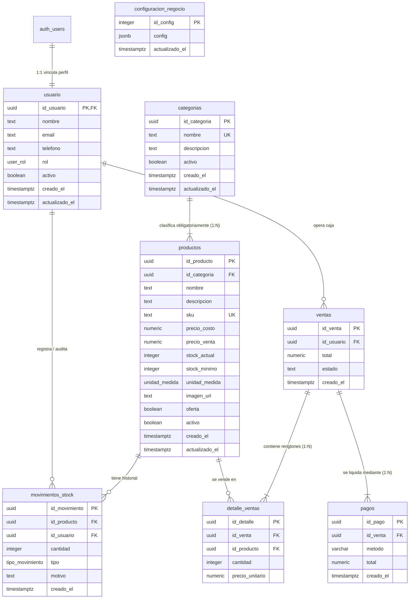

# Análisis Técnico del Esquema de Base de Datos (Supabase / PostgreSQL)

**Proyecto:** miStock — Sistema de Gestión de Inventario y Punto de Venta (POS)  
**Ubicación del Archivo de Migración:** [`mistock/supabase/migrations/schema.sql`](file:///b:/Programas/Github/m.i-stock/mistock/supabase/migrations/schema.sql)  
**Motor de Persistencia:** PostgreSQL 15+ administrado mediante Supabase  
**Estado:** Consolidado y Alineado con Modelos de Dominio Frontend (TypeScript)  

---

## 1. Resumen Ejecutivo y Propósito

El esquema SQL define la arquitectura relacional y el modelo de datos central para el sistema **miStock**. Su diseño está enfocado en una operatoria comercial para **comercio minorista, locales comerciales o almacenes**, soportando tres flujos críticos:
1. **Administración de Catálogo e Inventario Físico:** Clasificación taxonómica de productos, regla estricta de pertenencia a categoría obligatoria (`NOT NULL` con `ON DELETE RESTRICT`), control de costos de reposición y precios de venta al consumidor, alertas de stock mínimo y auditoría histórica de entradas/salidas mediante un patrón de libro mayor (*ledger*).
2. **Operación de Caja y Punto de Venta (POS):** Registro de tickets de venta, congelamiento de precios históricos (*Snapshot*), soporte para pagos divididos (*split payments*), trazabilidad del empleado responsable y **descuento automático de existencias físicas ante cada venta**.
3. **Autenticación e Identidad Robusta:** Integración directa con `auth.users` de Supabase, asignación de roles de negocio (`admin`, `vendedor`, `no_rol`) y control granular de acceso a nivel de fila (**Row Level Security - RLS**) con optimización de subconsultas escalares.

---

## 2. Diagrama Entidad-Relación (ER)

---

## 3. Desglose Estructural de Tablas y Tipos de Datos

### 3.1. Tipos Personalizados (ENUMs)

* `public.user_rol`: Define el rol operativo del personal dentro del sistema:
  - `'admin'`: Acceso total para dar de alta/modificar/eliminar productos, cambiar roles de usuarios y configurar el sistema.
  - `'vendedor'`: Acceso a cobro en el POS, consulta de productos y registro de movimientos de stock estándar.
  - `'no_rol'`: Rol de seguridad asignado por defecto a usuarios recién autenticados (impide que usuarios externos no autorizados ejecuten acciones hasta que un administrador les otorgue permisos explícitos).
* `public.tipo_movimiento`: Clasificación semántica de las alteraciones del stock:
  - `'compra'`: Entrada de mercadería por parte de proveedores (+).
  - `'venta'`: Salida de mercadería por facturación (-).
  - `'ajuste'`: Corrección manual por inventario físico, rotura, merma o extravío (+/-).
  - `'devolucion'`: Reintegro de productos al inventario (+).
* `public.unidad_medida`: Unidades físicas admitidas para la venta y control de inventario:
  - `'unidad'`, `'kg'`, `'gramo'`, `'litro'`, `'metro'`, `'paquete'`.

---

### 3.2. Módulo de Usuarios y Seguridad

#### Tabla: `public.usuario`
Extiende el esquema interno de Supabase (`auth.users`) almacenando metadatos de los empleados.
* **`id_usuario` (UUID, PK):** Clave primaria que apunta directamente a `auth.users(id) ON DELETE CASCADE`. Si el usuario es eliminado de la autenticación de Supabase, su registro público se elimina en cascada.
* **`rol` (`user_rol`):** Por defecto `'no_rol'`. Evita la escalada de privilegios inadvertida tras el primer login con Google u OAuth.
* **`telefono` (TEXT):** Número de contacto telefónico del colaborador (opcional, validado a 6-15 dígitos numéricos).
* **`activo` (BOOLEAN, Default: true):** Habilitación operativa del usuario. Si es `false`, el sistema bloquea el inicio de sesión.
* **Trazabilidad:** Marcas de tiempo `creado_el` y `actualizado_el` con zona horaria (`timestamptz`).

---

### 3.3. Módulo de Catálogo e Inventario

#### Tabla: `public.categorias`
Agrupación taxonómica para organizar productos.
* **`id_categoria` (UUID, PK):** Generado automáticamente mediante `gen_random_uuid()`.
* **`nombre` (TEXT, UNIQUE, NOT NULL):** Garantiza que no existan categorías duplicadas (ej: "Almacén", "Bebidas").
* **`descripcion` (TEXT):** Detalle comercial sobre la familia de productos.
* **`activo` (BOOLEAN, Default: true):** Control de baja lógica de categorías.

#### Tabla: `public.productos`
Entidad principal del catálogo comercial, alineada con `productoModel.ts`.
* **Taxonomía e Integridad Estricta:**
  - `id_producto` (UUID, PK).
  - `id_categoria` (UUID, FK): `NOT NULL REFERENCES public.categorias(id_categoria) ON DELETE RESTRICT`. Cumple la regla de negocio que prohíbe productos huérfanos e impide borrar categorías con productos asociados.
  - `sku` (TEXT, UNIQUE): Código de barras o código interno de inventario único.
* **Estructura de Precios y Costos:**
  - `precio_costo` (NUMERIC(10,2), Default: 0.00, `CHECK precio_costo >= 0`): Costo mayorista / reposición. Permite reportar márgenes reales de rentabilidad.
  - `precio_venta` (NUMERIC(10,2), Default: 0.00, `CHECK precio_venta >= 0`): Precio final al consumidor.
* **Control Físico y Unidades:**
  - `stock_actual` (INTEGER): Existencias físicas actuales. Restricción `CHECK (stock_actual >= 0)` que impide stock negativo a nivel de motor.
  - `stock_minimo` (INTEGER, Default: 5): Umbral de seguridad para disparar alertas de stock crítico y órdenes de reposición.
  - `unidad_medida` (`unidad_medida`, Default: `'unidad'`): Unidad de comercialización.
* **Comercialización y Borrado Lógico:**
  - `descripcion` (TEXT): Detalles descriptivos del artículo.
  - `imagen_url` (TEXT): URL del recurso gráfico o foto del producto.
  - `oferta` (BOOLEAN): Flag promocional.
  - `activo` (BOOLEAN, Default: true): **Soft Delete (Borrado Lógico)**. Permite dar de baja un producto comercialmente sin romper las referencias históricas de tickets de ventas pasadas.

#### Tabla: `public.movimientos_stock`
Auditoría y trazabilidad histórica del inventario (Patrón *Ledger / Libro Mayor*).
* **`id_producto` (UUID, FK):** Referencia al producto afectado (`ON DELETE CASCADE`).
* **`id_usuario` (UUID, FK):** Empleado o administrador responsable del movimiento.
* **`cantidad` (INTEGER):** Variación de stock (+ para ingresos, - para egresos).
* **`tipo` (`tipo_movimiento`):** Origen del movimiento (`compra`, `venta`, `ajuste`, `devolucion`).
* **`motivo` (TEXT):** Justificación detallada (ej: "Venta automática en ticket ...", "Vencimiento lote #482").

---

### 3.4. Módulo de Ventas y Cobros (POS)

#### Tabla: `public.ventas`
Encabezado del ticket de venta o transacción comercial.
* **`id_venta` (UUID, PK):** Identificador único del comprobante.
* **`id_usuario` (UUID, FK):** Cajero o vendedor que registró la operación.
* **`total` (NUMERIC(10,2)):** Importe total de la venta (`CHECK total >= 0`).
* **`estado` (TEXT):** `'completada'`, `'pendiente'` o `'cancelada'`.

#### Tabla: `public.detalle_ventas`
Renglones o ítems incluidos en cada venta.
* **`id_venta` (UUID, FK):** Vinculado a la cabecera `ON DELETE CASCADE`.
* **`id_producto` (UUID, FK):** Producto vendido con regla `ON DELETE RESTRICT`. **Decisión de diseño crítica:** Impide borrar de la base de datos un producto si ya figura en alguna venta pasada, garantizando la integridad legal y contable.
* **`precio_unitario` (NUMERIC(10,2)):** **Fotografía del precio (*Snapshot*)**. Guarda el precio exacto al momento de la venta. Si mañana el producto aumenta en la tabla `productos`, las ventas pasadas conservan el precio real facturado.

#### Tabla: `public.pagos`
Gestión de cobros asociados a la venta.
* **`id_venta` (UUID, FK):** Venta que liquida.
* **`metodo` (VARCHAR(50)):** Medio de pago (`efectivo`, `tarjeta_debito`, `tarjeta_credito`, `transferencia`, etc.).
* **Diseño para Pagos Divididos (*Split Payment*):** Al tener una tabla separada con relación 1:N respecto a `ventas`, el sistema permite que un cliente pague, por ejemplo, $10.000 de una venta abonando $4.000 en efectivo y $6.000 con tarjeta de débito en múltiples registros de pago.

---

### 3.5. Módulo de Configuración del Comercio

#### Tabla: `public.configuracion_negocio`
Persistencia de los parámetros comerciales, identidad fiscal y reglas de funcionamiento del sistema.
* **`id_config` (INTEGER, PK):** Clave única (registro singleton `id = 1`).
* **`config` (JSONB, NOT NULL):** Estructura consolidada de `ConfiguracionCompleta` (identidad de empresa, moneda, métodos de pago habilitados, venta sin stock, modo de ticket no_fiscal/fiscal y períodos analíticos).
* **`actualizado_el` (TIMESTAMPTZ):** Marca temporal de la última modificación.

---

## 4. Automatizaciones en la Base de Datos (Funciones y Triggers)

### 4.1. Sincronización Automática de Usuarios (`handle_new_user`)
* **Mecanismo:** Trigger `AFTER INSERT ON auth.users`.
* **Beneficio:** Cuando un empleado inicia sesión por primera vez con Google o correo electrónico, se genera automáticamente su ficha en `public.usuario` con rol `'no_rol'`.
* **Seguridad:** Utiliza `SECURITY DEFINER` y fija explícitamente `SET search_path = public` para prevenir ataques de secuestro de ruta de búsqueda (*search_path hijacking*).

---

### 4.2. Recálculo Automático de Stock por Movimiento (`actualizar_stock_producto`)
* **Mecanismo:** Trigger `AFTER INSERT ON public.movimientos_stock`.
* **Beneficio:** Aplica de forma atómica la suma o resta sobre `productos.stock_actual`. Si la operación resulta en un valor negativo, la restricción `CHECK (stock_actual >= 0)` aborta la transacción completa y revierte el movimiento.
* **Seguridad:** Fija explícitamente `SET search_path = public`.

---

### 4.3. Automatización de Salida de Stock ante Ventas (`registrar_movimiento_por_venta`)
* **Mecanismo:** Trigger `AFTER INSERT ON public.detalle_ventas`.
* **Beneficio:** Cada vez que el cajero confirma una venta y se insertan los renglones en `detalle_ventas`, este trigger genera automáticamente en la misma transacción un movimiento en `movimientos_stock` con `tipo = 'venta'` y `cantidad = -NEW.cantidad`. A su vez, esto dispara el recálculo en `actualizar_stock_producto`, garantizando que el stock físico **siempre esté sincronizado en tiempo real**.

---

### 4.4. Validación de Permisos sin Recursión RLS (`is_admin`)
* **Mecanismo:** Función `SECURITY DEFINER` y `STABLE` con `SET search_path = public`.
* **Beneficio:** Comprueba si el usuario autenticado tiene rol `'admin'` y se encuentra activo (`activo = true`) sin disparar recursión infinita en las políticas RLS de `public.usuario`.

---

### 4.5. Reintegro Automático de Stock por Anulación (`reintegrar_stock_por_cancelacion`)
* **Mecanismo:** Trigger `tr_cancelar_venta_reintegrar_stock` (`AFTER UPDATE OF estado ON public.ventas`).
* **Beneficio:** Cuando una venta cambia su estado a `'cancelada'`, la función recorre automáticamente los renglones de `detalle_ventas`, genera movimientos de tipo `'devolucion'` en `movimientos_stock` con cantidad positiva y restituye el stock físico en `productos.stock_actual`.

---

### 4.6. Procedimientos Almacenados de Administración (RPCs Seguras)
* **`public.crear_colaborador_admin(email, password, nombre, rol, telefono)`:** Función `SECURITY DEFINER` que aprovisiona criptográficamente al usuario en `auth.users` y en `public.usuario` sin almacenar contraseñas en texto plano.
* **`public.actualizar_password_colaborador_admin(usuario_id, password)`:** Función `SECURITY DEFINER` para restablecer contraseñas de colaboradores desde la consola de administración. Ejecución restringida exclusivamente a usuarios autenticados con rol `admin`.

---

## 5. Estrategia de Seguridad: Row Level Security (RLS)

Todas las tablas tienen RLS habilitado explícitamente (`ENABLE ROW LEVEL SECURITY`). Las políticas implementan un modelo de **Control de Acceso Basado en Roles (RBAC)** con optimización de subconsultas `((SELECT public.is_admin()))`:

| Tabla | Operación | Roles Autorizados | Condición / Política Optimizada |
| :--- | :--- | :--- | :--- |
| `categorias` | SELECT | `authenticated` (Staff) | `USING (true)` (Todo el personal puede ver el catálogo) |
| `categorias` | INSERT / UPDATE / DELETE | `authenticated` (Solo Admin) | `USING ((SELECT public.is_admin()))` |
| `productos` | SELECT | `authenticated` (Staff) | `USING (true)` |
| `productos` | INSERT / UPDATE / DELETE | `authenticated` (Solo Admin) | `USING ((SELECT public.is_admin()))` |
| `usuario` | SELECT | `authenticated` (Staff) | `USING (true)` (Para ver nombres de cajeros/empleados) |
| `usuario` | INSERT / UPDATE / DELETE | `authenticated` (Solo Admin) | `USING ((SELECT public.is_admin()))` |
| `ventas` | SELECT / INSERT | `authenticated` (Staff) | Todo el staff autenticado puede registrar ventas |
| `ventas` | UPDATE (Anulación) | `authenticated` (Staff) | Política `"Staff anula ventas activas"` (`WITH CHECK (estado = 'cancelada')`) |
| `configuracion_negocio` | SELECT | `authenticated` (Staff) | Todo el personal consulta parámetros comerciales |
| `configuracion_negocio` | INSERT / UPDATE | `authenticated` (Solo Admin) | `USING ((SELECT public.is_admin()))` |
| `detalle_ventas` | SELECT / INSERT | `authenticated` (Staff) | Todo el staff autenticado puede cargar renglones |
| `pagos` | SELECT / INSERT | `authenticated` (Staff) | Todo el staff autenticado puede registrar pagos |
| `movimientos_stock` | SELECT / INSERT | `authenticated` (Staff) | Staff registra ingresos/egresos |

> [!NOTE]
> **Modelo de Apéndice Inmutable (*Append-Only* y Anulación Segura):**  
> Para `detalle_ventas`, `pagos` y `movimientos_stock` **NO existen políticas de `UPDATE` ni `DELETE`**. Ningún usuario puede alterar o borrar registros contables emitidos. Para `ventas`, únicamente se autoriza la transición controlada a `estado = 'cancelada'`, la cual dispara el reintegro de existencias físicas mediante trigger.

---

## 6. Índices de Rendimiento Implementados

El script incluye índices sobre claves foráneas y columnas de ordenamiento temporal:
* `idx_productos_categoria` sobre `productos(id_categoria)`.
* `idx_movimientos_producto` sobre `movimientos_stock(id_producto)`.
* `idx_movimientos_usuario` sobre `movimientos_stock(id_usuario)`.
* `idx_ventas_usuario` sobre `ventas(id_usuario)`.
* `idx_ventas_fecha` sobre `ventas(creado_el DESC)` (Acelera reportes diarios y dashboards de caja).
* `idx_pagos_venta` sobre `pagos(id_venta)`.
* `idx_detalle_venta` sobre `detalle_ventas(id_venta)`.
* `idx_detalle_ventas_producto` sobre `detalle_ventas(id_producto)` (Acelera consultas históricas y restricciones `RESTRICT`).

---

## 7. Estado de las Mejoras y Ajustes Realizados

Todas las recomendaciones de diseño y rendimiento fueron aplicadas directamente en [`schema.sql`](file:///b:/Programas/Github/m.i-stock/mistock/supabase/migrations/schema.sql):

| Área | Ajuste Aplicado en `schema.sql` | Beneficio Técnico |
| :--- | :--- | :--- |
| **Precios** | `precio_costo` + `precio_venta` (`numeric(10,2)`) | Cálculo de rentabilidad real y márgenes brutos. |
| **Unidades** | ENUM `public.unidad_medida` | Integridad física en venta por peso, volumen o bulto. |
| **Descripciones** | `descripcion text` en `categorias` y `productos` | Persistencia completa de datos comerciales del frontend. |
| **Taxonomía** | `id_categoria NOT NULL ... ON DELETE RESTRICT` | Impide productos huérfanos y protege categorías activas. |
| **Índices** | `idx_detalle_ventas_producto` | Evita escaneos secuenciales lentos en consultas de ventas. |
| **RLS Performance** | `USING ((SELECT public.is_admin()))` | Evaluación escalar única por query (5x-100x más rápida). |
| **Seguridad PL/pgSQL** | `SET search_path = public` en triggers | Blindaje contra ataques de secuestro de esquema. |
| **POS Automatizado** | Trigger `tr_venta_movimiento_stock` | Descuento automático de stock sin depender de código frontend. |
| **Anulación y Reintegro** | Trigger `tr_cancelar_venta_reintegrar_stock` | Reintegro automático de stock y registro de devolución al cancelar una venta. |
| **RLS Anulación** | Política `Staff anula ventas activas` FOR UPDATE | Permite al personal autenticado cambiar el estado de ventas a 'cancelada'. |
| **Parámetros Negocio** | Tabla `public.configuracion_negocio` con RLS | Persistencia multi-dispositivo de parámetros fiscales, ticket y POS. |
| **Usuarios Extendido** | Columnas `telefono text` y `activo boolean DEFAULT true` | Control de estado de cuenta y contacto en `public.usuario`. |
| **RPCs de Colaboradores** | `crear_colaborador_admin` y `actualizar_password_colaborador_admin` | Creación y cambio de contraseñas de personal sin cuentas huérfanas locales. |
| **Script de Migración** | [`patch_integridad_y_anulacion.sql`](file:///b:/Programas/Github/m.i-stock/mistock/supabase/migrations/patch_integridad_y_anulacion.sql) | Parche idempotente para aplicar estas mejoras en bases de datos activas. |
