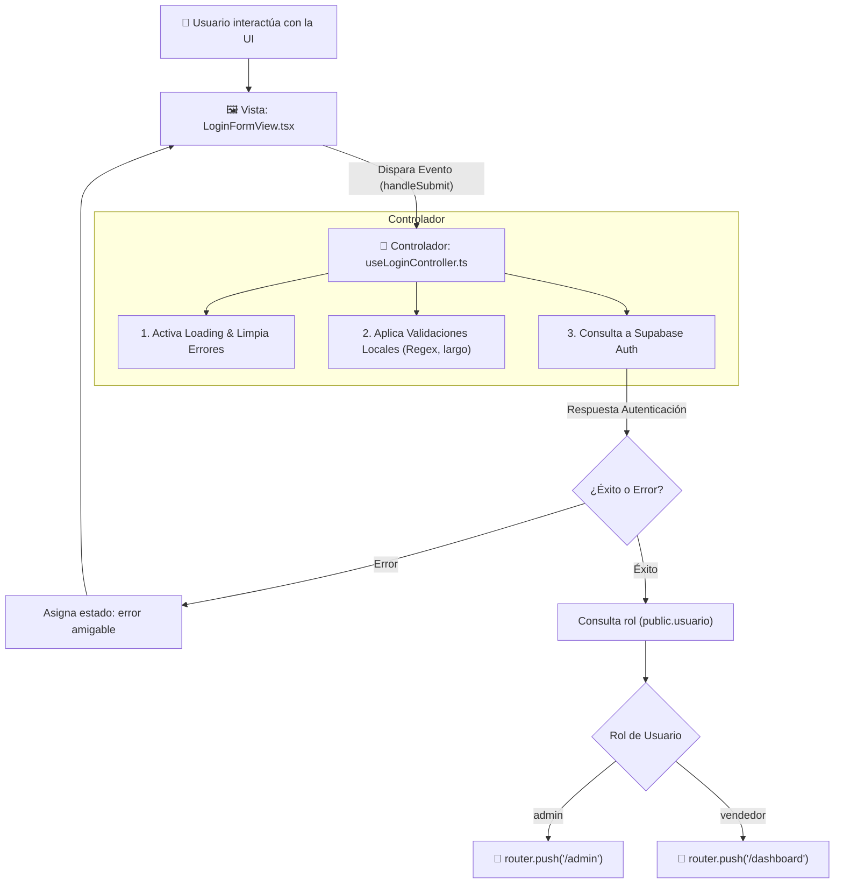

# 🧠 Patrón Controlador MVC en React + TypeScript

#architecture #react #typescript #mvc #nextjs #clean-code

---

## 📌 Resumen Ejecutivo

En arquitecturas web modernas con **React 19**, **Next.js (App Router)** y **TypeScript**, el patrón **Modelo-Vista-Controlador (MVC)** se adapta implementando los **Controladores como Custom Hooks**.

> [!INFO] **Principio de Responsabilidad Única (SRP)**
> - **La Vista (`View`)**: Se encarga únicamente del renderizado visual (UI), componentes accesibles (Radix UI / shadcn), estilos atómicos (Tailwind CSS v4), animaciones y accesibilidad.
> - **El Controlador (`Controller`)**: Actúa como el cerebro operacional. Maneja el estado reactivo (`useState`), las validaciones de negocio, la conexión con Supabase/APIs y el enrutamiento (`useRouter`).
> - **El Modelo (`Model`)**: Define las entidades de negocio (`modelos_dominio/`), ViewModels de formulario (`modelos_vista/`) y esquemas tipados con TypeScript.

---

## 🔄 Diagrama de Flujo de Interacción



---

## 📐 Estructura Básica de 3 Pasos de todo Controlador

Todo controlador profesional en TypeScript se organiza en **3 partes fundamentales**:

### 1. El Estado (State)
Define la información reactiva que la vista necesita reflejar en pantalla (`values`, `fieldErrors`, `loading`, `error`).

### 2. Las Acciones / Lógica de Negocio (Handlers)
Funciones que procesan los eventos del usuario, aplican reglas de validación y llaman a la infraestructura (`handleSubmit`, `setFieldValue`, `validate`).

### 3. El Contrato de Salida (Return Contract)
El objeto retornado que consume la vista de forma segura con tipado estricto e inmutable en TypeScript.

---

## 💻 Código de Referencia Didáctico (`src/controllers/authController.ts`)

```typescript
'use client';

import { useState } from 'react';
import { useRouter } from 'next/navigation';
import { createClient } from '@/lib/supabase/client';
import { LoginFormValues } from '@/models/modelos_vista/authModel';

/**
 * Custom Hook: useLoginController
 */
export function useLoginController() {
  const router = useRouter();

  // =========================================================================
  // PASO 1: ESTADO REACTIVO (State)
  // =========================================================================
  const [values, setValues] = useState<LoginFormValues>({
    email: '',
    password: '',
    rememberMe: false,
  });
  const [fieldErrors, setFieldErrors] = useState<Partial<Record<keyof LoginFormValues, string>>>({});
  const [loading, setLoading] = useState<boolean>(false);
  const [error, setError] = useState<string | null>(null);

  // =========================================================================
  // PASO 2: ACCIONES Y LÓGICA DE NEGOCIO (Handlers & Validaciones)
  // =========================================================================
  const setFieldValue = <K extends keyof LoginFormValues>(field: K, value: LoginFormValues[K]) => {
    setValues((prev) => ({ ...prev, [field]: value }));
    setFieldErrors((prev) => ({ ...prev, [field]: undefined }));
  };

  const validate = (): boolean => {
    const errors: Partial<Record<keyof LoginFormValues, string>> = {};
    if (!values.email || !/^\S+@\S+$/.test(values.email)) {
      errors.email = 'Correo electrónico no válido';
    }
    if (!values.password || values.password.length < 6) {
      errors.password = 'La contraseña debe tener al menos 6 caracteres';
    }
    setFieldErrors(errors);
    return Object.keys(errors).length === 0;
  };

  const handleSubmit = async (e?: React.FormEvent) => {
    if (e) e.preventDefault();
    if (!validate()) return;

    setLoading(true);
    setError(null);

    try {
      const supabase = createClient();
      const { data, error: authError } = await supabase.auth.signInWithPassword({
        email: values.email,
        password: values.password,
      });

      if (authError) {
        if (authError.message.includes('Invalid login credentials')) {
          setError('Correo electrónico o contraseña incorrectos.');
        } else {
          setError(authError.message || 'Error al iniciar sesión.');
        }
        return;
      }

      if (data.session) {
        const { data: usuarioData } = await supabase
          .from('usuario')
          .select('rol')
          .eq('id_usuario', data.session.user.id)
          .maybeSingle();

        if (usuarioData?.rol === 'vendedor') {
          router.push('/dashboard');
        } else {
          router.push('/admin');
        }
        router.refresh();
      }
    } catch (err: unknown) {
      const message = err instanceof Error ? err.message : 'Error inesperado de conexión.';
      setError(message);
    } finally {
      setLoading(false);
    }
  };

  const clearError = () => setError(null);

  // =========================================================================
  // PASO 3: CONTRATO EXPORTADO A LA VISTA (Return Contract)
  // =========================================================================
  return {
    values,
    fieldErrors,
    setFieldValue,
    loading,
    error,
    handleSubmit,
    clearError,
  };
}
```

---

## ⚖️ Cuadro Comparativo de Responsabilidades

| Responsabilidad | Vista (`View`) | Controlador (`Controller`) | Modelo (`Model`) |
| :--- | :---: | :---: | :---: |
| Renderizar HTML / JSX | ✅ | ❌ | ❌ |
| Aplicar Tailwind CSS y Radix UI | ✅ | ❌ | ❌ |
| Guardar estado reactivo (`loading`, `error`, filtros) | ❌ | ✅ | ❌ |
| Validar reglas de negocio y campos | ❌ | ✅ | ❌ |
| Llamar a `supabase` / APIs externas | ❌ | ✅ | ❌ |
| Definir Interfaces TypeScript y DTOs | ❌ | ❌ | ✅ |
| Redirigir páginas (`router.push`) | ❌ | ✅ | ❌ |

---

> [!TIP] **Ventajas de esta Arquitectura en miStock**
> 1. **Mantenibilidad**: Si se rediseña la UI en Tailwind o shadcn/ui, no se toca una sola línea del controlador.
> 2. **Testeabilidad**: Se pueden testear las reglas comerciales y flujos de cobro sin montar elementos visuales en el DOM.
> 3. **Tipado Estricto de Extremo a Extremo**: El contrato de retorno (`controller`) provee autocompletado y validación de tipos en tiempo de compilación.
