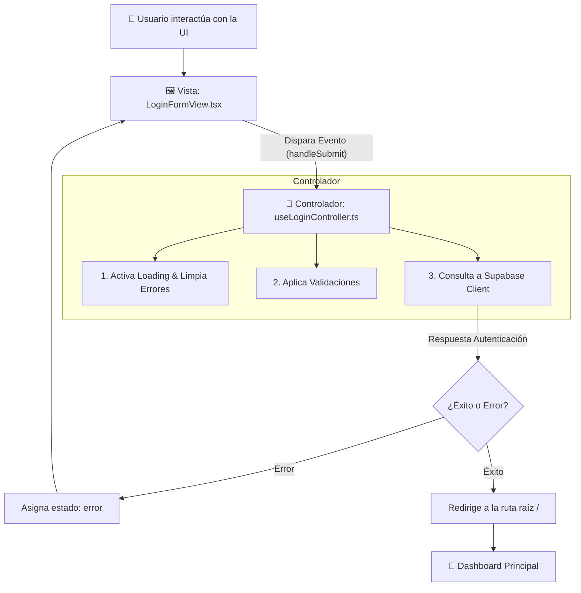

# 🧠 Patrón Controlador MVC en React + TypeScript

#architecture #react #typescript #mvc #nextjs #clean-code

---

## 📌 Resumen Ejecutivo

En arquitecturas web modernas con **React 19**, **Next.js (App Router)** y **TypeScript**, el patrón **Modelo-Vista-Controlador (MVC)** se adapta implementando los **Controladores como Custom Hooks**.

> [!INFO] **Principio de Responsabilidad Única (SRP)**
> - **La Vista (`View`)**: Se encarga únicamente del renderizado visual (UI), componentes Mantine, CSS Modules y accesibilidad.
> - **El Controlador (`Controller`)**: Actúa como el cerebro de la aplicación. Maneja el estado reactivo, las validaciones de negocio, la conexión con Supabase/APIs y el enrutamiento.
> - **El Modelo (`Model`)**: Define los tipos de datos, interfaces TypeScript y esquemas de base de datos.

---

## 🔄 Diagrama de Flujo de Interacción



---

## 📐 Estructura Básica de 3 Pasos de todo Controlador

Todo controlador profesional en TypeScript se organiza en **3 partes fundamentales**:

### 1. El Estado (State)
Define la información reactiva que la vista necesita reflejar en pantalla.

### 2. Las Acciones / Lógica de Negocio (Handlers)
Funciones asíncronas que procesan los eventos del usuario, aplican reglas de validación y llaman a la infraestructura.

### 3. El Contrato de Salida (Return Contract)
El objeto retornado que consume la vista de forma segura con autocompletado en TypeScript.

---

## 💻 Código de Referencia Didáctico

```typescript
'use client';

import { useState } from 'react';
import { useRouter } from 'next/navigation';
import { useForm } from '@mantine/form';
import { createClient } from '@/lib/supabase/client';
import { LoginFormValues } from '@/models/authModel';

/**
 * Custom Hook: useLoginController
 */
export function useLoginController() {
  const router = useRouter();

  // =========================================================================
  // PASO 1: ESTADO REACTIVO (State)
  // =========================================================================
  const [loading, setLoading] = useState<boolean>(false);
  const [error, setError] = useState<string | null>(null);

  // Formulario con validaciones declarativas de Mantine Form
  const form = useForm<LoginFormValues>({
    initialValues: { email: '', password: '', rememberMe: false },
    validate: {
      email: (val) => (/^\S+@\S+$/.test(val) ? null : 'Email inválido'),
      password: (val) => (val.length >= 6 ? null : 'Mínimo 6 caracteres'),
    },
  });

  // =========================================================================
  // PASO 2: ACCIONES Y LÓGICA DE NEGOCIO (Handlers)
  // =========================================================================
  const handleSubmit = async (values: LoginFormValues) => {
    setLoading(true);   // A. Iniciar carga
    setError(null);      // B. Limpiar errores previos

    try {
      const supabase = createClient();
      const { data, error: authError } = await supabase.auth.signInWithPassword({
        email: values.email,
        password: values.password,
      });

      if (authError) {
        setError('Correo electrónico o contraseña incorrectos.');
        return;
      }

      if (data.session) {
        router.push('/'); // C. Redirección al Dashboard
        router.refresh();
      }
    } catch (err: any) {
      setError(err?.message || 'Error inesperado de conexión.');
    } finally {
      setLoading(false);  // D. Finalizar carga
    }
  };

  const clearError = () => setError(null);

  // =========================================================================
  // PASO 3: CONTRATO EXPORTADO A LA VISTA (Return)
  // =========================================================================
  return {
    form,
    loading,
    error,
    handleSubmit: form.onSubmit(handleSubmit),
    clearError,
  };
}
```

---

## ⚖️ Cuadro Comparativo de Responsabilidades

| Responsabilidad | Vista (`View`) | Controlador (`Controller`) | Modelo (`Model`) |
| :--- | :---: | :---: | :---: |
| Renderizar HTML / JSX | ✅ | ❌ | ❌ |
| Aplicar CSS Modules y Estilos | ✅ | ❌ | ❌ |
| Guardar estado `loading` y `error` | ❌ | ✅ | ❌ |
| Llamar a `supabase.auth` / APIs | ❌ | ✅ | ❌ |
| Definir Interfaces TypeScript | ❌ | ❌ | ✅ |
| Redirigir páginas (`router.push`) | ❌ | ✅ | ❌ |

---

> [!TIP] **Ventajas de esta Arquitectura**
> 1. **Mantenibilidad**: Si cambias el diseño de Mantine UI, no tocas una sola línea de código del controlador.
> 2. **Testeabilidad**: Puedes hacer tests unitarios sobre el controlador sin montar componentes visuales.
> 3. **Tipado Estricto**: Evita errores de tipo en tiempo de desarrollo.
