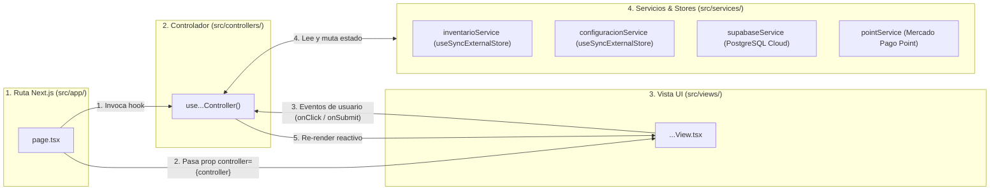

# 🧠 Controladores y Servicios del Sistema (Capa "C" del MVC): M.I Stock

**Proyecto:** M.I Stock — Sistema de Gestión de Inventario, Punto de Venta (POS) y Catálogo Comercial  
**Capa de Arquitectura:** Controladores (Custom React Hooks) + Servicios Reactivos (`External Stores`)  
**Ubicación en Código:** `mistock/src/controllers/` y `mistock/src/services/`  
**Tags:** #controladores #mvc #react-hooks #services #typescript #clean-architecture #mistock

---

## 📌 1. ¿Cómo funciona la Capa de Controladores en M.I Stock? (Guía para Defensa Oral)

En **M.I Stock**, el patrón **MVC (Modelo-Vista-Controlador)** está adaptado a la arquitectura reactiva de **React 19 y Next.js 16 (App Router)** mediante tres reglas estrictas:

1. **La Ruta (`src/app/.../page.tsx`) actúa como Ensamblador (Dependency Injection):**
   - La página de Next.js instancia el controlador (`const controller = use...Controller()`) y se lo inyecta como única propiedad a la Vista (`<...View controller={controller} />`).
2. **El Controlador (`src/controllers/...Controller.ts`) es el Cerebro Operacional:**
   - Es un *Custom React Hook* que encapsula todos los estados (`useState`, `useMemo`, `useEffect`), valida las reglas de negocio usando los **Modelos**, coordina los **Servicios** (`inventarioService`, `configuracionService`, `supabaseService`) y devuelve un objeto con datos y funciones listas para usar.
3. **La Vista (`src/views/...View.tsx`) es 100% Declarativa:**
   - La Vista **nunca** importa `supabaseService` ni ejecuta consultas a la base de datos: solo lee `controller.datos` y dispara eventos como `controller.guardarProducto(...)` o `controller.procesarVentaTicket(...)`.



### Ejemplo Real del Ensamblaje MVC en Código (`src/app/(admin)/admingestioninven/page.tsx`)
```tsx
'use client';
import { useAdminInventarioController } from '@/controllers/adminControllers/inventarioController';
import { AdminGestionInventarioView } from '@/views/admin/AdminGestionInventario';

export default function AdminGestionInventarioPage() {
  // 1. El controlador concentra toda la lógica de negocio y estado
  const controller = useAdminInventarioController();
  // 2. La vista recibe únicamente el controlador inyectado por props
  return <AdminGestionInventarioView controller={controller} />;
}
```

---

## 🗂️ 2. Mapa Completo de Controladores y Servicios

```
mistock/src/
├── controllers/                                  # CAPA DE CONTROLADORES (8 Hooks MVC)
│   ├── authController.ts                         # 1. Login (useLoginController) y Logout (useLogoutController)
│   ├── permisosController.ts                     # 2. Control de Permisos y Roles de Acceso (usePermisosController)
│   ├── adminControllers/
│   │   ├── dashboardController.ts                # 3. Métricas, KPIs, Ventanas de Tiempo y Gráficos
│   │   ├── inventarioController.ts               # 4. Hub de Inventario: Altas, Bajas, Modificación y Stock
│   │   ├── inventarioGlobalController.ts         # 5. Inventario Consolidado por Categorías y Valuación
│   │   ├── usuariosController.ts                 # 6. Nómina de Colaboradores, Roles y Credenciales
│   │   └── configuracionController.ts            # 7. Parámetros del Negocio, Ticket, POS y Exportación CSV
│   └── userControllers/
│       └── userDashboardController.ts            # 8. Terminal POS: Caja, Carrito, Consultor, Historial y Arqueo Z
│
└── services/                                     # CAPA DE SERVICIOS Y ALMACENES REACTIVOS
    ├── inventarioService.ts                      # Single Source of Truth de Productos y Categorías
    ├── configuracionService.ts                   # Single Source of Truth de Configuración Global
    ├── supabaseService.ts                        # Conector asíncrono resiliente con Supabase PostgreSQL
    └── mercadopago/services/pointService.ts      # Cliente Cloud para terminales físicas Mercado Pago Point
```

---

## 🔐 3. Controladores de Seguridad y Control de Acceso

### 3.1. `authController.ts` (`useLoginController` y `useLogoutController`)
* **Rutas asociadas:** `/login` (`LoginFormView.tsx`) y `/logout` (`LogoutView.tsx`).
* **Modelos que consume:** `LoginFormValues` (`authModel.ts`), `Usuario` (`userModel.ts`).
* **`useLoginController()` — Flujo Paso a Paso:**
  1. **Validación en Cliente (`validateForm`):** Verifica que el correo tenga formato válido (`/^\S+@\S+$/`) y que la contraseña tenga al menos 6 caracteres antes de realizar peticiones de red.
  2. **Autenticación Soberana y Exclusiva en Supabase Auth (`signInWithPassword`):**
     - Autentica contra `auth.users` en Supabase (eliminando por completo fallbacks inseguros con contraseñas en texto plano).
     - Valida `esEmailValido(email)` y contraseña de $6 \dots 72$ caracteres según `src/lib/validaciones.ts`.
     - Si las credenciales son válidas, consulta `rol`, `nombre`, `telefono` y `activo` en `public.usuario`.
     - Si `activo === false`, aborta el login alertando que la cuenta está inhabilitada.
     - **Barrera de Seguridad (`no_rol`):** Si el usuario tiene rol `'no_rol'`, cierra inmediatamente la sesión (`signOut()`) y muestra alerta indicando que la cuenta aún no tiene permisos asignados por el Administrador.
     - Persiste `mistock_rol_activo` y `mistock_usuario_activo` en `localStorage` y redirige según el rol:
       - `admin` $\rightarrow$ `/admin`
       - `vendedor` $\rightarrow$ `/dashboard`
  3. **Cero Fugas ni Contraseñas Planas Locales:** Se eliminó todo fallback de autenticación local con contraseñas en texto plano. Todas las credenciales son administradas exclusivamente por Supabase Auth.
* **`useLogoutController()` — Cierre de Sesión Limpio y Purga Total:**
  - Ejecuta `supabase.auth.signOut()` y llama a `limpiarSesionLocal()`, purgando de raíz `mistock_rol_activo`, `mistock_usuario_activo`, `mistock_inventario_data_test_v1`, `mistock_usuarios_data_test_v1`, `mistock_ventas_historial_test_v1`, `mistock_sesion_caja_v1` y `mistock_configuracion_v1` para evitar fuga de datos entre operadores y redirigiendo a `/login`.

---

### 3.2. `permisosController.ts` (`usePermisosController`)
* **Dónde se utiliza:** En los layouts protegidos (`src/app/(admin)/layout.tsx` y `src/app/(user)/layout.tsx`) junto con el componente `ModalAccesoRestringido.tsx` y los sidebars (`AdminSidebar`, `UserSidebar`).
* **Propósito:** Garantizar en tiempo real que cada usuario solo acceda a las pantallas autorizadas para su rol (`'admin' | 'vendedor' | 'no_rol'`).
* **Lógica Interna y Sincronización:**
  1. Al montar el layout, consulta `supabase.auth.getUser()` y obtiene el perfil real desde `public.usuario` (`nombre`, `rol`).
  2. Sincroniza siempre `mistock_rol_activo` y `mistock_usuario_activo` con el perfil autenticado.
  3. Si no existe sesión en Supabase ni sesión local activa de colaborador, redirige automáticamente a `/login`.
  4. Expone banderas booleanas semánticas:
     - `esAdmin` (`rol === 'admin'`): Acceso total a `/admin*` y también a `/dashboard` (herencia funcional).
     - `esVendedor` (`rol === 'vendedor'`): Acceso exclusivo a `/dashboard` (si intenta entrar a `/admin*`, el layout bloquea la vista y despliega `ModalAccesoRestringido`).
     - `esSinRol` (`rol === 'no_rol'`): Bloquea la operatoria hasta que un administrador le asigne permisos.

---

## 📊 4. Controladores del Panel de Administración (`src/controllers/adminControllers/`)

### 4.1. `dashboardController.ts` (`useAdminDashboardController`)
* **Ruta y Vista:** `/admin` $\rightarrow$ `AdminDashboardView.tsx`.
* **Modelos y Servicios que consume:** `AdminDashboardData`, `AdminMetricCard`, `ProductoRankingVentas` (`dashboardModel.ts`), `useInventarioData()`, `useConfiguracionData()`, `supabaseService.fetchVentas()`.
* **Responsabilidades y Algoritmos Clave:**
  1. **Hidratación y Sincronización en Tiempo Real de Ventas:**
     - Lee las ventas locales (`mistock_ventas_historial_test_v1`) y al montar consulta `supabaseService.fetchVentas()`, fusionando sin duplicar por ID todas las ventas remotas registradas en PostgreSQL.
     - Escucha los eventos `storage` y `mistock_ventas_updated` para recalcular los indicadores al instante cuando se cobra o anula un ticket en el POS.
  2. **Único Período Global y Comparativa Real (`periodoMetricasActivo`):**
     - Sincroniza todo el dashboard bajo `'diario' | 'semanal' | 'mensual' | 'ultimos_30_dias'` y expone `etiquetaPeriodoActivo`.
     - Calcula tanto la ventana activa (`ventasVentanaActiva`) como su ventana anterior homóloga (`ventasVentanaAnterior`) respetando `inicioSemana` (`'lunes' | 'domingo'`) y `diaCorteMensual` (`1..28`).
     - Mediante `calcularVariacionKPI(actual, anterior, mostrarComparativa)`, calcula la variación porcentual real ($\Delta\%$) de cada uno de los 4 KPIs (`kpisActivos`: Recaudación, Ticket Promedio, Operaciones y Unidades).
  3. **Generación de Series Gráficas Sincronizadas (`graficos`):**
     - `tendenciaActiva`: Compara `Recaudación Actual` vs `Período Anterior` en 6 franjas de 4h (`diario`), 7 días (`semanal`), 4 semanas (`mensual`) o 6 bloques de 5 días (`ultimos_30_dias`).
     - `distribucionPagosActiva`: Agrupa montos y porcentajes reales por canal de pago en el período activo.
  4. **Ranking de Rotación con Costos y Umbrales Reales (`productosMasVendidos` y `productosMenosVendidos`):**
     - Cruza las ventas completadas del período activo con los productos activos (`p.activo`), inyectando `stockMinimo` y `precioCosto` reales de cada artículo para valuar con exactitud el capital inmovilizado y las alertas de reposición.
  5. **Auditoría Multivariada de Comprobantes (`ventasPeriodoActivo`):**
     - Expone las transacciones del período global y los estados de filtrado por vendedor (`filtroVendedorVentas`), medio de pago (`filtroMetodoPagoVentas`), estados reales (`completada` / `cancelada`) y búsqueda textual (`busquedaVentas`).

---

### 4.2. `inventarioController.ts` (`useAdminInventarioController`)
* **Ruta y Vista:** `/admingestioninven` $\rightarrow$ `AdminGestionInventarioView` (`AdminGestionInventario.tsx`).
* **Modelos y Servicios que consume:** `Producto`, `Categoria` (`productoModel.ts`), `FormularioCargaProducto` (`cargaProductoModel.ts`), `useInventarioData()`, `inventarioService`, `useConfiguracionData()`.
* **Responsabilidades Clave:**
  1. **Hub Unificado de Catálogo (`seccionActiva: 'menu' | 'alta'`):** Concentra la consulta, edición/reposición modal, baja lógica y reactivación en una única vista `'menu'` (con filtro `filtroEstadoHub: 'activos' | 'inactivos' | 'todos'`) y reserva `'alta'` para el formulario dedicado de nuevo producto.
  2. **Enlace Profundo desde Inventario Global (`?q=SKU`):** Al montar en el cliente, lee `window.location.search` para prefiltrar `busquedaHub` por SKU cuando el administrador navega desde `/admininventarioglobal`.
  3. **Diagnóstico Unificado de Salud de Stock (`metricasStockHub`):**
     Clasifica los productos activos en 4 estados estrictamente disjuntos (cuya suma equivale al total de activos):
     - `agotados`: $\text{stockActual} = 0$
     - `criticos`: $0 < \text{stockActual} \le \text{stockMinimo}$
     - `bajasUnidades`: $\text{stockMinimo} < \text{stockActual} \le \text{stockMinimo} \times 1.5$
     - `optimos`: $\text{stockActual} > \text{stockMinimo} \times 1.5$
  4. **ABM Completo Delegado al Servicio Central (`inventarioService`):**
     - `agregarCategoria(nombre, descripcion)`: Crea categorías con UUID v4 válido y las persiste en Supabase.
     - `guardarProducto(datos)`: Valida categoría obligatoria (`categoriaId`) y unicidad de código SKU antes de dar de alta el producto.
     - `modificarProducto(productoId, datosActualizados)`: Actualiza precios, costos, categoría y stock físico (`stockActual`, `stockMinimo`).
     - `darDeBajaProducto(productoId, motivo)` y `reactivarProducto(productoId)`: Ejecutan el borrado lógico (`activo: false/true`) preservando la integridad histórica de las ventas.
  5. **Conexión con Configuración de Inventario:** Expone `config` para que el formulario de alta tome `umbralMinimoPorDefecto` como stock mínimo inicial y muestre la advertencia preventiva cuando `alertarMargenNegativo` está activo y $\text{precioVenta} \le \text{precioCosto}$.

---

### 4.3. `inventarioGlobalController.ts` (`useAdminInventarioGlobalController`)
* **Ruta y Vista:** `/admininventarioglobal` (y redirección desde `/adminstockcritico`) $\rightarrow$ `AdminInventarioGlobalView.tsx`.
* **Propósito:** Proveer una vista ejecutiva consolidada del inventario activo por familias de categorías y valuación financiera del depósito.
* **Cálculos y Responsabilidades:**
  1. **Conteo por Categoría (`conteosPorCategoria`):** Cuenta los artículos activos (`p.activo`) en cada categoría.
  2. **Valuación Financiera del Depósito (`metricasGlobales`):**
     - `unidadesTotales`: $\sum \text{stockActual}$ de todos los productos activos.
     - `valuacionCosto`: $\sum (\text{precioCosto} \times \text{stockActual})$ (capital invertido en mercadería).
     - `valuacionVenta`: $\sum (\text{precioVenta} \times \text{stockActual})$ (ingreso bruto potencial).
     - `margenEstimadoPorcentaje`: $\left(\frac{\text{valuacionVenta} - \text{valuacionCosto}}{\text{valuacionCosto}}\right) \times 100$.
     - `articulosBajos`, `articulosCriticos` y `articulosSinStock`.
  3. **Métricas por Categoría Seleccionada (`metricasCategoriaActual`):** Calcula unidades, valor de venta y críticos del rubro elegido.
  4. **Taxonomía Unificada y Ordenamiento Multicriterio (`productosFiltrados`):** Filtra productos activos por categoría, búsqueda textual y los mismos 4 estados de stock que `inventarioController.ts` (`'todos' | 'optimo' | 'bajo' | 'critico' | 'sin_stock'`), ordenando por nombre, precio o stock (`asc`/`desc`).

---

### 4.4. `usuariosController.ts` (`useAdminUsuariosController`)
* **Ruta y Vista:** `/adminusuarios` $\rightarrow$ `AdminUsuariosView.tsx`.
* **Modelos y Servicios que consume:** `Usuario`, `CrearUsuarioDTO`, `RolUsuarioDB`, `EstadoUsuario` (`userModel.ts`), `supabaseService`.
* **Responsabilidades Clave:**
  1. **Sincronización Cloud-First con Fuente de Verdad Remota:** Al montar, invoca `supabaseService.fetchUsuariosWithStatus()`. Si la consulta a Supabase responde exitosamente (`res.ok === true`), los registros remotos reemplazan la caché local, garantizando que no queden usuarios ficticios huérfanos.
  2. **Alta Real de Colaboradores en Supabase Auth (`crearUsuario`):** Valida `esEmailValido`, nombre, teléfono y contraseña ($6 \dots 72$ caracteres). Se comunica con `supabaseService.crearColaboradorRemoto` invocando la RPC de administración `public.crear_colaborador_admin` (o fallback sin persistencia de sesión `persistSession: false`). Se descartan las contraseñas antes de almacenar en caché local.
  3. **Edición, Cambio de Rol y Modificación Remota de Contraseña (`actualizarUsuario`):** Sincroniza `nombre`, `email`, `rol`, `telefono` y `activo` con `public.usuario`. Si el administrador especifica una nueva contraseña, invoca la función RPC de servidor `public.actualizar_password_colaborador_admin`.
  4. **Protección de Cuenta Maestra (Regla de Negocio 4.5):** Antes de quitar el rol `admin` o eliminar un usuario (`eliminarUsuario`), verifica cuántos administradores quedan en el sistema. Si es el único administrador, bloquea la acción con un mensaje de error para impedir que el sistema quede acéfalo.

---

### 4.5. `configuracionController.ts` (`useAdminConfiguracionController`)
* **Ruta y Vista:** `/adminconfiguracion` $\rightarrow$ `AdminConfiguracionView.tsx`.
* **Modelos y Servicios que consume:** `ConfiguracionCompleta` (`configuracionModel.ts`), `configuracionService`, `useConfiguracionData()`, `useInventarioData()`, `inicializarVentasCliente()`.
* **Responsabilidades Clave:**
  1. **Gestión de las 5 Pestañas de Configuración (`pestañaActiva`):** `'negocio' | 'pos' | 'inventario' | 'metricas' | 'respaldos'`.
  2. **Guardado Automático Reactivo en Tiempo Real:** Cada cambio en datos fiscales, formato de ticket, medios de cobro, umbrales de stock o períodos analíticos persiste inmediatamente en `configuracionService`, propagándose en vivo al POS y al Dashboard sin requerir confirmación manual.
  3. **Estadísticas Reales de Base de Datos (`estadisticasSistema`):** Computa en vivo `totalProductos`, `totalCategorias`, `totalVentas`, `totalRegistros` y `ultimoRespaldoCSV` (`mistock_ultimo_respaldo_csv`).
  4. **Guardia de Medios de Cobro (`toggleMetodoPago`):** Impide desactivar todos los métodos de pago simultáneamente (garantiza que siempre exista al menos un medio habilitado en la caja).
  5. **Motor de Exportación CSV RFC 4180 con UTF-8 BOM (`exportarCatalogoCSV` y `exportarVentasCSV`):**
     - Genera archivos `.csv` con encabezado `\uFEFF` (Byte Order Mark) y comillas escapadas RFC 4180 para apertura directa en Microsoft Excel y Google Sheets, registrando automáticamente la fecha y hora de la última exportación.

---

## 🛒 5. Controlador del Punto de Venta / Operador POS (`src/controllers/userControllers/`)

### 5.1. `userDashboardController.ts` (`useUserDashboardController`)
* **Ruta y Vista:** `/dashboard` $\rightarrow$ `UserDashboardView.tsx` y sus 4 submódulos (`ModuloTerminalCobro`, `ModuloCatalogoProductos`, `ModuloConsultorPrecios`, `ModuloHistorialTickets`).
* **Propósito:** Es el controlador operativo más completo del sistema. Orquesta en tiempo real la atención en mostrador, el carrito de compras, la apertura/cierre de caja por turnos y la facturación.
* **Submódulos y Responsabilidades Paso a Paso:**
  1. **Sincronización de Pestañas con URL (`pestanaOperativa`):**
     - Lee y actualiza `?tab=caja | catalogo | precios | historial` mediante `useSearchParams()` y `router.push()`, manteniendo sincronizados el `UserSidebar` (en escritorio) y la barra móvil.
  2. **Control Estricto de Sesión de Caja Mono-Caja (`abrirCaja` y `confirmarCierreCaja`):**
     - La caja inicia cerrada (`cajaAbierta = false`), bloqueando la carga de productos al carrito hasta que el operador ejecute `abrirCaja(montoInicial, observaciones)`.
     - Al abrir la caja, genera un código único de turno (`idTurno = TRN-XXXXXX`), registra `timestampApertura` y asocia automáticamente el nombre del usuario autenticado (`mistock_usuario_activo`).
     - `ventasTurnoActual`: Filtra exclusivamente las ventas completadas dentro del turno abierto, calculando `resumenMediosTurno`, `efectivoEsperado` ($\text{Fondo Inicial} + \text{Ventas Efectivo}$), `diferencia` y emitiendo el **Reporte Z (`ArqueoCajaDTO`)** al cerrar la caja.
  3. **Gestión del Carrito / Ticket en Curso (`carrito`):**
     - `agregarAlCarrito(producto, cantidad)`: Verifica que la caja esté abierta y que `nuevaCantidad <= producto.stock` (salvo que `permitirVentaSinStock` esté habilitado en configuración).
     - `actualizarCantidadItem`, `removerItemCarrito`, `vaciarCarrito`: Recalculan subtotales y totales usando la función pura `calcularTotalesCarrito(carrito)`.
  4. **Procesamiento de Venta y Deducción Atómica de Stock (`procesarVentaTicket`):**
     - Valida caja abierta y existencias de cada renglón.
     - Genera el comprobante `VentaRecientePOS` congelando precios unitarios (`DetalleVenta[]`) y registrando el pago (`Pago[]`).
     - **Eliminación de Doble Deducción:** Descuenta el stock en la memoria local con `sincronizarRemoto = false`, delegando la actualización del stock físico en PostgreSQL al trigger `tr_venta_movimiento_stock` (que se ejecuta atómicamente al persistir `supabaseService.registrarVenta`). Si la inserción remota falla, revierte el ticket local.
     - Si `config.pos.sonidoConfirmacionVenta` está activo, reproduce un tono acústico de confirmación mediante **Web Audio API**.
  5. **Anulación Transaccional de Comprobantes (`cancelarVenta`):**
     - Valida que la venta posea UUID persistido en Supabase.
     - Persiste el estado `'cancelada'` en `public.ventas` a través de la política RLS `FOR UPDATE` (`"Staff anula ventas activas"`).
     - El trigger `tr_cancelar_venta_reintegrar_stock` en PostgreSQL asienta automáticamente el movimiento de devolución en `public.movimientos_stock` y reintegra las existencias físicas en `public.productos`. En el frontend se actualiza la memoria local con `sincronizarRemoto = false` para sincronía 1:1.
  6. **Consultor de Precios (`consultarProducto`) y Catálogo General:**
     - Permite escanear o buscar artículos en `ModuloConsultorPrecios` y `ModuloCatalogoProductos` de forma independiente sin alterar el carrito activo del cliente en caja.

---

## ⚙️ 6. Capa de Servicios y Almacenes Reactivos (`src/services/`)

Para que los controladores del Administrador y del Cajero compartan el mismo estado en tiempo real sin necesidad de recargar la página, **M.I Stock** implementa una capa de servicios basada en el hook nativo **`useSyncExternalStore`** de React 19:

### 6.1. `inventarioService.ts` (`useInventarioData` + `inventarioService`)
* **Rol:** Almacén central reactivo (*Single Source of Truth*) de categorías y productos.
* **Cómo funciona:**
  - Mantiene en memoria el snapshot de `categorias` y `productos`, sincronizado con `localStorage` (`mistock_inventario_data_test_v1`) y con **Supabase PostgreSQL**.
  - Al montar en el cliente, consulta `supabaseService.fetchCategorias()` y `supabaseService.fetchProductos()` para hidratar el catálogo real de la nube.
  - Cuando se crea un producto o categoría, genera un **UUID v4 válido** (`crypto.randomUUID()`) en el cliente y lo inserta en Supabase (`insertCategoria`, `insertProducto`), garantizando compatibilidad total con las claves primarias `uuid` de PostgreSQL.
  - Cualquier descuento o reintegro de stock en caja notifica a todos los componentes suscritos (`notifySubscribers()`), delegando la actualización remota de `stock_actual` en Supabase a los triggers transaccionales de PostgreSQL para evitar duplicaciones o desfasajes.

### 6.2. `configuracionService.ts` (`useConfiguracionData` + `configuracionService`)
* **Rol:** Almacén central reactivo de la configuración del comercio (`mistock_configuracion_v1`).
* **Cómo funciona:**
  - Aplica *deep-merge* con `valoresPorDefectoConfiguracion` para evitar fallos si se agregan nuevas propiedades.
  - Escucha el evento `storage` del navegador para propagar cambios instantáneamente entre pestañas abiertas (por ejemplo, si el administrador habilita o deshabilita un medio de pago en `/adminconfiguracion`, el modal de cobro en `/dashboard` se actualiza al instante).

### 6.3. `supabaseService.ts`
* **Rol:** Adaptador de persistencia remota hacia **Supabase PostgreSQL**.
* **Métodos expuestos:**
  - **Usuarios:** `fetchUsuarios()`, `updateUsuario()`, `deleteUsuario()`.
  - **Categorías:** `fetchCategorias()`, `insertCategoria()`.
  - **Productos:** `fetchProductos()`, `insertProducto()`, `updateProducto()`, `toggleActivoProducto()`.
  - **Ventas y Movimientos:** `fetchVentas()`, `registrarVenta()`, `cancelarVenta()`, `registrarMovimiento()`.

### 6.4. `src/services/mercadopago/services/pointService.ts`
* **Rol:** Servicio de comunicación Cloud con terminales físicas **Mercado Pago Point Smart (PDV)**, invocado a través de los Route Handlers de Next.js (`/api/mercadopago/point/...`) desde `ModalCobroTicket.tsx`.
* **Métodos expuestos:**
  - `listarDispositivosPoint()`: Lista los posnets asociados a la cuenta comercial.
  - `configurarModoOperativoPoint(deviceId, mode)`: Cambia la terminal a modo `PDV`.
  - `crearIntencionPagoPoint(deviceId, payload)`: Envía el importe a cobrar a la pantalla física del posnet.
  - `obtenerEstadoIntencionPoint(intentId)`: Sondea en tiempo real si el cliente ya pasó la tarjeta (`OPEN`, `ON_TERMINAL`, `PROCESSED`, `ABANDONED`).
  - `cancelarIntencionPagoPoint(deviceId, intentId)`: Aborta la orden en la terminal física.

---

## 🎓 7. Preguntas Clave de Examen / Defensa Oral sobre MVC

> [!QUESTION] **1. "¿Por qué usaron Custom Hooks como Controladores en lugar de clases tradicionales?"**
> En React 19 y Next.js, el ciclo de vida y la reactividad de la interfaz dependen de los Hooks (`useState`, `useMemo`, `useSyncExternalStore`). Implementar cada Controlador como un *Custom Hook* (`useAdminInventarioController`, `useUserDashboardController`) nos permite encapsular toda la lógica de negocio fuera de los archivos `.tsx` de las Vistas, manteniendo los componentes visuales 100% declarativos y logrando el mismo desacople del patrón MVC clásico pero de forma idiomática para React.

> [!QUESTION] **2. "¿Cómo se entera el Dashboard del Administrador de que el Cajero acaba de hacer una venta?"**
> A través de tres mecanismos sincronizados:
> 1. Cuando `procesarVentaTicket()` en `userDashboardController.ts` confirma el cobro, descuenta el stock en `inventarioService` (que notifica a los suscriptores de `useSyncExternalStore`).
> 2. Persiste la venta en Supabase (`supabaseService.registrarVenta`) y actualiza `localStorage` emitiendo el evento `mistock_ventas_updated` y el evento nativo `storage`.
> 3. `dashboardController.ts` escucha ambos eventos y además hidrata las ventas desde Supabase con `supabaseService.fetchVentas()`, recalculando al instante la recaudación, los gráficos y el ranking de rotación.

> [!QUESTION] **3. "¿Dónde se valida que no se venda un producto sin stock o que no se cree un producto sin categoría?"**
> Aplicamos **Defensa en Profundidad** en las 3 capas:
> - **En la Vista (`View`):** El botón de agregar al carrito se deshabilita si `stock <= 0 && !permitirVentaSinStock`, y el selector de categoría es obligatorio en el formulario.
> - **En el Controlador y Servicio (`Controller` / `Service`):** `agregarAlCarrito`, `procesarVentaTicket` y `guardarProducto` validan las reglas en TypeScript y devuelven mensajes de error claros si no se cumplen.
> - **En la Base de Datos (`Model` / PostgreSQL):** La tabla `productos` tiene `id_categoria NOT NULL REFERENCES categorias ON DELETE RESTRICT` y `CHECK (stock_actual >= 0)`.

---

## 🔗 Enlaces Relacionados en la Bóveda
- [[Modelos]] — Detalle de todas las interfaces de Dominio, ViewModels y funciones puras.
- [[Vistas]] — Componentes React que reciben el objeto `controller`.
- [[Rutas del Sistema]] — Qué ruta (`page.tsx`) instancia cada controlador.
- [[Metricas y Calculo de KPIs]] — Fórmulas matemáticas ejecutadas por `dashboardController.ts`.
- [[Reglas de Negocio miStock]] — Reglas comerciales implementadas en los controladores.
