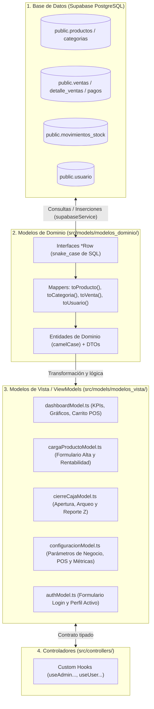

# 📐 Modelos de Datos y Tipos (Capa "M" del MVC): M.I Stock

**Proyecto:** M.I Stock — Sistema de Gestión de Inventario, Punto de Venta (POS) y Catálogo Comercial  
**Capa de Arquitectura:** Modelos (`Model` en el patrón MVC)  
**Ubicación en Código:** `mistock/src/models/`  
**Tags:** #modelos #mvc #typescript #interfaces #dto #viewmodel #domain-driven #mistock

---

##  1. ¿Cómo funciona la Capa de Modelos en M.I Stock? (Guía para Defensa Oral)

En **M.I Stock**, la capa de **Modelos (`src/models/`)** no se limita a copiar las tablas de la base de datos. Para lograr una arquitectura limpia (**Clean Architecture + MVC**) en **Next.js 16 y TypeScript**, los modelos se dividen en **dos subcapas con responsabilidades bien diferenciadas**:

1. **Modelos de Dominio (`src/models/modelos_dominio/`):**
   - Representan las **entidades reales y permanentes del negocio** (`Producto`, `Categoria`, `Venta`, `DetalleVenta`, `Pago`, `MovimientoStock`, `Usuario`).
   - Incluyen las interfaces crudas de PostgreSQL (`*Row` en `snake_case`), las interfaces limpias del frontend (en `camelCase`), los **DTOs** (*Data Transfer Objects*) de alta/modificación y las **funciones adaptadoras (Mappers)** (`toProducto`, `toCategoria`, `toVenta`, `toMovimientoStock`, `toUsuario`).
2. **Modelos de Vista / ViewModels (`src/models/modelos_vista/`):**
   - Representan el **estado específico que necesita cada pantalla**, formularios controlados, filtros, KPIs precalculados, estructura de arqueo de caja y **funciones puras de cálculo matemático** (subtotales de carrito, vuelto, arqueo de caja).



> [!TIP] **Argumento Clave para el Tribunal Evaluador**
> *"¿Por qué separaron `modelos_dominio` de `modelos_vista`?"*  
> Porque la base de datos trabaja con esquemas relacionales normalizados en `snake_case` (`id_producto`, `precio_venta`, `creado_el`), mientras que la interfaz de usuario necesita estructuras agregadas como tarjetas de KPIs, series para gráficos, carritos de compra en memoria y formularios interactivos. Si acopláramos las vistas directamente a las filas SQL, cualquier cambio en una tabla rompería los componentes visuales. Los **Mappers** (`toProducto`, `toVenta`, etc.) y los **ViewModels** actúan como un escudo anticambios.

---

##  2. Mapa Completo de Archivos en `src/models/`

```
mistock/src/models/
├── modelos_dominio/                  # Entidades nucleares del negocio y mapeo SQL <-> TS
│   ├── index.ts                      # Barrel file que reexporta todo el dominio
│   ├── productoModel.ts              # Categoría, Producto, DTOs y mappers toProducto / toCategoria
│   ├── ventaModel.ts                 # Venta, DetalleVenta, Pago, DTOs y mapper toVenta
│   ├── inventarioModel.ts            # MovimientoStock (Ledger), AjusteInventario y toMovimientoStock
│   └── userModel.ts                  # Usuario, RolUsuario ('admin'|'vendedor'|'no_rol') y toUsuario
│
├── modelos_vista/                    # ViewModels, formularios, KPIs y funciones puras de cálculo
│   ├── authModel.ts                  # LoginFormValues, UserRole y UserProfile
│   ├── cargaProductoModel.ts         # FormularioCargaProducto, valores iniciales y rentabilidad
│   ├── cierreCajaModel.ts            # AperturaCajaDTO, ArqueoCajaDTO y fórmulas puras de arqueo
│   ├── configuracionModel.ts         # ConfiguracionCompleta (Negocio, POS, Inventario, Métricas)
│   └── dashboardModel.ts             # AdminDashboardData, UserDashboardData y cálculos del POS
│
└── mock_data/                        # Semillas vacías (Clean Slate) para almacenamiento local inicial
    ├── inventarioMock.ts             # initialCategorias = [], initialProductos = []
    └── usuariosMock.ts               # initialUsuarios = [] (sin usuarios ficticios)
```

---

##  3. Modelos de Dominio (`src/models/modelos_dominio/`)

### 3.1. `productoModel.ts` — Catálogo de Productos y Categorías
Define los artículos comercializables y su clasificación taxonómica. Está sincronizado 1:1 con las tablas `public.categorias`, `public.productos` y el enumerado `public.unidad_medida` en PostgreSQL.

* **Tipos y Enumerados:**
  ```typescript
  export type UnidadMedida = 'unidad' | 'kg' | 'gramo' | 'litro' | 'metro' | 'paquete';
  ```
* **Interfaces de Base de Datos (`snake_case`) vs. Entidades de Dominio (`camelCase`):**
  - `CategoriaRow` $\rightarrow$ mapeada por `toCategoria(row)` hacia `Categoria`:
    ```typescript
    export interface Categoria {
      id: string;              // UUID (id_categoria en DB)
      nombre: string;          // Nombre único (ej: 'Almacén', 'Bebidas')
      descripcion?: string;
      activo: boolean;         // Soft-delete
      fechaCreacion?: Date | string;
      fechaActualizacion?: Date | string;
    }
    ```
  - `ProductoRow` $\rightarrow$ mapeada por `toProducto(row, cat)` hacia `Producto`:
    ```typescript
    export interface Producto {
      id: string;              // UUID (id_producto en DB)
      codigo: string;          // Código de barras EAN/UPC o SKU único
      sku?: string;            // Alias nativo de la columna sku en Supabase
      nombre: string;          // Nombre comercial del artículo
      descripcion?: string;
      precioVenta: number;     // Precio final al consumidor (numeric(10,2))
      precioCosto: number;     // Costo de adquisición o reposición (numeric(10,2))
      stockActual: number;     // Unidades físicas disponibles hoy
      stockMinimo: number;     // Umbral de seguridad que dispara alerta de stock crítico
      categoriaId: string;     // FK obligatoria (Regla de Negocio: prohibido productos huérfanos)
      categoria?: Categoria;   // Objeto poblado mediante JOIN relacional
      unidadMedida: UnidadMedida;
      oferta?: boolean;
      activo: boolean;         // Baja lógica (soft-delete) para no romper ventas históricas
      imagenUrl?: string;
      fechaCreacion: Date | string;
      fechaActualizacion?: Date | string;
    }
    ```
* **DTOs de Mutación:**
  - `CrearProductoDTO`: `Omit<Producto, 'id' | 'categoria' | 'fechaCreacion' | 'fechaActualizacion'>`
  - `ActualizarProductoDTO`: `Partial<CrearProductoDTO>`
* **Funciones Adaptadoras (Mappers):**
  - `toCategoria(row: CategoriaRow): Categoria`
  - `toProducto(row: ProductoRow, cat?: Categoria): Producto` (convierte `precio_venta` y `precio_costo` a `Number` e inyecta el objeto `Categoria`).

---

### 3.2. `ventaModel.ts` — Ventas, Renglones de Detalle y Pagos
Modela las transacciones del Punto de Venta (POS). Se sincroniza con `public.ventas`, `public.detalle_ventas` y `public.pagos`.

* **Principios Contables Incorporados en el Modelo:**
  1. **Snapshot de Precios (`DetalleVenta`):** Congela `precioUnitario`, `nombreProducto` y `codigoProducto` en el instante en que se emite el ticket. Si el administrador aumenta el precio de un producto mañana, los tickets históricos no se alteran.
  2. **Desacople de Pagos (`Pago`):** La relación `1:N` entre `Venta` y `Pago` permite liquidar una operación con distintos medios de cobro.

* **Tipos Principales:**
  ```typescript
  export type MetodoPago =
    | 'efectivo'
    | 'tarjeta_debito'
    | 'tarjeta_credito'
    | 'transferencia'
    | 'mercado_pago'
    | 'otro';

  export type EstadoVenta = 'completada' | 'cancelada' | 'pendiente';
  ```
* **Entidades de Dominio:**
  - `Pago` (y su par SQL `PagoRow`): `id`, `ventaId`, `metodo`, `total`, `fechaCreacion`.
  - `DetalleVenta` (y su par SQL `DetalleVentaRow`): `id`, `ventaId`, `productoId`, `codigoProducto`, `nombreProducto`, `cantidad`, `precioUnitario`, `subtotal`.
  - `Venta` (y su par SQL `VentaRow`):
    ```typescript
    export interface Venta {
      id: string;                 // UUID (id_venta)
      numeroComprobante?: string; // Formato legible, ej: 'VNT-9F2A'
      fecha: Date | string;
      usuarioId: string;          // UUID del cajero/vendedor responsable
      nombreVendedor?: string;
      items: DetalleVenta[];      // Renglones vendidos
      total: number;
      metodoPago: MetodoPago;
      pagos?: Pago[];
      estado: EstadoVenta;
      descuento?: number;
      observaciones?: string;
    }
    ```
* **Mapper y DTOs:**
  - `toVenta(row: VentaRow, items: DetalleVenta[], pagos: Pago[], nombreVendedor?: string): Venta`
  - `ItemNuevaVenta` y `RegistrarVentaDTO` (estructuras para registrar una nueva venta).

---

### 3.3. `inventarioModel.ts` — Libro Mayor de Movimientos (Patrón Ledger) y Auditoría
Representa la trazabilidad inmutable de entradas y salidas de mercadería (`public.movimientos_stock` y enum `public.tipo_movimiento`).

* **Convención Algebraica de Signos:**
  - `cantidad > 0`: Entrada física (compra a proveedor, alta inicial, devolución de cliente, ajuste positivo).
  - `cantidad < 0`: Salida física (venta en caja, merma, rotura, ajuste negativo).
* **Tipos y Entidades:**
  ```typescript
  export type TipoMovimientoDB = 'compra' | 'venta' | 'ajuste' | 'devolucion';

  export type TipoMovimientoStock =
    | TipoMovimientoDB
    | 'entrada_compra'
    | 'salida_venta'
    | 'ajuste_positivo'
    | 'ajuste_negativo'
    | 'merma_danio';
  ```
  - `MovimientoStock` (y `MovimientoStockRow` + mapper `toMovimientoStock`): Guarda `id`, `productoId`, `nombreProducto`, `tipo`, `cantidad`, `stockAnterior`, `stockPosterior`, `motivo`, `usuarioId`, `referenciaId`, `fecha`.
  - `ItemAjusteInventario` y `AjusteInventario`: Modelan las actas de recuento físico donde se compara el stock teórico del sistema contra el conteo físico en estantería (`diferencia = stockFisico - stockSistema`).
  - `RegistrarMovimientoDTO`: DTO para asentar un movimiento manual o automático.

---

### 3.4. `userModel.ts` — Usuarios, Perfiles y Roles (RBAC)
Sincronizado 1:1 con `public.usuario` (que extiende `auth.users` de Supabase Auth) y el enum `public.user_rol`.

* **Jerarquía Escalar de Roles (`RolUsuario`):**
  ```typescript
  export type RolUsuarioDB = 'admin' | 'vendedor' | 'no_rol';
  export type RolUsuario = RolUsuarioDB;
  export type EstadoUsuario = 'activo' | 'inactivo' | 'suspendido';
  ```
  - `'admin'`: Acceso total (Métricas, Inventario, Usuarios, Configuración y también Punto de Venta por herencia funcional).
  - `'vendedor'`: Acceso acotado a la Terminal de Punto de Venta (`/dashboard`).
  - `'no_rol'`: Estado de contención por defecto para cuentas nuevas hasta que un administrador les asigne un rol.
* **Entidad `Usuario` y Adaptador:**
  - `UsuarioRow` $\rightarrow$ transformada por `toUsuario(row)` en `Usuario` (`id`, `email`, `nombre`, `nombreCompleto`, `rol`, `telefono`, `avatarUrl`, `estado`, `ultimoAcceso`, `fechaCreacion`, `fechaActualizacion`, `password`). Incluye sincronización de las columnas SQL nativas `telefono text` y `activo boolean DEFAULT true` agregadas a `public.usuario`.
  - DTOs: `CrearUsuarioDTO` y `ActualizarUsuarioDTO`.

---

##  4. Modelos de Vista / ViewModels (`src/models/modelos_vista/`)

Los **ViewModels** moldean los datos exactamente como los necesitan los componentes React y contienen **funciones puras de cálculo** que están cubiertas por pruebas unitarias en Vitest (`src/__tests__/`).

### 4.1. `dashboardModel.ts` — Analítica Ejecutiva y Operativa de Caja POS
Es el ViewModel más importante para las pantallas principales tanto del Administrador (`/admin`) como del Cajero (`/dashboard`).

#### A) Estructuras para la Terminal POS (`UserDashboardView`)
* `PestanaOperativaPOS`: `'caja' | 'catalogo' | 'precios' | 'historial'`.
* `ProductoRapidoPOS`: Proyección liviana de `Producto` optimizada para renderizado veloz en las grillas y tablas del mostrador (`id`, `nombre`, `categoria`, `precio`, `stock`, `stockMinimo`, `codigo`, `unidadMedida`, `oferta`).
* `ItemCarritoPOS`: Renglón del ticket activo en memoria (`producto`, `cantidad`, `subtotal`).
* `VentaRecientePOS`: Comprobante emitido en la caja con soporte de aislamiento por turno (`idTurno`), marca de tiempo exacta (`timestamp`, `fechaISO`), renglones (`items: DetalleVenta[]`), pagos (`pagos: Pago[]`) y `estado` (`'completada' | 'cancelada'`).
* `UserDashboardData`: Objeto consolidado con `ventasDelDia`, `recaudacionDelDia`, `totalProductosEnStock`, `ventasRecientes` y `productosPopulares`.

#### B) Estructuras para el Dashboard de Administración (`AdminDashboardView`)
* `AdminMetricCard`: Tarjeta KPI (`title`, `value`, `changePercentage`, `status: 'positive' | 'negative' | 'neutral'`).
* `ProductoRankingVentas`: Renglón para el análisis de rotación de stock enriquecido con umbrales y costos reales (`unidadesVendidas`, `stockActual`, `stockMinimo`, `precioCosto`, `montoTotal`, `tendencia: 'alza' | 'baja' | 'estancada'`).
* `ResumenVentasPeriodo`, `DetalleVentaItem` y `VentasDetalleData` (`resumenPeriodoActivo`, `ventasPeriodoActivo`): Totales y filas auditables sincronizadas con el período global activo.
* `GraficosMetricasData`: Series tipadas para Recharts sincronizadas con el período activo (`tendenciaActiva`, `distribucionPagosActiva`).
* `AdminDashboardData`: Agrupa `kpiMetrics`, `productosMasVendidos`, `productosMenosVendidos`, `ventasDetalle` y `graficos`.

#### C) Funciones Puras de Dominio del Carrito y Cobro POS (Testeadas en `calculoVentaPos.test.ts`)
1. `calcularSubtotalRenglon(precio, cantidad)`: Multiplica $\text{precio} \times \text{cantidad}$ asegurando valores $\ge 0$ y redondeo a 2 decimales.
2. `calcularTotalesCarrito(carrito)`: Suma el importe total a cobrar y el total de unidades físicas acumuladas en el ticket.
3. `calcularVueltoPOS(total, montoRecibido)`: Devuelve `{ vuelto, faltante, esMontoSuficiente }` para cobros en efectivo.
4. `generarSugerenciasBilletes(total)`: Calcula los 6 botones de pago rápido en efectivo (`Exacto`, `+$1.000`, `+$2.000`, `+$5.000`, `+$10.000`, `+$20.000`).

---

### 4.2. `cierreCajaModel.ts` — Apertura, Arqueo Físico y Reporte Z (Mono-caja)
Define los contratos de datos y fórmulas contables para el control de turnos de caja en el POS.

* **Interfaces Clave:**
  - `AperturaCajaDTO`: Datos iniciales del turno (`idApertura`, `idTurno`, `timestampApertura`, `fechaApertura`, `cajero`, `numeroCaja`, `fondoInicial`, `observaciones`).
  - `ResumenMediosPagoCierre`: Acumuladores del turno por canal (`efectivo`, `mercadoPago`, `tarjetaDebito`, `tarjetaCredito`, `transferencia`, `otro`).
  - `EstadoBalanceCaja`: `'exacto' | 'sobrante' | 'faltante'`.
  - `ArqueoCajaDTO`: Comprobante inmutable de Cierre de Caja (Reporte Z) listo para imprimir en formato térmico de 80mm.
  - `EstadoSesionCaja`: Estado persistido de la sesión de caja activa.
* **Funciones Puras de Conciliación Contable (Testeadas en `cierreCaja.test.ts`):**
  1. `calcularEfectivoEsperado(fondoInicial, totalVentasEfectivo)`:
     $$\text{Efectivo Esperado} = \text{Fondo Inicial} + \text{Ventas en Efectivo del Turno}$$
  2. `calcularDiferenciaCaja(efectivoReal, efectivoEsperado)`:
     $$\Delta = \text{Efectivo Real Contado} - \text{Efectivo Esperado}$$
  3. `determinarEstadoBalance(diferencia)`: Clasifica en `'exacto'` ($|\Delta| < 0.001$, evitando errores de coma flotante IEEE 754), `'sobrante'` ($\Delta > 0$) o `'faltante'` ($\Delta < 0$).
  4. `calcularTotalesCierre(totalVentasEfectivo, desgloseMedios)`: Calcula `totalDigitales` y `granTotalRecaudado`.

---

### 4.3. `cargaProductoModel.ts` — Formulario de Alta y Calculadora de Rentabilidad
Gobierna el estado del formulario de creación de productos en `/admingestioninven`.

* `FormularioCargaProducto`:
  - Campos persistidos renderizados en el formulario de alta y edición: `codigo`, `nombre`, `descripcion`, `categoriaId` (obligatorio), `unidadMedida`, `precioCosto`, `precioVenta`, `stockInicial`, `stockMinimo`, `motivoIngreso` (sin campos fantasma no persistidos).
* `valoresInicialesCargaProducto`: Objeto constante para inicializar o limpiar el formulario (`stockInicial: 1`, `stockMinimo: 5`, `unidadMedida: 'unidad'`).
* `MetricasRentabilidad`:
  - `gananciaNeta`: $\text{precioVenta} - \text{precioCosto}$
  - `margenPorcentaje`: $\left(\frac{\text{precioVenta} - \text{precioCosto}}{\text{precioCosto}}\right) \times 100$
  - `esRentable`: `true` si $\text{precioVenta} \ge \text{precioCosto}$.
* `ResultadoCargaProducto`: Respuesta estructurada `{ exito: boolean; mensaje: string; productoId?: string }`.

---

### 4.4. `configuracionModel.ts` — Parametrización Integral del Comercio
Define la estructura del almacén central de configuración (`ConfiguracionCompleta`) y sus valores de fábrica limpios (`valoresPorDefectoConfiguracion`), sin datos ficticios precargados (CUIT, Razón Social, Teléfono y Dirección vacíos por defecto) y con sincronización bidireccional en la tabla `public.configuracion_negocio` en Supabase:

1. `ConfiguracionNegocio`: Identidad comercial (`nombreComercial`, `razonSocial`, `cuit`, `condicionIva`: `'monotributo' | 'responsable_inscripto' | 'consumidor_final'`), moneda (`monedaSimbolo`, `monedaCodigo`) y régimen del comprobante térmico (`modoComprobante`: `'no_fiscal' | 'factura_afip'`, `mostrarAclaracionLegal`, `textoAclaracionLegal`, `puntoVenta`).
2. `ConfiguracionPOS`: `numeroCaja`, `metodosPagoHabilitados` (`efectivo`, `tarjeta_debito`, `tarjeta_credito`, `transferencia`, `mercado_pago`), `permitirVentaSinStock`, `limiteDescuentoVendedor`, `sonidoConfirmacionVenta`, `modoEscanerRapido`, `autoImprimirTicket` y `anchoPapelTicket` (`'80mm' | '58mm'`).
3. `ConfiguracionInventario`: `umbralMinimoPorDefecto`, `alertarMargenNegativo`, `requerirCategoriaEstricta` y `controlarVencimientos`.
4. `ConfiguracionMetricas`: `periodoPorDefecto` (`'diario' | 'semanal' | 'mensual' | 'ultimos_30_dias'`), `inicioSemana` (`'lunes' | 'domingo'`), `diaCorteMensual` (`1..28`) y `compararPeriodoAnterior`.
5. `ConfiguracionSistema`: Diagnóstico de estado de conexión (`estadoConexionDB`), `versionEsquema`, `ultimoRespaldo` y `filasTotalesDB`.

---

### 4.5. `authModel.ts` — Sesión e Inicio de Sesión
* `LoginFormValues`: `{ email: string; password: string; rememberMe?: boolean }`.
* `UserRole`: Alias de `RolUsuario` (`'admin' | 'vendedor' | 'no_rol'`).
* `UserProfile`: Perfil compacto para cabeceras y barras laterales (`id`, `email`, `fullName`, `role`, `avatarUrl`).

---

### 4.6. `validaciones.ts` — Reglas Centralizadas de Integridad y Acotación
Ubicado en `mistock/src/lib/validaciones.ts`, establece los límites máximos y funciones de sanitización compartidas por modelos y vistas para blindar el motor relacional de PostgreSQL:
* **Tope Máximo Monetario:** `MAX_PRECIO_DB = 99_999_999.99` (acorde al límite físico de la columna `numeric(10,2)`).
* **Tope Máximo de Stock Físico:** `MAX_STOCK_DB = 1_000_000` (entero no negativo).
* **Diccionario de Longitudes (`LIMITES_TEXTO`):**
  - Nombre de Producto: $2 \dots 120$ caracteres.
  - Nombre de Categoría: $2 \dots 60$ caracteres.
  - SKU / Código: $2 \dots 40$ caracteres sin espacios (`esSkuValido`).
  - Nombre de Usuario: $2 \dots 80$ caracteres.
  - Email: hasta 120 caracteres (`esEmailValido`, soporte para TLDs comerciales y dominios de testing como `.mistock` o `.test`).
  - Contraseñas: $6 \dots 72$ caracteres (compatibilidad con bcrypt de Supabase Auth).
  - Teléfono: hasta 25 caracteres y validación de 6 a 15 dígitos reales (`esTelefonoValido`, `sanitizarTelefonoInput`).
  - CUIT argentino: 11 dígitos numéricos exactos formateados como `XX-XXXXXXXX-X` (`formatearCuitInput`, `esCuitValido`).
  - Código ISO de Moneda: 3 letras mayúsculas (`sanitizarCodigoIsoInput`).
  - Observaciones de Turno y Comprobantes: hasta 250 caracteres.
* **Funciones de Acotación Puras:** `acotarEntero(valor, min, max, fallback)` y `normalizarTexto(valor)`.

---

##  5. Estado Inicial Limpio (Clean Slate en `src/models/mock_data/`)

Para garantizar que la aplicación trabaje exclusivamente con datos reales (tanto de **Supabase PostgreSQL** como de las operaciones reales ejecutadas en el navegador), los arreglos iniciales en `src/models/mock_data/` se encuentran **vacíos por diseño**:

* `inventarioMock.ts`: `initialCategorias = []` e `initialProductos = []`.
* `usuariosMock.ts`: `initialUsuarios = []` (no inyecta usuarios ficticios; la nómina se hidrata desde `public.usuario` en Supabase y desde los colaboradores creados en `/adminusuarios`).

---

##  Enlaces Relacionados en la Bóveda
- [[Controladores]] — Cómo los Custom Hooks procesan estos Modelos e inyectan el estado en las Vistas.
- [[Vistas]] — Componentes visuales que consumen los ViewModels.
- [[Metricas y Calculo de KPIs]] — Fórmulas matemáticas detalladas de `dashboardModel.ts`.
- [[Chema de la Base de Datos]] — Tablas SQL que se corresponden con `modelos_dominio/`.
- [[Reglas de Negocio miStock]] — Validaciones comerciales respaldadas por estos tipos.
