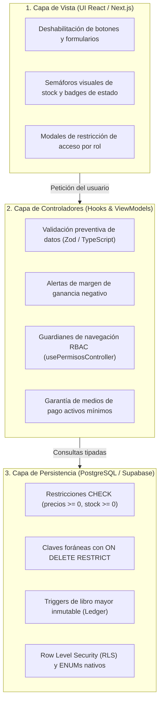
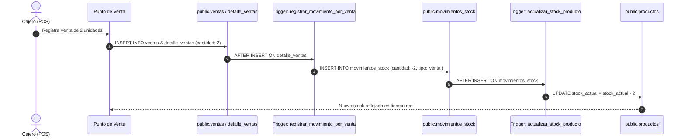
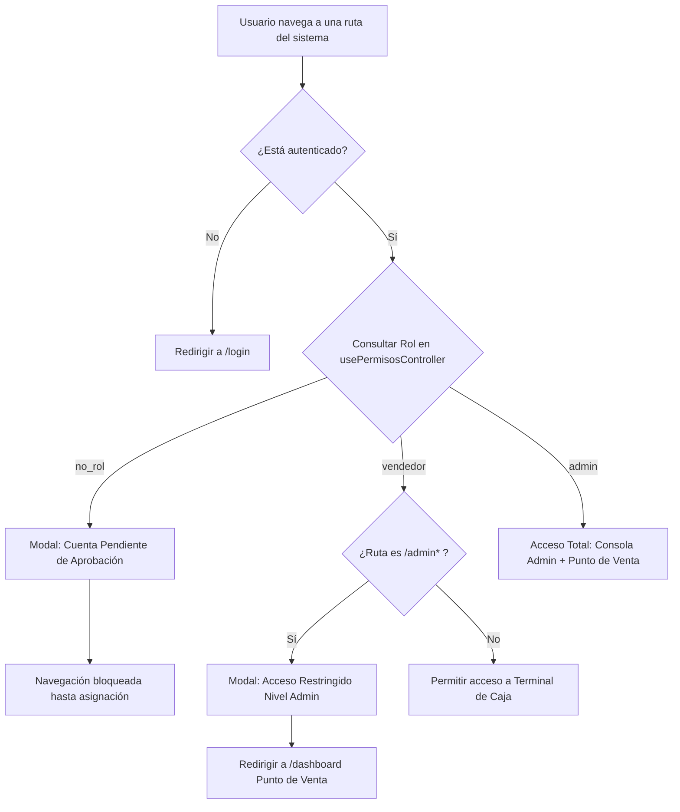

# Manual de Reglas de Negocio y Políticas del Sistema: miStock

**Proyecto:** miStock — Sistema de Gestión de Inventario, Punto de Venta (POS) y Catálogo Comercial  
**Destinatarios:** Equipo Directivo, Evaluadores Académicos y Desarrolladores de Software  
**Arquitectura:** Modelo-Vista-Controlador (MVC) reactivo en Next.js / TypeScript + Supabase (PostgreSQL 15+)  
**Versión de Documentación:** 1.0 (Producción / Auditada)  

---

## 1. Introducción y Enfoque de Integridad en Profundidad

El sistema **miStock** implementa el principio de **"Integridad en Profundidad"** (*Defense in Depth*). Esto significa que las reglas de negocio no residen únicamente en la interfaz gráfica (donde un usuario podría eludirlas alterando el DOM o enviando solicitudes directas), sino que están distribuidas y reforzadas armónicamente en **tres barreras defensivas**:



A continuación se detalla cada regla de negocio agrupada en sus **cinco pilares operativos**.

---

## 2. Pilar 1: Catálogo y Taxonomía de Mercancías

Este pilar regula la vida útil, clasificación comercial y fijación de precios de los artículos.

### Regla 1.1: Taxonomía Estricta y Prohibición de Productos Huérfanos
* **Enunciado de Negocio:** *Ningún producto puede existir en el catálogo sin estar clasificado dentro de una categoría activa.*
* **Justificación Comercial:** Evita el desorden en la góndola digital, previene inconsistencias en balances por rubros y agiliza la búsqueda del cajero en el POS.
* **Mecanismos de Control:**
  1. **Base de Datos:** La columna `productos.id_categoria` es `NOT NULL` con clave foránea `REFERENCES public.categorias(id_categoria) ON DELETE RESTRICT`. Si se intenta eliminar una categoría que contiene productos asociados, la base de datos aborta la transacción con error de integridad relacional.
  2. **Controlador:** El DTO [productoModel.ts](file:///b:/Programas/Github/m.i-stock/mistock/src/models/modelos_dominio/productoModel.ts) tipa obligatoriamente `categoriaId: string`.
  3. **Configuración:** Opción `requerirCategoriaEstricta` activada en los parámetros del sistema.

### Regla 1.2: Unicidad de Identificadores Comerciales (SKU y Código de Barras)
* **Enunciado de Negocio:** *No pueden cohabitar dos productos distintos con el mismo código de barras o código SKU en el comercio.*
* **Justificación Comercial:** Previene colisiones al disparar pistolas lectoras láser de códigos de barras en el mostrador.
* **Mecanismos de Control:**
  1. **Base de Datos:** Restricción `sku text UNIQUE` en la tabla `public.productos`.
  2. **Vista:** Búsqueda en tiempo real que localiza instantáneamente el artículo por coincidencia exacta de SKU.

### Regla 1.3: Doble Precio y Control de Rentabilidad Preventiva
* **Enunciado de Negocio:** *Todo producto posee dos valores monetarios: Costo de Adquisición y Precio de Venta al Público. El precio de venta nunca debería ser inferior al costo salvo liquidación deliberada.*
* **Justificación Comercial:** Resguardar el margen de contribución del negocio e impedir ventas a pérdida causadas por errores de tipeo.
* **Mecanismos de Control:**
  1. **Base de Datos:** `CHECK (precio_costo >= 0)` y `CHECK (precio_venta >= 0)` en tipo `numeric(10,2)`.
  2. **Controlador:** En [cargaProductoModel.ts](file:///b:/Programas/Github/m.i-stock/mistock/src/models/modelos_vista/cargaProductoModel.ts) y [inventarioController.ts](file:///b:/Programas/Github/m.i-stock/mistock/src/controllers/adminControllers/inventarioController.ts), el parámetro `alertarMargenNegativo: true` evalúa en vivo si `precioCosto >= precioVenta`, alertando visualmente al administrador antes de persistir los cambios.

### Regla 1.4: Baja Lógica (Soft-Delete) y Preservación de Trazabilidad
* **Enunciado de Negocio:** *Los productos y categorías nunca se destruyen físicamente (`DELETE`) si ya tuvieron actividad comercial.*
* **Justificación Comercial:** Preservar la integridad referencial histórica de ventas pasadas y auditorías fiscales.
* **Mecanismos de Control:**
  1. **Base de Datos:** Campo `activo boolean NOT NULL DEFAULT true` en `public.productos` y `public.categorias`.
  2. **Vistas:** El catálogo de ventas en caja solo exhibe productos donde `activo === true`. Los inactivos permanecen en la consola de administración con insignia "Inactivo" para permitir su reactivación.

### Regla 1.5: Unidades de Medida Físicas Normalizadas
* **Enunciado de Negocio:** *La comercialización solo se efectúa bajo unidades de medida homologadas.*
* **Mecanismos de Control:**
  1. **Base de Datos:** Enum nativo de PostgreSQL:
     ```sql
     CREATE TYPE public.unidad_medida AS ENUM ('unidad', 'kg', 'gramo', 'litro', 'metro', 'paquete');
     ```
  2. **Modelo:** Type union estricto de TypeScript en [productoModel.ts](file:///b:/Programas/Github/m.i-stock/mistock/src/models/modelos_dominio/productoModel.ts).

---

## 3. Pilar 2: Inventario, Existencias y Libro Mayor (Patrón Ledger)

Este pilar gobierna el movimiento físico de mercancías, asegurando que cada alta o baja tenga justificación auditable.



### Regla 2.1: Trazabilidad Inmutable mediante Ledger (Libro Diario)
* **Enunciado de Negocio:** *Nadie puede alterar el stock de un producto arbitrariamente sin dejar asentado un movimiento de inventario con fecha, usuario responsable, motivo y cantidad.*
* **Justificación Comercial:** Detección de mermas, prevención de robos hormiga y reconciliación contable.
* **Mecanismos de Control:**
  1. **Base de Datos:** Tabla `public.movimientos_stock` vinculada a `public.productos` y `public.usuario`.
  2. **Políticas RLS:** Modelo **Append-Only**. Los empleados tienen permisos para `SELECT` e `INSERT`, pero no existe permiso de `UPDATE` ni `DELETE` sobre el historial de movimientos. Lo registrado queda inmutable.

### Regla 2.2: Convención Algebraica de Signos
* **Enunciado de Negocio:** *Todos los movimientos respetan una dirección matemática estricta:*
  - `cantidad > 0` (Positivo): Entradas físicas (compras mayoristas, devoluciones de clientes, sobrantes de auditoría).
  - `cantidad < 0` (Negativo): Salidas físicas (ventas en mostrador, roturas, mermas por vencimiento, faltantes de inventario).
* **Mecanismos de Control:**
  1. **Base de Datos:** Trigger `actualizar_stock_producto` que aplica la suma algebraica:
     `SET stock_actual = stock_actual + NEW.cantidad`.

### Regla 2.3: Automatización de Saldo mediante Triggers en Cascada y Deducción Única
* **Enunciado de Negocio:** *La venta en el mostrador descuenta el inventario de manera atómica, única e indivisible en la base de datos, sin que el cliente web altere el stock por duplicado.*
* **Mecanismos de Control:**
  1. El trigger `tr_venta_movimiento_stock` escucha cada inserción en `public.detalle_ventas`.
  2. Genera automáticamente una fila en `public.movimientos_stock` con valor negativo (`-NEW.cantidad`).
  3. A su vez, `tr_actualizar_stock` impacta en `public.productos.stock_actual`. Todo ocurre dentro de la misma transacción ACID de PostgreSQL.
  4. En el frontend, `inventarioService.descontarStock` opera con `sincronizarRemoto = false`, eliminando la doble deducción que ocurría anteriormente al actualizar el stock tanto por cliente como por trigger.

### Regla 2.4: Semáforo Unificado de Existencias de Cuatro Estados Mutuamente Excluyentes
* **Enunciado de Negocio:** *El sistema clasifica el nivel de abastecimiento de cada producto activo según su umbral de seguridad (`stockMinimo`) en cuatro rangos disjuntos:*
  - **Sin Stock / Agotado (`stockActual === 0`):** Badge destructivo rojo. Requiere reposición inmediata o bloqueo de despacho en caja.
  - **Stock Crítico (`0 < stockActual <= stockMinimo`):** Badge de alerta urgente. El producto perforó su colchón de seguridad.
  - **Bajas Unidades (`stockMinimo < stockActual <= stockMinimo * 1.5`):** Badge preventivo ámbar. Señal temprana de reabastecimiento.
  - **Stock Óptimo (`stockActual > stockMinimo * 1.5`):** Badge verde de normalidad operativa.
* **Mecanismos de Control:**
  1. Taxonomía unificada compartida entre [inventarioController.ts](file:///b:/Programas/Github/m.i-stock/mistock/src/controllers/adminControllers/inventarioController.ts), [inventarioGlobalController.ts](file:///b:/Programas/Github/m.i-stock/mistock/src/controllers/adminControllers/inventarioGlobalController.ts) y la terminal de caja ([userDashboardController.ts](file:///b:/Programas/Github/m.i-stock/mistock/src/controllers/userControllers/userDashboardController.ts)).

### Regla 2.5: Auditoría de Inventario Físico y Acta de Discrepancias
* **Enunciado de Negocio:** *Al realizar recuentos manuales en depósito, la discrepancia se formula como `diferencia = stockFisico - stockSistema`.*
* **Mecanismos de Control:**
  1. Modelo de dominio [inventarioModel.ts](file:///b:/Programas/Github/m.i-stock/mistock/src/models/modelos_dominio/inventarioModel.ts) (`ItemAjusteInventario`).
  2. Si la diferencia es positiva genera un movimiento de `ajuste` positivo; si es negativa genera un movimiento de merma/ajuste negativo.

---

## 4. Pilar 3: Punto de Venta (POS), Facturación y Validez Legal

Este pilar rige el proceso de cobro en mostrador, la inmutabilidad de los comprobantes y el cumplimiento de las normativas fiscales vigentes.

### Regla 3.1: Inmutabilidad de Comprobante (Snapshot de Precios)
* **Enunciado de Negocio:** *Una vez concretada una venta, cualquier cambio futuro en el precio del producto en el catálogo NO debe alterar retroactivamente el monto facturado en ventas pasadas.*
* **Justificación Comercial:** Principio contable elemental. De lo contrario, un aumento general de precios falsificaría los balances históricos y el dinero efectivamente ingresado a caja.
* **Mecanismos de Control:**
  1. **Base de Datos:** La tabla `public.detalle_ventas` almacena una copia estática:
     ```sql
     precio_unitario numeric(10,2) NOT NULL CHECK (precio_unitario >= 0)
     ```
  2. La clave foránea `id_producto REFERENCES public.productos(id_producto) ON DELETE RESTRICT` impide que se borre un producto si ya tiene renglones de venta vendidos históricamente.

### Regla 3.2: Directiva de Venta Sin Stock Configurable
* **Enunciado de Negocio:** *El administrador decide si el comercio permite registrar ventas de productos con existencia cero o negativa.*
* **Justificación Comercial:** En ciertos comercios de rotación rápida o cuando la mercadería física ingresó antes de que el administrativo cargue la factura del proveedor, se necesita permitir la venta momentáneamente. En otros rubros más estrictos, vender sin stock ocasiona descontrol logístico.
* **Mecanismos de Control:**
  1. **Parámetro:** `config.pos.permitirVentaSinStock` (booleano).
  2. **Caja (UI):** Si el producto tiene `stock <= 0` y la opción está desactivada, el botón "Vender" se deshabilita físicamente (`disabled={prod.stock <= 0 && !permitirVentaSinStock}`).
  3. **Controlador:** Si se intenta forzar la venta, el controlador aborta emitiendo el mensaje de error: `"Stock insuficiente para este producto"`.

### Regla 3.3: Desacople de Medios de Pago y Cobro Dividido (Split Payment)
* **Enunciado de Negocio:** *Una venta puede ser cancelada con uno o más medios de cobro simultáneos (ej: mitad en efectivo y mitad por transferencia bancaria).*
* **Mecanismos de Control:**
  1. **Base de Datos:** La entidad `public.pagos` es independiente y tiene cardinalidad 1 a N con `public.ventas`.
  2. Admite métodos tipados: `'efectivo' | 'tarjeta_debito' | 'tarjeta_credito' | 'transferencia'`.

### Regla 3.4: Disponibilidad Mínima de Medios de Cobro
* **Enunciado de Negocio:** *La caja nunca puede quedarse sin al menos un método de cobro habilitado.*
* **Mecanismos de Control:**
  1. **Controlador:** En [configuracionController.ts](file:///b:/Programas/Github/m.i-stock/mistock/src/controllers/adminControllers/configuracionController.ts), la función `toggleMetodoPago` computa la cantidad de métodos activos restantes:
     ```typescript
     if (habilitados === 0) {
       setMensajeError('Debe quedar al menos un método de cobro habilitado para la caja.');
       return prev;
     }
     ```

### Regla 3.5: Régimen de Validez Legal del Ticket y Coherencia Tributaria (Ley 11.683 vs. RG AFIP/ARCA 4892)
* **Enunciado de Negocio:** *Todo comprobante impreso por el sistema debe clarificar inequívocamente su naturaleza fiscal y respetar la matemática impositiva según la condición frente al IVA del comercio.*
* **Justificación Legal y Tributaria:**
  - **Modo Comprobante Interno (`no_fiscal`):** Se utiliza para control interno de stock, preventa o cambios en mostrador. La **Ley 11.683 de Procedimiento Tributario (Art. 40)** sanciona la emisión de tickets que simulen ser facturas sin serlo. Por ello, el sistema imprime en tipografía destacada `*** DOCUMENTO NO VÁLIDO COMO FACTURA ***` sin discriminar IVA ficticio.
  - **Modo Comprobante Fiscal Oficial (`factura_afip`):** Cumple con la **Resolución General AFIP 4892/2020**:
    1. Si `condicionIva === 'responsable_inscripto'`, emite **FACTURA B** desglosando `SUBTOTAL NETO` + `IVA CONTENIDO (21%)` cuya suma exacta coincide con el `TOTAL`.
    2. Si `condicionIva === 'monotributo'`, emite **FACTURA C** por el importe final sin discriminar IVA, exhibiendo CAE y fecha de vencimiento.

```
+-------------------------------------------------------------+
|              TICKET DE CONTROL INTERNO (POS)                |
|                      M.I STOCK S.R.L.                       |
|                   CUIT: 30-71829340-9                       |
|           Av. Corrientes 3450, CABA - Tel: 4521-8890        |
+-------------------------------------------------------------+
|    *** DOCUMENTO NO VÁLIDO COMO FACTURA ***                 |
|             (Conforme Ley Nacional N° 11.683)               |
+-------------------------------------------------------------+
| Fecha: 26/09/2026 10:30        Comprobante: TKT-0001-0000124|
| Cajero: Lucas Benitez          Punto de Venta: 0001         |
+-------------------------------------------------------------+
| CANT  DESCRIPCIÓN                        P.UNIT     SUBTOTAL|
| 2 un  Aceite Girasol 1.5L               $2.450,00  $4.900,00|
| 1 un  Galletitas Surtidas 400g          $1.350,00  $1.350,00|
+-------------------------------------------------------------+
| TOTAL A PAGAR:                                     $6.250,00|
| FORMA DE PAGO: Efectivo                            $6.250,00|
+-------------------------------------------------------------+
|      ¡Gracias por su compra! Conserve este comprobante      |
|           para gestionar cualquier cambio o reclamo.        |
+-------------------------------------------------------------+
```

### Regla 3.7: Conciliación de Efectivo y Cierre de Caja Aislado por Turno (Reporte Z - Arqueo de Gaveta)
* **Enunciado de Negocio:** *Al concluir el turno de atención o la jornada comercial, el cajero debe realizar el arqueo de efectivo en gaveta y emitir el Comprobante de Cierre de Caja (Reporte Z), computando exclusivamente los cobros generados dentro de su propio turno activo.*
* **Justificación Comercial:** Garantiza la rendición de cuentas sin distorsión contable, previene que ventas históricas o de turnos precedentes inflen el dinero esperado y concilia las ventas registradas contra los cobros físicos y canales electrónicos (Mercado Pago, Tarjetas y Transferencias).
* **Mecanismos de Control y Fórmulas Contables:**
  1. **Fondo Inicial (Cambio de Gaveta):** El comercio inicia el turno con un monto base configurable ($FondoInicial$) para entregar cambio a los clientes.
  2. **Identificador Unívoco de Turno:** Al abrir la caja se genera un `idTurno` (`TRN-XXXXXX`) y una marca temporal `timestampApertura`.
  3. **Efectivo Teórico Esperado:**
     $$EfectivoEsperado = FondoInicial + \sum_{v \in TurnoActivo} VentasEfectivo$$
  4. **Conteo Físico Real ($EfectivoReal$):** El cajero ingresa la suma de billetes y monedas contados en mano en la gaveta.
  5. **Diferencia de Caja ($\Delta$):**
     $$\Delta = EfectivoReal - EfectivoEsperado$$
     - Si $\Delta = 0$: **Caja Cuadrada (Exacta)**.
     - Si $\Delta > 0$: **Sobrante de Caja** (dinero en exceso en gaveta).
     - Si $\Delta < 0$: **Faltante de Caja** (diferencia negativa atribuible a errores de vuelto o egresos no declarados).
  6. **Comprobante de Cierre (Reporte Z):** Emisión de ticket térmico inmutable de 80mm con desglose completo por canal de pago, conciliación de efectivo y espacio para firma del cajero y firma del administrador.

### Regla 3.8: Apertura Estricta de Turno de Caja y Bloqueo Preventivo del Armado de Carrito
* **Enunciado de Negocio:** *Ningún cajero o vendedor puede armar un ticket de venta, escanear artículos ni añadir productos al carrito mientras la caja permanezca cerrada. La apertura del turno es un acto administrativo deliberado que únicamente puede ejecutarse desde el botón de apertura oficial en la barra superior.*
* **Justificación Comercial:** Impide la emisión de comprobantes o movimientos de stock antes del arqueo inicial de gaveta, resguardando la trazabilidad de fondos para dar cambio y evitando aperturas accidentales durante la atención.
* **Mecanismos de Control:**
  1. **Aislamiento del Disparador:** El botón `[ Abrir Caja ]` reside de forma exclusiva en la barra superior del Punto de Venta. No se ofrece ninguna opción de apertura automática ni atajo en el pie del carrito ni en los modales de cobro.
  2. **Bloqueo del Escáner y Búsqueda:** El input de código de barras y búsqueda permanece deshabilitado (`disabled`) con placeholder indicativo de caja cerrada.
  3. **Inhabilitación del Catálogo:** Las tarjetas de producto (cuadrícula) y filas (tabla) desactivan el botón de agregar con la leyenda "Caja cerrada" y estilo bloqueado.
  4. **Protección en Controladores:** Los métodos `agregarAlCarrito`, `actualizarCantidadItem`, `removerItemCarrito`, `vaciarCarrito` y `procesarVentaTicket` en `userDashboardController.ts` rechazan cualquier mutación emitiendo mensaje de advertencia si `cajaAbierta === false`.
  5. **Módulos Secundarios:** Los botones de carga en `ModuloCatalogoProductos` y `ModuloConsultorPrecios` se inhabilitan cuando la caja está cerrada.

### Regla 3.9: Anulación de Comprobantes y Restitución Inmediata de Stock mediante Trigger
* **Enunciado de Negocio:** *Un comprobante emitido erróneamente o devuelto por el cliente puede ser cancelado en el historial de la terminal POS, reintegrando automáticamente las existencias físicas al inventario en PostgreSQL mediante trigger relacional y deduciendo el monto cobrado de las métricas de recaudación del día y del turno.*
* **Justificación Comercial:** Permite corregir equivocaciones operativas en mostrador sin recurrir a ajustes manuales de stock, asegurando que el libro mayor y la gaveta concilien con la realidad física.
* **Mecanismos de Control:**
  1. **Acción de Anulación:** Disponible en `ModalDetalleVenta.tsx` con confirmación explícita para evitar anulaciones accidentales (solo habilitada si la venta ya fue persistida con UUID en base de datos).
  2. **Persistencia en Base de Datos:** Invoca `supabaseService.cancelarVenta(ventaId)` que actualiza `estado = 'cancelada'` en `public.ventas` bajo la política RLS `FOR UPDATE` (`"Staff anula ventas activas"`).
  3. **Restitución Atómica por Trigger:** El trigger `tr_cancelar_venta_reintegrar_stock` en PostgreSQL intercepta el cambio de estado, asienta los movimientos de devolución en `public.movimientos_stock` y reintegra el stock en `public.productos`. En el frontend se actualiza la memoria con `sincronizarRemoto = false` evitando desfasajes.
  4. **Ajuste de Balances:** La venta transiciona al estado inmutable `'cancelada'`. Su importe es excluido de los acumuladores `recaudacionDelDia`, `ventasDelDia` y `resumenMediosTurno`.

---

## 5. Pilar 4: Seguridad, Autorización y Control de Acceso (RBAC)

Este pilar administra los privilegios de los operadores según el rol asignado en la organización.

### Regla 4.1: Modelo Jerárquico de Roles Escalar
* **Enunciado de Negocio:** *El sistema adopta una escala unificada de tres roles tipados en la base de datos:*
  1. **`admin` (Nivel 1 - Administrador):** Control financiero total, fijación de precios, configuración comercial, gestión de usuarios, auditoría de stock y operación de caja.
  2. **`vendedor` (Nivel 2 - Cajero / Operador POS):** Acceso acotado a la pantalla de Punto de Venta (`/dashboard`), búsqueda de catálogo y registro de cobros.
  3. **`no_rol` (Nivel 3 - Usuario Pendiente):** Cuenta recién autenticada por Google/Email a la espera de autorización por parte de un administrador.
* **Mecanismos de Control:**
  1. **Base de Datos:** `CREATE TYPE public.user_rol AS ENUM ('admin', 'vendedor', 'no_rol');`.
  2. Todo usuario nuevo ingresa por defecto con rol `no_rol` gracias al trigger `handle_new_user`.

### Regla 4.2: Herencia Funcional del Administrador (Sin Duplicación de Roles)
* **Enunciado de Negocio:** *Un usuario con rol `admin` no necesita tener simultáneamente el rol `vendedor`. El rol `admin` hereda de forma natural todas las capacidades operativas del vendedor.*
* **Justificación Arquitectónica:** Al ser la columna `rol` un valor escalar (ENUM de PostgreSQL) y no un arreglo de textos, la herencia por diseño evita redundancias en la base de datos. El administrador puede conmutar en un clic a la terminal de caja para atender clientes cuando el local lo requiera.

### Regla 4.3: Guardián de Rutas y Modales de Contención
* **Enunciado de Negocio:** *Si un usuario intenta vulnerar la navegación e ingresar directamente por URL a una sección no autorizada, el sistema no lanza un error genérico ni se rompe: lo intercepta con un modal explicativo y lo redirige a su área permitida.*
* **Mecanismos de Control:**
  1. Hook central [permisosController.ts](file:///b:/Programas/Github/m.i-stock/mistock/src/controllers/permisosController.ts) (`usePermisosController`).
  2. Componente [ModalAccesoRestringido.tsx](file:///b:/Programas/Github/m.i-stock/mistock/src/views/comunes/ModalAccesoRestringido.tsx):
     - **Caso `vendedor_en_admin`:** Si un vendedor navega a `/admindashboard`, `/admininventario` o `/adminconfiguracion`, el modal le informa amablemente que esa sección contiene información financiera sensible y lo redirige a `/dashboard` (Punto de Venta).
     - **Caso `sin_rol`:** Si un usuario sin rol intenta operar, el modal bloquea el fondo y le informa que su cuenta está a la espera de que el administrador le asigne un rol.



### Regla 4.4: Ocultamiento Proactivo de Navegación (User Experience)
* **Enunciado de Negocio:** *La interfaz no debe tentar al usuario mostrándole botones a los que no tiene acceso.*
* **Mecanismos de Control:**
  1. En [UserSidebar.tsx](file:///b:/Programas/Github/m.i-stock/mistock/src/views/user/UserSidebar.tsx), el botón para *"Ir a Consola Administrador"* está condicionado a `esAdmin`. Un cajero ordinario ni siquiera visualiza el enlace, manteniendo su interfaz enfocada exclusivamente en su labor de despacho.

### Regla 4.5: Protección de la Cuenta Maestra
* **Enunciado de Negocio:** *El sistema impide que se elimine o suspenda al único administrador existente.*
* **Justificación Comercial:** Previene que el comercio quede bloqueado y sin posibilidad de administrar la plataforma.
* **Mecanismos de Control:**
  1. Validación en el controlador de usuarios ([usuariosController.ts](file:///b:/Programas/Github/m.i-stock/mistock/src/controllers/adminControllers/usuariosController.ts)) que cuenta los administradores activos antes de autorizar una baja o cambio de rol.

### Regla 4.6: Seguridad en Base de Datos (Row Level Security - RLS)
* **Enunciado de Negocio:** *Incluso si alguien burla la interfaz web y ejecuta peticiones REST directas a Supabase con la API Key pública, la base de datos rechaza cualquier operación no autorizada.*
* **Mecanismos de Control:**
  1. RLS activo en todas las tablas (`usuario`, `categorias`, `productos`, `movimientos_stock`, `ventas`, `detalle_ventas`, `pagos`).
  2. Función `public.is_admin()` optimizada con subconsulta `(SELECT public.is_admin())` para evitar llamadas recursivas y garantizar máximo rendimiento.

### Regla 4.7: Autenticación Soberana en Supabase Auth y Gestión Centralizada de Colaboradores
* **Enunciado de Negocio:** *Todo colaborador creado por un administrador en la nómina (`/adminusuarios`) se aprovisiona como usuario real en Supabase Auth (`auth.users`) y en `public.usuario`. Se prohíbe el almacenamiento de contraseñas en texto plano o cuentas locales ficticias en el navegador.*
* **Justificación Comercial:** Garantiza la seguridad de nivel empresarial, auditoría legal e inhabilitación inmediata ante desvinculaciones laborales.
* **Mecanismos de Control:**
  1. **Aprovisionamiento Criptográfico:** `crearUsuario` invoca la RPC `public.crear_colaborador_admin` (o signup seguro) requiriendo contraseña de $6 \dots 72$ caracteres cifrada con bcrypt por Supabase Auth.
  2. **Bloqueo Preventivo de Cuentas Inactivas:** La columna `activo boolean DEFAULT true` en `public.usuario` es evaluada en cada inicio de sesión y validación de layout. Si `activo === false`, el acceso queda inmediatamente revocado.
  3. **Direccionamiento de Roles:** Los usuarios válidos activos fijan `mistock_rol_activo` y son redirigidos a `/admin` o `/dashboard` según corresponda.

---

## 6. Pilar 5: Parametrización, Auditoría y Portabilidad de Datos

Este pilar respalda la continuidad operativa y la soberanía de los datos del comerciante.

### Regla 6.1: Persistencia y Sincronización de Parámetros
* **Enunciado de Negocio:** *Los cambios de configuración (datos de empresa, umbrales de stock, modo de ticket, métodos de pago) persisten en el entorno de trabajo del comercio.*
* **Mecanismos de Control:**
  1. Persistencia reactiva en almacenamiento local bajo la clave `mistock_configuracion_v1`.
  2. Fusión profunda (*deep merge*) con los valores por defecto [configuracionModel.ts](file:///b:/Programas/Github/m.i-stock/mistock/src/models/modelos_vista/configuracionModel.ts) para evitar caídas ante versiones nuevas del esquema.

### Regla 6.2: Motor de Exportación RFC 4180 con UTF-8 BOM
* **Enunciado de Negocio:** *Toda exportación de datos a formato CSV (catálogo de productos e historial de ventas) debe abrirse sin caracteres extraños ni rotura de columnas en Microsoft Excel en español.*
* **Mecanismos de Control:**
  1. En [configuracionController.ts](file:///b:/Programas/Github/m.i-stock/mistock/src/controllers/adminControllers/configuracionController.ts):
     - Inyección obligatoria del Byte Order Mark UTF-8 (`\uFEFF`).
     - Escape de comillas dobles y textos con espacios según la norma RFC 4180.

---

### Regla 6.3: Integridad de Entradas y Techos Numéricos Relacionales
* **Enunciado de Negocio:** *Todos los campos de entrada de la plataforma están acotados por límites físicos compatibles con los tipos de datos de PostgreSQL para impedir desbordes o errores de base de datos.*
* **Mecanismos de Control:**
  1. **Precios y Valores Monetarios:** Límite máximo de `$99.999.999,99` (`MAX_PRECIO_DB`) coincidente con `numeric(10,2)`.
  2. **Cantidades y Stock:** Números enteros en el rango $0 \dots 1.000.000$ (`MAX_STOCK_DB`).
  3. **Identificadores Fiscales y Teléfonos:** CUIT formateado estrictamente a 11 dígitos numéricos (`XX-XXXXXXXX-X`) y teléfonos acotados a 6-15 dígitos numéricos reales con sanitización en vivo.
  4. **Códigos de Barras / SKU:** Longitud entre 2 y 40 caracteres alfanuméricos, guiones y barras sin espacios (`esSkuValido`).

---

## 7. Matriz Resumen de Validación por Capas

| Regla de Negocio | Capa Vista (UI) | Capa Controlador (MVC) | Capa Base de Datos (PostgreSQL) |
| :--- | :---: | :---: | :---: |
| **Categoría obligatoria** | Selector con validación visual | Validación en DTO `CrearProductoDTO` | `NOT NULL` + `ON DELETE RESTRICT` |
| **Unicidad de SKU / Código** | Búsqueda en vivo por código | Validación en hook de guardado | `sku text UNIQUE` |
| **Precios no negativos** | `min={0}` en inputs numéricos | Control de signo en submit | `CHECK (precio >= 0)` |
| **Alerta de margen negativo** | Warning visual en formulario | `alertarMargenNegativo: true` | Auditado en libro mayor |
| **Baja lógica (Soft-delete)** | Filtro de productos activos | Toggle reactivo de estado | `activo boolean DEFAULT true` |
| **Libro mayor inmutable (Ledger)** | Historial de movimientos | Mapeo a `MovimientoStock` | RLS Append-Only (sin UPDATE/DELETE) |
| **Actualización automática de stock** | Reflejo reactivo en tablas | Recálculo de existencias | Triggers `tr_actualizar_stock` |
| **Venta sin stock controlada** | Botón disabled si stock <= 0 | Validación de saldo antes de insertar | `CHECK (stock_actual >= 0)` opcional |
| **Snapshot de precio en venta** | Muestra total histórico | Congela precio unitario al vender | `detalle_ventas.precio_unitario` |
| **Mínimo 1 medio de pago** | Bloqueo visual de switches | Guardia preventiva en `toggleMetodoPago` | Restricción en tabla `pagos` |
| **Leyenda legal en tickets** | Previsualización en simulador | Parámetros de texto en `ConfiguracionNegocio` | Registro legal según Ley 11.683 |
| **Restricción de acceso RBAC** | `ModalAccesoRestringido` | `usePermisosController` (evaluación de rol activo) | RLS con función `public.is_admin()` |
| **Herencia de roles (Admin en POS)** | Acceso irrestricto en UI | `esAdmin` habilita todas las vistas | Enum `public.user_rol` escalar |
| **Exportación estándar Excel** | Botón de descarga de archivo | Inyección de `\uFEFF` y formato RFC 4180 | Consultas SELECT optimizadas con índices |

---

## 8. Conclusiones y Estado del Sistema

El sistema **miStock** cuenta hoy con una base sólida de reglas de negocio que garantizan:
1. **Fiabilidad Contable:** Ningún peso ni producto desaparece sin registro auditable.
2. **Cumplimiento Normativo:** Distinción clara entre tickets de control interno y facturación fiscal conforme a las leyes argentinas.
3. **Seguridad y Usabilidad:** Los cajeros operan con rapidez sin riesgo de alterar parámetros financieros, y los administradores cuentan con control absoluto y herramientas de exportación seguras.

### RN-POS-04: Apertura Previa Obligatoria de Caja
- **Regla:** Ningún cajero puede procesar ventas, emitir comprobantes o finalizar tickets sin haber efectuado previamente la Apertura de Caja.
- **Validación:** Si `cajaAbierta === false`, el sistema bloquea el cobro (`procesarVentaTicket`) y transforma el botón de checkout en *"Abrir Caja para Habilitar Cobro"*, desplegando el `ModalAperturaCaja` para registrar el fondo inicial en efectivo.
