# 🗺️ Mapa de Rutas y Ensamblado MVC: M.I Stock

**Proyecto:** M.I Stock — Sistema de Gestión de Inventario, Punto de Venta (POS) y Catálogo Comercial  
**Framework:** Next.js 16.3.4 (App Router con Turbopack)  
**Ubicación en Código:** `src/app/`  
**Tags:** #rutas #nextjs #app-router #mvc #rbac #endpoints #api #mercadopago #mistock

---

## 📌 1. Rol del App Router en el Patrón MVC (Ensamblador de Dependencias)

En **M.I Stock**, los archivos `page.tsx` dentro de `src/app/` cumplen el rol de **Ensambladores MVC (Dependency Injectors)**:
1. No contienen lógica de negocio ni maquetado complejo de UI.
2. Instancian el **Controlador** correspondiente (`const controller = use...Controller()`).
3. Renderizan la **Vista** pasándole el controlador por prop (`return <...View controller={controller} />`).

Además, el sistema organiza las rutas mediante **Route Groups** de Next.js:
- `(auth)`: Rutas de autenticación (`/login`, `/logout`) centradas y con pie de página institucional (`Footer.tsx`).
- `(user)`: Entorno de terminal de Punto de Venta (`/dashboard`) protegido por `UserLayout` (`UserSidebar.tsx` + `usePermisosController`).
- `(admin)`: Consola ejecutiva de administración (`/admin`, `/admingestioninven`, `/admininventarioglobal`, `/adminusuarios`, `/adminconfiguracion`) protegida por `AdminLayout` (`AdminSidebar.tsx` + `usePermisosController`).
- `api/`: **Route Handlers** de servidor para la integración con hardware **Mercado Pago Point Smart** y webhooks.

```mermaid
flowchart TD
    ROOT["src/app/"]
    
    ROOT --> AUTH["(auth)/"]
    AUTH --> L1["/login (LoginFormView + useLoginController)"]
    AUTH --> L2["/logout (LogoutView + useLogoutController)"]
    
    ROOT --> USER["(user)/ — Protegido por usePermisosController"]
    USER --> U1["/dashboard (UserDashboardView + useUserDashboardController)"]
    
    ROOT --> ADMIN["(admin)/ — Protegido por usePermisosController (Solo Admin)"]
    ADMIN --> A1["/admin (AdminDashboardView + useAdminDashboardController)"]
    ADMIN --> A2["/admingestioninven (AdminGestionInventario + useAdminInventarioController)"]
    ADMIN --> A3["/admininventarioglobal (AdminInventarioGlobalView + useAdminInventarioGlobalController)"]
    ADMIN --> A4["/adminstockcritico (Redirección a /admininventarioglobal)"]
    ADMIN --> A5["/adminusuarios (AdminUsuariosView + useAdminUsuariosController)"]
    ADMIN --> A6["/adminconfiguracion (AdminConfiguracionView + useAdminConfiguracionController)"]
    ADMIN --> A7["/adminmetricas (Redirección a /admin)"]
    
    ROOT --> API["api/mercadopago/"]
    API --> MP1["GET /point/devices (Listar terminales Point Smart)"]
    API --> MP2["POST /point/intent (Enviar cobro al posnet)"]
    API --> MP3["GET & DELETE /point/intent/[id] (Consultar o cancelar cobro)"]
    API --> MPW["POST /webhook (Notificaciones asíncronas con firma HMAC)"]
```

---

## 📋 2. Cuadro General de Rutas y Conexión MVC

| Ruta (URL) | Archivo en `src/app/` | Rol Requerido | Layout y Guardia RBAC | Vista (`src/views/`) | Controlador (`src/controllers/`) |
| :--- | :--- | :--- | :--- | :--- | :--- |
| **`/`** | `src/app/page.tsx` | Entrada Pública | Redirección Canónica | Redirige a `/login` | N/A |
| **`/login`** | `src/app/(auth)/login/page.tsx` | Público | `AuthLayout` | `auth/LoginFormView.tsx` | `useLoginController` (`authController.ts`) |
| **`/logout`** | `src/app/(auth)/logout/page.tsx` | Autenticado | `AuthLayout` | `auth/LogoutView.tsx` | `useLogoutController` (`authController.ts`) |
| **`/dashboard`** | `src/app/(user)/dashboard/page.tsx` | `vendedor` o `admin` | `UserLayout` (`UserSidebar` + `usePermisosController`) | `user/UserDashboardView.tsx` | `useUserDashboardController` (`userDashboardController.ts`) |
| **`/admin`** | `src/app/(admin)/admin/page.tsx` | `admin` | `AdminLayout` (`AdminSidebar` + `usePermisosController`) | `admin/AdminDashboardView.tsx` | `useAdminDashboardController` (`dashboardController.ts`) |
| **`/admingestioninven`** | `src/app/(admin)/admingestioninven/page.tsx` | `admin` | `AdminLayout` (`AdminSidebar` + `usePermisosController`) | `admin/AdminGestionInventario.tsx` | `useAdminInventarioController` (`inventarioController.ts`) |
| **`/admininventarioglobal`** | `src/app/(admin)/admininventarioglobal/page.tsx` | `admin` | `AdminLayout` (`AdminSidebar` + `usePermisosController`) | `admin/AdminInventarioGlobalView.tsx` | `useAdminInventarioGlobalController` (`inventarioGlobalController.ts`) |
| **`/adminstockcritico`** | `src/app/(admin)/adminstockcritico/page.tsx` | `admin` | Redirección Canónica | Redirige a `/admininventarioglobal` | N/A |
| **`/adminusuarios`** | `src/app/(admin)/adminusuarios/page.tsx` | `admin` | `AdminLayout` (`AdminSidebar` + `usePermisosController`) | `admin/AdminUsuariosView.tsx` | `useAdminUsuariosController` (`usuariosController.ts`) |
| **`/adminconfiguracion`** | `src/app/(admin)/adminconfiguracion/page.tsx` | `admin` | `AdminLayout` (`AdminSidebar` + `usePermisosController`) | `admin/AdminConfiguracionView.tsx` | `useAdminConfiguracionController` (`configuracionController.ts`) |
| **`/adminmetricas`** | `src/app/(admin)/adminmetricas/page.tsx` | `admin` | Redirección Canónica | Redirige a `/admin` | N/A |

---

## 🔌 3. Endpoints de Servidor (Route Handlers) para Mercado Pago Point Smart

Para proteger el `MERCADOPAGO_ACCESS_TOKEN` privado del comercio y evitar errores de CORS, las vistas del navegador (`ModalCobroTicket.tsx`) se comunican con los Route Handlers internos de Next.js, los cuales delegan la lógica al servicio `src/services/mercadopago/pointService.ts`:

### 3.1. `GET /api/mercadopago/point/devices`
- **Archivo:** `src/app/api/mercadopago/point/devices/route.ts`
- **Función en `pointService.ts`:** `listPointDevices()`
- **Propósito:** Consulta las terminales físicas Point Smart vinculadas a la cuenta de Mercado Pago del comercio y devuelve también el `defaultDeviceId` configurado en `.env.local`.

### 3.2. `POST /api/mercadopago/point/intent`
- **Archivo:** `src/app/api/mercadopago/point/intent/route.ts`
- **Función en `pointService.ts`:** `createPaymentIntent(deviceId, payload)`
- **Propósito:** Crea una intención de cobro con cabecera `X-Idempotency-Key` (UUID v4) hacia el posnet físico seleccionado, enviando el monto del carrito y el identificador externo del ticket.

### 3.3. `GET /api/mercadopago/point/intent/[id]` y `DELETE /api/mercadopago/point/intent/[id]`
- **Archivo:** `src/app/api/mercadopago/point/intent/[id]/route.ts`
- **Funciones en `pointService.ts`:** `getPaymentIntentStatus(intentId)` y `cancelPaymentIntent(deviceId, intentId)`
- **Propósito:**
  - `GET`: Permite hacer *polling* cada 3 segundos desde `ModalCobroTicket.tsx` para conocer el estado del cobro en la terminal (`OPEN`, `ON_TERMINAL`, `PROCESSING`, `PROCESSED`, `ABANDONED`, `CANCELLED`, `ERROR`).
  - `DELETE`: Cancela en caliente una orden de cobro enviada al posnet si el cliente desiste o cambia de medio de pago.

### 3.4. `POST /api/mercadopago/webhook`
- **Archivo:** `src/app/api/mercadopago/webhook/route.ts`
- **Función en `pointService.ts`:** `verifyWebhookSignature(xSignature, xRequestId, dataId)`
- **Propósito:** Recibe notificaciones asíncronas de Mercado Pago verificando la autenticidad criptográfica mediante **HMAC-SHA256** (`MERCADOPAGO_WEBHOOK_SECRET`).

---

## 🛡️ 4. Doble Anillo de Seguridad (Middleware SSR + Guardia RBAC en Layouts)

1. **Anillo 1 — Middleware de Sesión SSR (`src/proxy.ts` + `src/lib/supabase/middleware.ts`):**
   - Intercepta cada petición HTTP y refresca el token JWT de las cookies `HttpOnly` mediante `@supabase/ssr`.
   - Si un visitante sin sesión activa intenta entrar a `/admin/*` o `/dashboard`, lo redirige automáticamente a `/login`.
2. **Anillo 2 — Control de Permisos y Roles de Acceso (`src/controllers/permisosController.ts`):**
   - Tanto `src/app/(admin)/layout.tsx` como `src/app/(user)/layout.tsx` ejecutan el hook `usePermisosController()`.
   - Si un usuario autenticado con rol `vendedor` intenta acceder a cualquier ruta de `(admin)`, `AdminLayout` bloquea el contenido y renderiza `ModalAccesoRestringido` (`tipo="vendedor_en_admin"`).
   - Si un usuario con rol `no_rol` intenta operar en `(admin)` o `(user)`, el layout correspondiente muestra `ModalAccesoRestringido` (`tipo="sin_rol"`).

---

## 🔗 Enlaces Relacionados
- [[Modelos]] — Entidades de dominio, DTOs y funciones puras.
- [[Controladores]] — Hooks controladores MVC y servicios reactivos.
- [[Vistas]] — Componentes visuales renderizados en cada ruta.
- [[Stack de Tecnologias]] — Arquitectura de Next.js y Supabase SSR.
