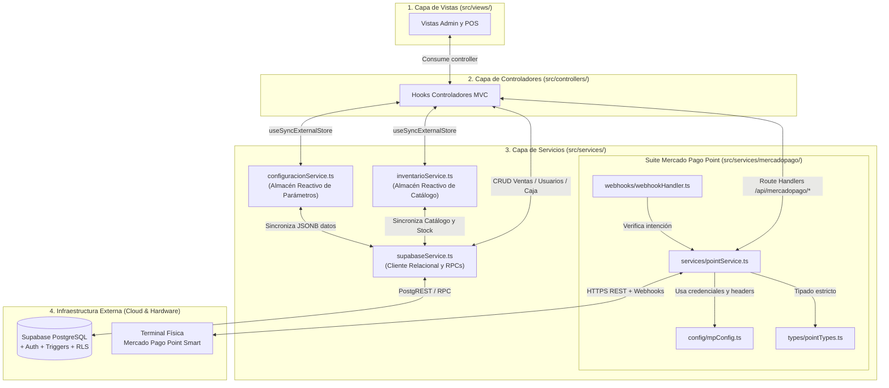
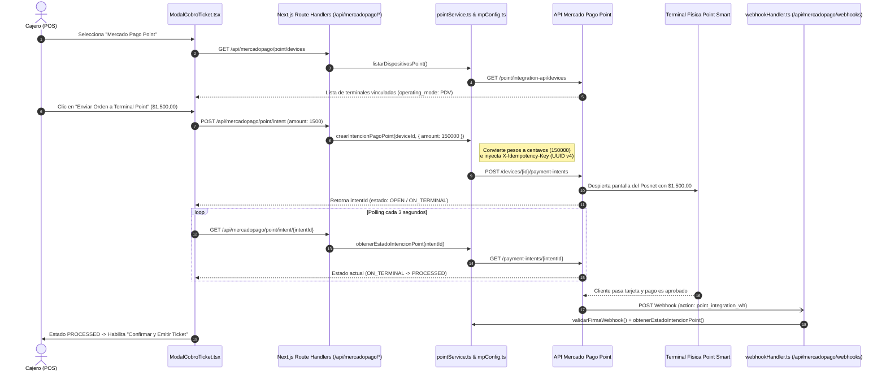

# ⚙️ Capa de Servicios e Integraciones Externas: M.I Stock

**Proyecto:** M.I Stock — Sistema de Gestión de Inventario, Punto de Venta (POS) y Catálogo Comercial  
**Capa de Arquitectura:** Servicios (`Services` — Almacenes Reactivos Globales, Persistencia en Supabase PostgreSQL e Integración Mercado Pago Point)  
**Ubicación en Código:** `src/services/`  
**Tags:** #servicios #mvc #supabase #mercadopago #point #usesyncexternalstore #arquitectura #mistock #defensa-oral

---

## 🎓 1. Guía para Defensa Oral: ¿Qué es y por qué existe la carpeta `src/services/`?

En la arquitectura **Modelo-Vista-Controlador (MVC)** de **M.I Stock**, los **Controladores** (`src/controllers/`) gestionan el estado de la interfaz y las reglas de negocio de cada pantalla, pero **no se comunican directamente con motores de base de datos ni con APIs de terceros mediante llamadas `fetch` dispersas**. En su lugar, delegan toda comunicación externa y sincronización entre pestañas a la **Capa de Servicios (`src/services/`)**.

> [!IMPORTANT] **Las 3 Responsabilidades Clave de `src/services/` (Para destacar en la defensa)**
> 1. **Almacenes Reactivos Compartidos (`useSyncExternalStore`):** `inventarioService.ts` y `configuracionService.ts` implementan el patrón *External Store* nativo de React 19. Esto permite que cuando el Administrador modifica un precio, el stock o un método de pago en su consola, el Punto de Venta (POS) se entere y actualice instantáneamente sin recargar la página.
> 2. **Abstracción Relacional y Transaccional (`supabaseService.ts`):** Encapsula todas las consultas SQL/REST y llamadas RPC hacia **Supabase (PostgreSQL)**, traduciendo los nombres de columnas en `snake_case` de la base de datos a los modelos de dominio en `camelCase` de TypeScript y envolviendo las lecturas en el contrato resiliente `FetchResult<T>`.
> 3. **Integración de Hardware Físico de Cobro (`src/services/mercadopago/`):** Aísla toda la comunicación con la **API de Mercado Pago Point Smart**, incluyendo cabeceras de idempotencia, tipado de estados del posnet, órdenes de cobro en centavos y validación de Webhooks.



---

## 📂 2. Estructura Completa del Directorio `src/services/`

La carpeta `src/services/` está compuesta por **8 archivos** organizados en dos bloques funcionales: los servicios troncales del sistema (raíz) y el submódulo especializado de **Mercado Pago Point** (`mercadopago/`):

```text
src/services/
├── inventarioService.ts                  # (1) Almacén reactivo global de Productos y Categorías (useSyncExternalStore)
├── configuracionService.ts               # (2) Almacén reactivo global de Configuración Comercial y Fiscal
├── supabaseService.ts                    # (3) Conector PostgreSQL (CRUD, Movimientos Ledger, Ventas, Usuarios RPC, Caja)
└── mercadopago/                          # Suite de integración con terminales físicas Mercado Pago Point
    ├── index.ts                          # (4) Archivo barril (Barrel export) de toda la suite Mercado Pago
    ├── config/
    │   └── mpConfig.ts                   # (5) Credenciales, endpoints REST y generador de headers con X-Idempotency-Key
    ├── types/
    │   └── pointTypes.ts                 # (6) Contratos TypeScript para dispositivos, intenciones de pago y Webhooks
    ├── services/
    │   └── pointService.ts               # (7) Cliente HTTP para listar posnets, enviar cobros, consultar y cancelar
    └── webhooks/
        └── webhookHandler.ts             # (8) Validador de firma y procesador de notificaciones asíncronas Point
```

| # | Archivo | Patrón / Rol | Consumido por |
| :-: | :--- | :--- | :--- |
| **1** | `src/services/inventarioService.ts` | *Reactive External Store* (`useSyncExternalStore`) | `dashboardController`, `inventarioController`, `inventarioGlobalController`, `configuracionController`, `userDashboardController` |
| **2** | `src/services/configuracionService.ts` | *Reactive External Store* (`useSyncExternalStore`) | `dashboardController`, `inventarioController`, `configuracionController`, `userDashboardController` |
| **3** | `src/services/supabaseService.ts` | *Data Access Service / Repository* (`FetchResult<T>`) | `inventarioService`, `configuracionService`, `dashboardController`, `usuariosController`, `userDashboardController`, `permisosController` |
| **4** | `src/services/mercadopago/index.ts` | *Barrel Module* (Re-exportación unificada) | Route Handlers en `src/app/api/mercadopago/...` |
| **5** | `src/services/mercadopago/config/mpConfig.ts` | *Configuration & Security Header Builder* | `pointService.ts`, `webhookHandler.ts` |
| **6** | `src/services/mercadopago/types/pointTypes.ts` | *TypeScript DTOs & State Machine Types* | `pointService.ts`, `webhookHandler.ts`, `ModalCobroTicket.tsx` |
| **7** | `src/services/mercadopago/services/pointService.ts` | *REST API Client* (Mercado Pago Point API) | `/api/mercadopago/point/devices`, `/api/mercadopago/point/intent`, `/api/mercadopago/point/intent/[id]`, `webhookHandler.ts` |
| **8** | `src/services/mercadopago/webhooks/webhookHandler.ts` | *Webhook Security & Event Processor* | `/api/mercadopago/webhooks/route.ts` |

---

## 🔄 3. Almacenes Reactivos Globales (`useSyncExternalStore`)

### 3.1. `src/services/inventarioService.ts` — Almacén Reactivo de Inventario y Catálogo

#### A. Propósito y Arquitectura
Centraliza en memoria la fuente única de verdad en el cliente para **Categorías (`Categoria[]`)** y **Productos (`Producto[]`)**, manteniendo sincronizadas en tiempo real todas las vistas del sistema (Tablero Admin, Gestión de Inventario, Inventario Global y Terminal POS) con la base de datos PostgreSQL en Supabase.

* **Estado Interno (`InventarioState`):**
  ```typescript
  interface InventarioState {
    categorias: Categoria[];
    productos: Producto[];
    sincronizadoRemoto?: boolean;
    cargandoRemoto?: boolean;
    errorRemoto?: string | null;
  }
  ```
* **Hidratación Segura en Next.js (SSR + CSR):**
  - Durante el renderizado en servidor (`getServerSnapshot`), entrega siempre `INITIAL_STATE` determinístico para evitar errores de *hydration mismatch* en Next.js 16.
  - En el cliente (`asegurarHidratacionCliente`), hidrata inicialmente desde la caché local (`mistock_inventario_v2`), escucha el evento `window.addEventListener('storage', ...)` para sincronizar pestañas abiertas en el mismo navegador, e inmediatamente dispara `sincronizarConSupabase()` para traer el estado real desde PostgreSQL.

#### B. Hook y Métodos Expuestos por `inventarioService`

| Símbolo / Método | Firma y Parámetros | Explicación Técnica y Regla de Negocio |
| :--- | :--- | :--- |
| **`useInventarioData()`** | `() => InventarioState` | Hook reactivo basado en `useSyncExternalStore(subscribe, getSnapshot, getServerSnapshot)`. Suscribe cualquier controlador a cambios instantáneos del catálogo y dispara la sincronización inicial con Supabase. |
| **`sincronizarConSupabase()`** | `() => Promise<void>` | Consulta en paralelo `fetchCategoriasWithStatus()` y `fetchProductosWithStatus()`. **Protección anti-pérdida de datos:** Solo reemplaza el estado en memoria si `catRes.ok && prodRes.ok`. Si hay un corte de internet, conserva la caché operativa y expone `errorRemoto`. |
| **`agregarCategoria()`** | `(nombre: string, descripcion?: string) => Promise<Categoria>` | Valida que no exista otra categoría con el mismo nombre (`case-insensitive`). Aplica una actualización optimista en memoria e inserta el registro en `public.categorias` vía `insertCategoria()`, reemplazando el ID temporal por el UUID definitivo de PostgreSQL. |
| **`guardarProducto()`** | `(nuevo: Omit<Producto, 'id' \| 'stockActual' \| 'activo'>, stockInicial: number) => Promise<Producto>` | Crea un producto activo con `stockActual = stockInicial`. Lo persiste en `public.productos` (`insertProducto`) y, si `stockInicial > 0` y el ID devuelto es un UUID válido, registra automáticamente en el Libro Mayor (`public.movimientos_stock`) un movimiento inicial de tipo `'compra'` con motivo `'Stock inicial en alta de producto'`. |
| **`modificarProducto()`** | `(id: string, cambios: Partial<Omit<Producto, 'id'>>) => Promise<void>` | Calcula la diferencia algebraica de stock ($\Delta = \text{nuevoStock} - \text{stockAnterior}$). Actualiza los metadatos comerciales en `public.productos` (`updateProducto`) y, si $\Delta \neq 0$, asienta un movimiento de tipo `'ajuste'` en `public.movimientos_stock`. El trigger `tr_actualizar_stock` de PostgreSQL impacta el nuevo saldo de forma atómica. |
| **`darDeBajaProducto()`** | `(id: string) => Promise<void>` | Aplica **Baja Lógica (Soft-Delete)** marcando `activo = false` en memoria y ejecutando `toggleActivoProducto(id, false)` en Supabase. El artículo desaparece del mostrador POS pero preserva la integridad histórica de ventas pasadas. |
| **`reactivarProducto()`** | `(id: string) => Promise<void>` | Restituye un artículo dado de baja marcando `activo = true` y sincronizando con `toggleActivoProducto(id, true)` en PostgreSQL. |
| **`descontarStock()`** | `(items: { productoId: string; cantidad: number }[], sincronizarRemoto = false) => Promise<void>` | Descuenta en memoria las unidades vendidas ($\max(0, \text{stockActual} - \text{cantidad})$). **Detalle crítico de arquitectura:** Por defecto `sincronizarRemoto` es `false` porque al insertar una venta en `public.detalle_ventas`, el trigger de PostgreSQL `tr_venta_movimiento_stock` ya genera el movimiento y descuenta `stock_actual` en la base de datos. Esto evita la doble deducción de stock. |
| **`reintegrarStock()`** | `(items: { productoId: string; cantidad: number }[], sincronizarRemoto = false) => Promise<void>` | Suma nuevamente al estado en memoria las unidades de un ticket anulado ($\text{stockActual} + \text{cantidad}$). Al igual que en la venta, `sincronizarRemoto = false` evita duplicar el reintegro que ya ejecuta en PostgreSQL el trigger `tr_cancelar_venta_reintegrar_stock`. |
| **`limpiarCacheLocal()`** | `() => void` | Elimina `mistock_inventario_v2` de `localStorage`, restablece el estado inicial y fuerza una recarga limpia desde Supabase. |

---

### 3.2. `src/services/configuracionService.ts` — Almacén Reactivo de Configuración del Sistema

#### A. Propósito y Arquitectura
Administra de forma reactiva el objeto `ConfiguracionCompleta` (datos fiscales del comercio, reglas del POS, medios de pago habilitados, umbrales de inventario y preferencias de métricas), sincronizándolo entre todas las pantallas y persistiendo cada cambio en la tabla `public.configuracion_negocio` de Supabase.

* **Fusión Profunda y Sanitización Defensiva (`deepMergeConfig` + `sanitizarConfiguracion`):**
  1. **`deepMergeConfig(base, guardado)`:** Combina recursivamente el JSON recuperado de la base de datos o caché local con `CONFIGURACION_POR_DEFECTO`. Si en una futura versión del sistema se agrega una nueva propiedad a la configuración, el sistema no falla con `undefined`, sino que adopta el valor por defecto automáticamente.
  2. **`sanitizarConfiguracion(config)`:** Valida y corrige en tiempo de ejecución posibles valores corruptos:
     - Fuerza que `inventario.umbralMinimoPorDefecto` sea un entero finito $\ge 0$.
     - Fuerza que `metricas.diaCorteMensual` esté estrictamente acotado al rango $[1, 28]$.
     - Garantiza la **Regla de Negocio 3.4**: si ningún medio de pago estuviera habilitado en `pos.mediosPago`, reactiva automáticamente `efectivo: true` para que la caja nunca quede bloqueada.

#### B. Hook y Métodos Expuestos por `configuracionService`

| Símbolo / Método | Firma y Parámetros | Explicación Técnica |
| :--- | :--- | :--- |
| **`useConfiguracionData()`** | `() => ConfiguracionCompleta` | Hook reactivo (`useSyncExternalStore`) consumido por los controladores de Admin y POS. Al montarse en el cliente, hidrata la caché local (`mistock_configuracion_v1`) y lanza `sincronizarConSupabase()`. |
| **`sincronizarConSupabase()`** | `() => Promise<void>` | Descarga la configuración remota desde `public.configuracion_negocio` mediante `fetchConfiguracionNegocio()`. Si existe en la nube, la fusiona con `deepMergeConfig`, la sanitiza y notifica a todos los componentes suscritos. Si la tabla está vacía, sube la configuración actual a Supabase (`saveConfiguracionNegocio`). |
| **`guardarConfiguracion()`** | `(nuevaConfig: ConfiguracionCompleta) => void` | Sanitiza el objeto completo, actualiza la memoria reactiva, guarda en `localStorage` y persiste asincrónicamente en Supabase (`saveConfiguracionNegocio`). |
| **`actualizarNegocio()`** | `(cambios: Partial<ConfiguracionNegocio>) => void` | Actualiza en tiempo real los datos comerciales y tributarios (razón social, CUIT, condición frente al IVA, dirección, teléfono, modo de comprobante y pie de ticket). |
| **`actualizarPOS()`** | `(cambios: Partial<ConfiguracionPOS>) => void` | Actualiza las reglas operativas de la terminal de caja (`permitirVentaSinStock`, `sonidoConfirmacion`, `modoEscanerRapido`, `autoImprimirTicket`, etc.). |
| **`toggleMetodoPago()`** | `(metodo: keyof MediosPagoHabilitados) => boolean` | Conmuta el estado de un canal de cobro (`efectivo`, `tarjeta_debito`, `tarjeta_credito`, `transferencia`, `mercado_pago`). Si el usuario intenta apagar el único método activo restante, **aborta la operación y retorna `false`**. |
| **`actualizarInventario()`** | `(cambios: Partial<ConfiguracionInventario>) => void` | Actualiza parámetros globales de depósito (`umbralMinimoPorDefecto`, `alertarMargenNegativo`). |
| **`actualizarMetricas()`** | `(cambios: Partial<ConfiguracionMetricas>) => void` | Actualiza la parametrización del motor de KPIs (`periodoPredeterminado`, `inicioSemana`, `diaCorteMensual`, `compararPeriodoAnterior`). |
| **`restablecerPorDefecto()`** | `() => void` | Restaura `CONFIGURACION_POR_DEFECTO` tanto en memoria como en `public.configuracion_negocio` en Supabase. |

---

## 🗄️ 4. Conector Relacional y Transaccional (`src/services/supabaseService.ts`)

`supabaseService.ts` es el **único punto de acceso a datos (Data Access Layer)** hacia Supabase PostgreSQL desde la capa de servicios y controladores.

### 4.1. Patrón de Resiliencia `FetchResult<T>` y Validación `isUUID`
Para distinguir entre *"la base de datos está vacía"* (`ok: true, items: []`) y *"ocurrió un fallo de red o permisos"* (`ok: false, items: [], error: '...'`), todas las funciones de lectura implementan el contenedor tipado `FetchResult<T>`:

```typescript
export interface FetchResult<T> {
  ok: boolean;
  items: T[];
  error?: string;
}
```
Además, el helper interno `isUUID(str)` verifica mediante expresión regular (`/^[0-9a-f]{8}-[0-9a-f]{4}-[1-5][0-9a-f]{3}-[89ab][0-9a-f]{3}-[0-9a-f]{12}$/i`) que nunca se envíen IDs temporales de interfaz (como `'prod-1'` o `'VNT-123'`) a columnas de tipo `uuid` en PostgreSQL.

### 4.2. Catálogo Completo de Funciones de `supabaseService.ts`

#### A. Gestión de Categorías (`public.categorias`)
| Función | Firma | Descripción |
| :--- | :--- | :--- |
| **`fetchCategoriasWithStatus()`** | `() => Promise<FetchResult<Categoria>>` | Obtiene todas las categorías activas (`activo = true`) ordenadas alfabéticamente por `nombre`. |
| **`fetchCategorias()`** | `() => Promise<Categoria[]>` | Wrapper directo que retorna `res.items` de `fetchCategoriasWithStatus()`. |
| **`insertCategoria()`** | `(nombre: string, descripcion?: string) => Promise<Categoria \| null>` | Inserta una nueva categoría activa en `public.categorias` y devuelve el modelo `Categoria` con su `id_categoria` (UUID) generado por PostgreSQL. |

#### B. Gestión de Productos (`public.productos`)
| Función | Firma | Descripción |
| :--- | :--- | :--- |
| **`fetchProductosWithStatus()`** | `() => Promise<FetchResult<Producto>>` | Recupera el catálogo completo de productos haciendo `SELECT *, categorias(nombre)` y mapeando `precio_costo` → `precioCosto`, `precio_venta` → `precioVenta`, `stock_actual` → `stockActual`, `stock_minimo` → `stockMinimo` y `unidad_medida` → `unidadMedida`. |
| **`fetchProductos()`** | `() => Promise<Producto[]>` | Wrapper que retorna el arreglo de productos de `fetchProductosWithStatus()`. |
| **`insertProducto()`** | `(producto: Omit<Producto, 'id'>) => Promise<Producto \| null>` | Inserta un nuevo artículo en `public.productos`. Si `categoriaId` no es un UUID válido, aborta preventivamente para respetar la clave foránea. |
| **`updateProducto()`** | `(id: string, cambios: Partial<Producto>) => Promise<boolean>` | Actualiza campos modificados en `public.productos` y refresca la marca temporal `actualizado_el`. **Nota clave:** No sobreescribe `stock_actual` directamente para que toda variación de inventario pase por el Libro Mayor (`movimientos_stock`). |
| **`toggleActivoProducto()`** | `(id: string, activo: boolean) => Promise<boolean>` | Ejecuta la baja lógica o reactivación comercial (`UPDATE public.productos SET activo = $1 WHERE id_producto = $2`). |

#### C. Libro Mayor de Inventario (`public.movimientos_stock`)
| Función | Firma | Descripción |
| :--- | :--- | :--- |
| **`registrarMovimiento()`** | `(idProducto: string, tipo: TipoMovimientoStock, cantidad: number, motivo: string) => Promise<boolean>` | Obtiene el `auth.uid()` del operador autenticado e inserta una fila inmutable en `public.movimientos_stock` (`tipo`, `cantidad` con signo algebraico, `motivo`, `id_usuario`). En PostgreSQL, el trigger `tr_actualizar_stock` intercepta esta inserción y suma algebraicamente `cantidad` a `productos.stock_actual`. |

#### D. Transacciones del Punto de Venta (`public.ventas`, `public.detalle_ventas`, `public.pagos`)
| Función | Firma | Descripción |
| :--- | :--- | :--- |
| **`fetchVentasWithStatus()`** | `() => Promise<FetchResult<Venta>>` | Consulta las ventas con sus relaciones anidadas (`usuario(nombre)`, `detalle_ventas(*, productos(nombre, sku, unidad_medida))` y `pagos(*)`), reconstruyendo el objeto `Venta` completo con sus renglones e historial de cobro. |
| **`fetchVentas()`** | `() => Promise<Venta[]>` | Wrapper directo de `fetchVentasWithStatus()`. |
| **`registrarVenta()`** | `(params: { total, metodoPago, montoRecibido, vuelto, items }) => Promise<{ id: string; fecha: string } \| null>` | **Transacción encadenada con compensación de errores:**<br>1. Verifica la sesión activa de Supabase Auth.<br>2. Inserta la cabecera en `public.ventas` (`estado: 'completada'`).<br>3. Inserta los renglones en `public.detalle_ventas` con `precio_unitario` congelado (disparando el trigger `tr_venta_movimiento_stock` que descuenta el stock en DB). Si falla, elimina la cabecera de `ventas` (rollback compensatorio).<br>4. Inserta el cobro en `public.pagos` (`estado: 'aprobado'`). Si falla, limpia `detalle_ventas` y `ventas`. |
| **`cancelarVenta()`** | `(ventaId: string) => Promise<boolean>` | Actualiza `estado = 'cancelada'` en `public.ventas`. Esto dispara automáticamente en PostgreSQL el trigger `tr_cancelar_venta_reintegrar_stock`, que inserta movimientos de `'devolucion'` en `public.movimientos_stock` y restituye las unidades a `public.productos`. |

#### E. Administración de Usuarios y Funciones RPC (`public.usuario` y `auth.users`)
| Función | Firma | Descripción |
| :--- | :--- | :--- |
| **`fetchUsuariosWithStatus()`** | `() => Promise<FetchResult<Usuario>>` | Consulta la nómina de personal en `public.usuario` ordenada por `creado_el DESC`, mapeando `activo` (`boolean`) a `estado` (`'activo' \| 'inactivo'`). |
| **`crearColaboradorRemoto()`** | `(params: { nombre, email, password, rol, telefono }) => Promise<{ ok, usuario?, error? }>` | **Aprovisionamiento Dual de Cuentas:**<br>1. Intenta ejecutar la función RPC `public.crear_colaborador_admin` (`SECURITY DEFINER` con `pgcrypto`) que crea el usuario directamente en `auth.users` (con `email_confirmed_at = now()`) y en `public.usuario` sin cerrar la sesión del administrador.<br>2. Si la RPC no está disponible, utiliza un cliente Supabase efímero (`persistSession: false`) para hacer `auth.signUp()` sin pisar la cookie JWT del administrador actual. |
| **`updateUsuario()`** | `(id: string, cambios: Partial<Pick<Usuario, 'nombre' \| 'email' \| 'rol' \| 'telefono' \| 'estado'>>) => Promise<boolean>` | Actualiza los datos de perfil, el rol RBAC (`admin`, `vendedor`, `no_rol`) o la habilitación operativa (`activo`) del colaborador en `public.usuario`. |
| **`actualizarPasswordColaborador()`** | `(idUsuario: string, nuevaPassword: string) => Promise<{ ok, error? }>` | Invoca la función RPC `public.actualizar_password_colaborador_admin` que cifra la nueva contraseña con `crypt(p_password, gen_salt('bf'))` directamente en `auth.users`. |
| **`deleteUsuario()`** | `(id: string) => Promise<{ ok, modo?: 'eliminado' \| 'desactivado' }>` | Intenta eliminar el registro en `public.usuario`. Si el colaborador ya registra ventas o movimientos de stock históricos (error de clave foránea `23503`), aplica automáticamente **baja lógica** (`activo = false`) retornando `modo: 'desactivado'`. |

#### F. Persistencia en la Nube de Configuración, Turno de Caja y Respaldos (`public.configuracion_negocio`)
La tabla `public.configuracion_negocio` almacena una única fila maestra (`id = 1`) cuya columna JSONB `datos` aloja tanto la `ConfiguracionCompleta` como las claves operativas `sesionCaja` y `ultimoRespaldoCSV`. Todas las funciones de escritura leen primero el JSONB actual y hacen un *merge* para no sobrescribir las claves hermanas:

| Función | Firma | Descripción |
| :--- | :--- | :--- |
| **`fetchConfiguracionNegocio()`** | `() => Promise<Partial<ConfiguracionCompleta> \| null>` | Extrae el objeto de configuración comercial desde `public.configuracion_negocio.datos` (excluyendo las claves operativas `sesionCaja` y `ultimoRespaldoCSV`). |
| **`saveConfiguracionNegocio()`** | `(config: ConfiguracionCompleta) => Promise<boolean>` | Persiste `ConfiguracionCompleta` en `id = 1` preservando intactos `sesionCaja` y `ultimoRespaldoCSV`. |
| **`fetchSesionCaja()`** | `() => Promise<SesionCajaRemota \| null>` | Recupera del JSONB `datos.sesionCaja` el estado del turno de caja (`apertura`, `cajaAbierta` e `historialCierres`) para que el turno sea consistente entre dispositivos. |
| **`saveSesionCaja()`** | `(sesion: SesionCajaRemota) => Promise<boolean>` | Guarda en `public.configuracion_negocio.datos.sesionCaja` la apertura activa o el cierre de turno recién emitido (Reporte Z). |
| **`fetchUltimoRespaldoCSV()`** | `() => Promise<string \| null>` | Lee la marca temporal ISO de la última exportación CSV desde `datos.ultimoRespaldoCSV`. |
| **`saveUltimoRespaldoCSV()`** | `(fechaISO: string) => Promise<boolean>` | Registra en Supabase la fecha y hora exacta en que un administrador descargó un respaldo CSV de inventario o ventas. |

---

## 💳 5. Suite de Integración Mercado Pago Point (`src/services/mercadopago/`)

Para cobrar con tarjetas de débito, crédito y QR en una terminal física **Mercado Pago Point Smart** desde el navegador sin exponer jamás el token privado (`MP_ACCESS_TOKEN`), **M.I Stock** implementa una arquitectura de **Proxy Server-Side**: el modal de cobro (`ModalCobroTicket.tsx`) llama a los Route Handlers internos de Next.js (`/api/mercadopago/...`), y estos consumen los 5 archivos de `src/services/mercadopago/`.



---

### 5.1. `src/services/mercadopago/index.ts` — Barrel File (Punto de Entrada)
Archivo barril que re-exporta de manera limpia toda la funcionalidad del submódulo para que los Route Handlers de Next.js puedan importar desde `@/services/mercadopago`:
```typescript
export * from './config/mpConfig';
export * from './types/pointTypes';
export * from './services/pointService';
export * from './webhooks/webhookHandler';
```

---

### 5.2. `src/services/mercadopago/config/mpConfig.ts` — Configuración, Endpoints y Cabeceras Seguras

Centraliza la lectura de variables de entorno del servidor, el catálogo de URLs de la API de Mercado Pago y la construcción de cabeceras HTTP.

#### A. Objeto `MP_CONFIG`
* **`baseUrl`:** `'https://api.mercadopago.com'`
* **`apiVersion`:** `'v1'`
* **Getters de Credenciales (evaluados en servidor):**
  - `accessToken`: Lee `process.env.MP_ACCESS_TOKEN` (Token privado `APP_USR-...` o `TEST-...`). Si no está configurado, emite un `console.warn` preventivo en consola del servidor.
  - `publicKey`: Lee `process.env.NEXT_PUBLIC_MP_PUBLIC_KEY`.
  - `webhookSecret`: Lee `process.env.MP_WEBHOOK_SECRET` para verificar la autenticidad de las notificaciones Webhook.
  - `defaultDeviceId`: Lee `process.env.MP_POINT_DEVICE_ID` (ID por defecto del posnet, ej. `PAX_A910__SMARTPOS123456`).
  - `isSandbox`: Propiedad calculada booleana que detecta automáticamente si el sistema está operando en entorno de pruebas verificando `MP_ACCESS_TOKEN.startsWith('TEST-')`.
* **Mapa de Endpoints (`MP_CONFIG.endpoints`):**
  - **`point.devices`:** `/point/integration-api/devices`
  - **`point.createPaymentIntent(deviceId)`:** `/point/integration-api/devices/${deviceId}/payment-intents`
  - **`point.cancelPaymentIntent(deviceId, intentId)`:** `/point/integration-api/devices/${deviceId}/payment-intents/${intentId}`
  - **`point.getPaymentIntentStatus(intentId)`:** `/point/integration-api/payment-intents/${intentId}`
  - **`qr.createOrder(userId, externalPosId)`:** `/instore/orders/qr/seller/collectors/${userId}/pos/${externalPosId}/qrs` *(preparado para expansión a QR estático/dinámico en mostrador)*.

#### B. Generador de Cabeceras `getMercadoPagoHeaders(idempotencyKey?: string)`
Construye el diccionario `HeadersInit` obligatorio para toda petición hacia Mercado Pago:
1. Valida que `MP_CONFIG.accessToken` exista; de lo contrario, lanza una excepción explícita impidiendo llamadas anónimas.
2. Inyecta `'Authorization': 'Bearer ' + MP_CONFIG.accessToken` y `'Content-Type': 'application/json'`.
3. Si recibe `idempotencyKey`, inyecta la cabecera estándar `'X-Idempotency-Key'`. Esto garantiza que si hay un microcorte de red y el servidor reintenta el `POST`, Mercado Pago no duplique la orden de cobro en la terminal física.

---

### 5.3. `src/services/mercadopago/types/pointTypes.ts` — Contratos de Datos y Máquina de Estados Point

Define las interfaces TypeScript que modelan las respuestas y peticiones oficiales de la API Point Integration de Mercado Pago:

| Tipo / Interfaz | Valores / Propiedades Clave | Propósito Técnico |
| :--- | :--- | :--- |
| **`PointOperatingMode`** | `'PDV' \| 'STANDALONE'` | Define si la terminal Point opera integrada al sistema de caja (`PDV`, recibe montos desde M.I Stock) o de forma autónoma (`STANDALONE`, el cajero tipea el monto a mano en el posnet). |
| **`PointPaymentIntentStatus`** | `'OPEN' \| 'ON_TERMINAL' \| 'PROCESSING' \| 'PROCESSED' \| 'ABANDONED' \| 'CANCELED' \| 'ERROR'` | Máquina de estados del ciclo de vida de una intención de pago:<br>- `OPEN`: Creada en la nube de MP.<br>- `ON_TERMINAL`: Desplegada en la pantalla del posnet esperando tarjeta/QR.<br>- `PROCESSING`: Leyendo chip/contactless y autorizando con la red bancaria.<br>- `PROCESSED`: Pago aprobado exitosamente.<br>- `ABANDONED` / `CANCELED` / `ERROR`: Expirada en posnet, cancelada por el cajero o rechazada. |
| **`PointDevice`** | `{ id, pos_id, store_id, external_pos_id, operating_mode }` | Representa una terminal física Point Smart asociada a la cuenta de Mercado Pago del comercio. |
| **`CreatePointPaymentIntentPayload`** | `{ amount, description?, payment?, additional_info? }` | Payload de creación de cobro. **Regla crítica de formato:** Mercado Pago exige que `amount` se envíe como un **entero en centavos** (por ejemplo, para cobrar $\$1.500,00\text{ ARS}$ se envía `amount: 150000`). Incluye además `additional_info.external_reference` para vincular el ticket de M.I Stock (`TKT-...`) y `print_on_terminal: boolean`. |
| **`PointPaymentIntent`** | `{ id, device_id, amount, state, payment?, additional_info? }` | Respuesta de estado de una intención de pago, incluyendo el `payment.id` y el tipo de medio utilizado cuando el cobro finaliza. |
| **`PointWebhookPayload`** | `{ id, live_mode, type, date_created, user_id, api_version, action, data: { id } }` | Estructura del cuerpo JSON que Mercado Pago envía por `POST` a `/api/mercadopago/webhooks` cada vez que una terminal Point cambia el estado de una orden. |

---

### 5.4. `src/services/mercadopago/services/pointService.ts` — Cliente de Comunicación con Terminales Point

Contiene las **5 funciones asíncronas de servidor** que ejecutan las operaciones sobre el hardware físico a través de la nube de Mercado Pago:

| Función | Método y Endpoint de Mercado Pago | Parámetros y Retorno | Explicación Paso a Paso |
| :--- | :--- | :--- | :--- |
| **`listarDispositivosPoint()`** | `GET /point/integration-api/devices` | `() => Promise<PointDeviceListResponse>` | Consulta todas las terminales Point vinculadas a la cuenta del comercio (`cache: 'no-store'`). Es invocada por `/api/mercadopago/point/devices` cuando el cajero abre el modal de cobro. |
| **`configurarModoOperativoPoint()`** | `PATCH /point/integration-api/devices/{device_id}` | `(deviceId: string, operatingMode: PointOperatingMode) => Promise<PointDevice>` | Permite conmutar remotamente un posnet entre modo integrado (`PDV`) y modo autónomo (`STANDALONE`). |
| **`crearIntencionPagoPoint()`** | `POST /point/integration-api/devices/{device_id}/payment-intents` | `(deviceId: string, payload: CreatePointPaymentIntentPayload, idempotencyKey?: string) => Promise<PointPaymentIntent>` | Envía el monto a cobrar a la terminal física seleccionada (`deviceId` o `MP_CONFIG.defaultDeviceId`). Si no recibe `idempotencyKey`, genera automáticamente un UUID v4 (`crypto.randomUUID()`) para blindar la operación contra cobros duplicados. |
| **`obtenerEstadoIntencionPoint()`** | `GET /point/integration-api/payment-intents/{intent_id}` | `(paymentIntentId: string) => Promise<PointPaymentIntent>` | Consulta en tiempo real (`cache: 'no-store'`) en qué estado se encuentra la orden (`OPEN`, `ON_TERMINAL`, `PROCESSED`, `CANCELED`, etc.). Es utilizada tanto por el *polling* cada 3 segundos del frontend como por el procesador de Webhooks. |
| **`cancelarIntencionPagoPoint()`** | `DELETE /point/integration-api/devices/{device_id}/payment-intents/{intent_id}` | `(deviceId: string, paymentIntentId: string) => Promise<boolean>` | Aborta una orden de cobro que aún no fue procesada en la terminal (por ejemplo, si el cliente decide cambiar de medio de pago en mostrador). Retorna `true` cuando la API responde `200 OK` o `204 No Content`. |

---

### 5.5. `src/services/mercadopago/webhooks/webhookHandler.ts` — Seguridad y Procesamiento de Webhooks Point

Cuando el cliente apoya su tarjeta en el posnet Point Smart y el banco aprueba o rechaza la transacción, los servidores de Mercado Pago envían una notificación asíncrona (`POST`) al endpoint `/api/mercadopago/webhooks`. Este módulo procesa y valida dichas notificaciones.

#### A. Interfaz `WebhookProcessingResult`
```typescript
export interface WebhookProcessingResult {
  success: boolean;
  message: string;
  intentState?: string;
  externalReference?: string;
  paymentId?: number;
}
```

#### B. Funciones de `webhookHandler.ts`

1. **`validarFirmaWebhook(xSignature: string | null, xRequestId: string | null): boolean`**
   - **Propósito:** Verificar que la petición entrante provenga legítimamente de Mercado Pago antes de procesarla.
   - **Comportamiento:**
     - Si `MP_CONFIG.webhookSecret` no está definido en las variables de entorno (modo desarrollo local sin túnel firmado), emite una advertencia en consola y permite continuar para facilitar pruebas en Sandbox.
     - En producción (con `MP_WEBHOOK_SECRET` configurado), exige que las cabeceras `x-signature` y `x-request-id` estén presentes en el request HTTP; si faltan, rechaza la solicitud devolviendo `false` (lo que genera un `401 Unauthorized` en el Route Handler).

2. **`procesarWebhookPoint(payload: PointWebhookPayload): Promise<WebhookProcessingResult>`**
   - **Propósito:** Procesar eventos de terminales Point aplicando el principio de **Verificación Cruzada (Zero-Trust Webhook)**.
   - **Flujo de Ejecución:**
     1. **Filtrado de Dominio:** Verifica si `payload.type === 'point_integration_wh'` o si `payload.action.startsWith('point_integration')`. Si es otro tipo de notificación de Mercado Pago ajena a Point, la ignora limpiamente con `success: true`.
     2. **Extracción de Identificador:** Toma `const intentId = payload.data?.id`. Si no existe, retorna `success: false`.
     3. **Doble Verificación contra la API Oficial (`obtenerEstadoIntencionPoint`):** En lugar de confiar ciegamente en el cuerpo del Webhook recibido (que alguien podría intentar falsificar), el handler utiliza las credenciales privadas del servidor para consultar directamente `GET /point/integration-api/payment-intents/{intentId}` en Mercado Pago.
     4. **Evaluación de Estado:**
        - Si `intentStatus.state === 'PROCESSED'`, extrae `external_reference` (ej. código del ticket) y `payment.id`, dejando confirmado el cobro.
        - Si el estado es `'CANCELED'`, `'ERROR'` o `'ABANDONED'`, registra el rechazo o abandono de la orden en la terminal.

---

## 🔗 6. Enlaces Relacionados en la Bóveda
- [[Controladores]] — Documentación de los 8 Controladores MVC que consumen estos servicios.
- [[Modelos]] — Interfaces de dominio (`Producto`, `Categoria`, `Venta`, `Usuario`) y vista (`ConfiguracionCompleta`, `AperturaCaja`).
- [[Rutas del Sistema]] — Documentación de los Route Handlers (`/api/mercadopago/...`) que exponen `pointService` y `webhookHandler`.
- [[Chema de la Base de Datos]] — Tablas de PostgreSQL, políticas RLS, funciones RPC y triggers que interactúan con `supabaseService.ts`.
- [[Reglas de Negocio miStock]] — Reglas de integridad comercial, deducción única de stock y medios de pago.
