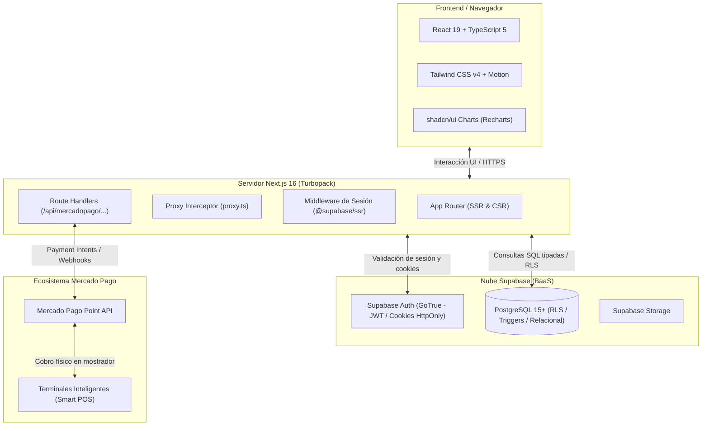

# ⚡ Stack de Tecnologías: miStock

**Proyecto:** miStock — Sistema de Gestión de Inventario, Punto de Venta (POS) y Catálogo Comercial  
**Capa de Arquitectura:** Infraestructura, Plataforma y Entorno de Ejecución  
**Tags:** #stack #tecnologias #nextjs #react #typescript #supabase #postgresql #tailwind #mercadopago #mistock

---

##  1. Visión General del Stack Tecnológico

El proyecto **miStock** está sustentado sobre una arquitectura moderna basada en el framework **Next.js 16 (App Router)** junto a un Backend-as-a-Service (**BaaS**) en la nube gestionado con **Supabase (PostgreSQL 15+)** e integraciones de cobro electrónico mediante **Mercado Pago Point API**.

---

##  2. Capa de Frontend y Renderizado

| Tecnología | Versión | Rol en el Proyecto y Justificación Técnica |
| :--- | :--- | :--- |
| **Next.js** | `16.3.4` | **Framework principal.** Proporciona el App Router, Server Components para carga ultra veloz, Server Actions y compilación en milisegundos con el motor **Turbopack**. |
| **React** | `19.2.8` | **Biblioteca núcleo de interfaz.** Aprovecha las nuevas capacidades de concurrencia, renderizado inmutable, hooks de ciclo de vida (`useMemo`, `useCallback`) y gestión declarativa. |
| **TypeScript** | `^5.0.0` | **Tipado estricto en todo el codebase.** Garantiza robustez técnica con cero errores `any`, DTOs de transporte y contratos rígidos entre controladores y vistas. |
| **Tailwind CSS** | `^4.0.0` | **Motor de estilos CSS nativo.** Versión 4 con sintaxis `@theme`, sin archivos de configuración `tailwind.config.js` pesados y con rendimiento de compilación instantáneo. |

---

##  3. Capa de Backend, Base de Datos y Seguridad

| Tecnología | Tipo | Rol y Justificación Técnica |
| :--- | :--- | :--- |
| **Supabase (PostgreSQL)** | Cloud Database | **Motor relacional principal.** Almacena las tablas de `productos`, `categorias`, `ventas`, `detalle_ventas`, `movimientos_stock` y `usuarios` garantizando integridad referencial ACID. |
| **Postgres Row Level Security (RLS)** | Seguridad Nativa | **Políticas de autorización a nivel de fila.** Garantiza que los cajeros solo vean los datos de su turno mientras que los administradores tienen acceso global. |
| **Supabase Auth (GoTrue)** | Servicio de Identidad | **Gestión de credenciales.** Hashing seguro de contraseñas con bcrypt, emisión y rotación transparente de tokens JWT. |
| **@supabase/ssr** | `^0.12.6` | **Mapeo de sesiones en Cookies Seguras.** Almacena los tokens en cookies `HttpOnly` y `SameSite=Lax`, permitiendo al Middleware de Next.js validar permisos antes de entregar el HTML. |

---

##  4. Capa de Pagos y Hardware (Mercado Pago Point)

| Componente | Rol en el Sistema |
| :--- | :--- |
| **Mercado Pago API SDK** | Creación y administración de intenciones de pago (`Payment Intents`) desde el controlador `cobroMercadoPagoController.ts`. |
| **Route Handlers (`/api/mercadopago/point/`)** | Endpoints de backend en Next.js para enviar la orden de cobro a la terminal física, consultar estado y procesar webhooks asíncronos. |
| **Terminales Smart POS** | Dispositivos físicos de cobro con tarjeta chip/contactless y QR dinámico en el mostrador del comercio. |

---

##  5. Paradigma y Arquitectura de Software

1. **Arquitectura MVC Adaptada:**
   - **Modelos (`src/models/`):** Separados en *Modelos de Dominio* (entidades de base de datos) y *Modelos de Vista* (formularios y agregaciones de UI).
   - **Vistas (`src/views/`):** Componentes visuales desacoplados que reciben datos únicamente mediante la prop `controller`.
   - **Controladores (`src/controllers/`):** Custom Hooks que centralizan la reactividad, llamadas asíncronas y validaciones de negocio.
2. **Defensa en Profundidad (*Defense in Depth*):**
   - Validación triple: 1) En el cliente mediante TypeScript/validadores; 2) En el controlador antes del despacho; 3) En la base de datos con restricciones `CHECK`, `NOT NULL`, `UNIQUE` y políticas RLS.

---

##  Enlaces Relacionados
- [[Librerias]] — Desglose exhaustivo de las librerías instaladas en `package.json`.
- [[Controladores]] — Implementación de la lógica en Custom Hooks.
- [[Vistas]] — Organización visual y componentes de pantalla.
- [[Chema de la Base de Datos]] — Esquema relacional en PostgreSQL.
