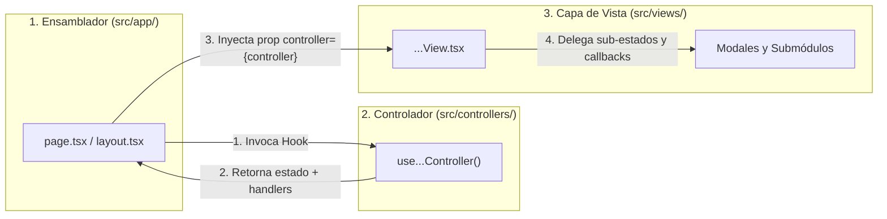

# 🖼️ Vistas del Sistema (Guía de Arquitectura MVC): M.I Stock

**Proyecto:** M.I Stock — Sistema de Gestión de Inventario, Punto de Venta (POS) y Catálogo Comercial  
**Capa de Arquitectura:** Vistas (`View` — Componentes UI Declarativos en React 19 / Next.js 16)  
**Ubicación en Código:** `src/views/`  
**Tags:** #vistas #mvc #ui #react #tailwind #recharts #shadcn #motion #mistock #defensa-oral

---

## 🎓 1. Guía para Defensa Oral: ¿Qué hace (y qué NO hace) una Vista en M.I Stock?

En la arquitectura **Modelo-Vista-Controlador (MVC)** de **M.I Stock**, la carpeta `src/views/` contiene **exclusivamente la representación visual e interactiva** de la aplicación.

> [!IMPORTANT] **Las 4 Reglas de Oro de las Vistas (Para responder en el examen)**
> 1. **Cero Acceso Directo a Base de Datos:** Ningún archivo en `src/views/` importa `@supabase/supabase-js` ni ejecuta consultas SQL.
> 2. **Cero Fórmulas Comerciales Internas:** Las vistas no calculan vueltos, márgenes de ganancia, diferencias de arqueo ni KPIs; reciben esos valores ya procesados desde el `controller`.
> 3. **Inyección de Dependencias vía Prop `controller`:** Cada vista principal define su interfaz de propiedades usando el tipo de retorno de su controlador:
>    ```tsx
>    interface AdminDashboardViewProps {
>      controller: ReturnType<typeof useAdminDashboardController>;
>    }
>    ```
>    El archivo de ruta de Next.js (`src/app/.../page.tsx`) instancia el controlador y se lo inyecta a la vista: `<AdminDashboardView controller={controller} />`.
> 4. **Estética Corporativa B2B y Accesibilidad:** Construidas con **Tailwind CSS v4**, primitivas **Radix UI** (`@/components/ui/`), gráficos vectoriales **shadcn/ui Charts (`Recharts`)**, animaciones **Motion (`motion/react`)** + **AutoAnimate**, e iconografía 100% unificada con **Phosphor Icons (`@phosphor-icons/react`)**.



---

## 🗺️ 2. Tabla Maestra de Trazabilidad MVC (Ruta ↔ Vista ↔ Controlador ↔ Modelos)

Esta tabla resume cómo se conectan las **21 piezas visuales** de `src/views/` con sus controladores y modelos:

| Contexto | Archivo de Vista (`src/views/`) | Ruta (`src/app/`) | Controlador Inyectado (`src/controllers/`) | Modelos Principales Consumidos (`src/models/`) |
| :--- | :--- | :--- | :--- | :--- |
| **Admin** | `admin/AdminDashboardView.tsx` | `/admin` | `useAdminDashboardController` (`dashboardController.ts`) | `AdminMetricCard`, `PuntoTendenciaVentas`, `PuntoDistribucionPago`, `ProductoRankingVentas`, `DetalleVentaItem` |
| **Admin** | `admin/AdminGestionInventario.tsx` | `/admingestioninven` | `useAdminInventarioController` (`inventarioController.ts`) | `Producto`, `Categoria`, `FormularioCargaProducto`, `FiltroStockHub`, `FiltroEstadoComercial` |
| **Admin** | `admin/AdminInventarioGlobalView.tsx` | `/admininventarioglobal` | `useAdminInventarioGlobalController` (`inventarioGlobalController.ts`) | `Producto`, `Categoria`, `FiltroEstadoStock`, `CriterioOrdenInventario` |
| **Admin** | `admin/AdminUsuariosView.tsx` | `/adminusuarios` | `useAdminUsuariosController` (`usuariosController.ts`) | `Usuario`, `RolUsuarioDB`, `EstadoUsuario`, `CrearUsuarioDTO` |
| **Admin** | `admin/AdminConfiguracionView.tsx` | `/adminconfiguracion` | `useAdminConfiguracionController` (`configuracionController.ts`) | `ConfiguracionCompleta`, `PestañaConfiguracion` |
| **Admin** | `admin/AdminSidebar.tsx` | `(admin)/layout.tsx` | Navegación contextual de Next.js (`usePathname`) | Agrupación lógica: `Métricas` → `Gestión de Inventario` → `Inventario Global` → `Gestión de Usuarios` → `Configuración` |
| **POS (Caja)** | `user/UserDashboardView.tsx` | `/dashboard` | `useUserDashboardController` (`userDashboardController.ts`) | `Producto`, `ItemCarritoPOS`, `Venta`, `AperturaCaja`, `RegistroCierreCaja`, `TabOperadorPOS` |
| **POS (Submódulo)** | `user/ModuloTerminalCobro.tsx` | `/dashboard?tab=terminal` | Recibe props de `UserDashboardView` (`useUserDashboardController`) | `Producto`, `Categoria`, `ItemCarritoPOS` |
| **POS (Submódulo)** | `user/ModuloCatalogoProductos.tsx` | `/dashboard?tab=catalogo` | Recibe props de `UserDashboardView` (`useUserDashboardController`) | `Producto`, `Categoria`, `ItemCarritoPOS` |
| **POS (Submódulo)** | `user/ModuloConsultorPrecios.tsx` | `/dashboard?tab=consultor` | Recibe props de `UserDashboardView` (`useUserDashboardController`) | `Producto`, `Categoria` |
| **POS (Submódulo)** | `user/ModuloHistorialTickets.tsx` | `/dashboard?tab=historial` | Recibe props de `UserDashboardView` (`useUserDashboardController`) | `Venta`, `MetodoPagoVenta`, `RegistroCierreCaja` |
| **POS (Modal)** | `user/ModalAperturaCaja.tsx` | Invocado en `UserDashboardView` | Recibe handlers de `useUserDashboardController` | `AperturaCaja` (`cierreCajaModel.ts`) |
| **POS (Modal)** | `user/ModalCobroTicket.tsx` | Invocado en `UserDashboardView` | Recibe carrito/handlers + consume endpoints de `pointService.ts` | `ItemCarritoPOS`, `MetodoPagoVenta`, `ConfiguracionPOS`, `PointPaymentIntentResponse` |
| **POS (Modal)** | `user/ModalArqueoCaja.tsx` | Invocado en `UserDashboardView` | Recibe estado de arqueo de `useUserDashboardController` | `ResumenArqueoTurno`, `EstadoBalanceCaja`, `RegistroCierreCaja` |
| **POS (Modal)** | `user/ModalDetalleVenta.tsx` | Invocado en `UserDashboardView` | Recibe `ventaSeleccionada` y `cancelarVenta` de `useUserDashboardController` | `Venta`, `DetalleVenta`, `ConfiguracionNegocio` |
| **POS (Modal)** | `user/ModalReporteCierreTicket.tsx` | Invocado en `UserDashboardView` | Recibe `ultimoCierreGenerado` de `useUserDashboardController` | `RegistroCierreCaja`, `ConfiguracionNegocio` |
| **POS (Navegación)** | `user/UserSidebar.tsx` | `(user)/layout.tsx` | Sincronizado con query param `?tab=` y sesión activa | `TabOperadorPOS` |
| **Auth** | `auth/LoginFormView.tsx` | `/login` | `useLoginController` (`authController.ts`) | `LoginCredentials`, `AuthFormState` (`authModel.ts`) |
| **Auth** | `auth/LogoutView.tsx` | `/logout` | `useLogoutController` (`authController.ts`) | Sesión de Supabase Auth |
| **Comunes / Permisos** | `comunes/ModalAccesoRestringido.tsx` | `(admin)/layout.tsx` y `(user)/layout.tsx` | `usePermisosController` (`permisosController.ts`) | `RolUsuario`, `TipoRestriccion` (`vendedor_en_admin` \| `sin_rol`) |
| **Comunes** | `comunes/Footer.tsx` | Global (`layout.tsx`) | Componente estático institucional | Identidad de marca `M.I Stock` |

---

## 🔍 3. Análisis Detallado de las Vistas por Módulo

### 3.1. Vistas del Panel de Administración (`src/views/admin/`)

#### A. `AdminDashboardView.tsx` (Tablero Ejecutivo de Métricas y KPIs)
* **Controlador Asociado:** `useAdminDashboardController` (`src/controllers/adminControllers/dashboardController.ts`).
* **Propósito:** Brindar al dueño o administrador una visión ejecutiva en tiempo real sobre la facturación, el ticket promedio, la participación de medios de pago y la rotación de stock bajo un único período global coherente.
* **Secciones Visuales:**
  1. **Único Selector Global de Período (`periodoMetricasActivo`):** Ubicado en la cabecera superior, alterna entre `Hoy`, `Esta Semana`, `Este Mes` y `Últimos 30d` (con indicador de la preferencia base configurada en `AdminConfiguracionView`) y sincroniza simultáneamente todas las tarjetas, gráficos, rankings y registros del tablero.
  2. **4 Tarjetas KPI Dinámicas (`kpisActivos`):** Recaudación del Período, Ticket Promedio, Operaciones Concretadas y Unidades Despachadas, con insignias de variación porcentual real (`+X%` / `-Y% vs. período ant.`) calculadas contra la ventana temporal previa equivalente (controlables mediante `config.metricas.compararPeriodoAnterior`).
  3. **Gráficos Financieros Interactivos (`@/components/ui/chart.tsx` sobre `Recharts`):**
     - **Evolución de Recaudación (`AreaChart`):** Curva comparativa entre `Recaudación Actual` (`#2A7A78`) y `Período Anterior` (`#94A3B8`) adaptada a las 4 granularidades (6 franjas de 4h, 7 días, 4 semanas o 6 bloques de 5 días).
     - **Distribución de Métodos de Pago (`PieChart` / Donut):** Gráfico de anillo centrado con mapeo semántico exacto de colores (`COLORES_METODOS`) entre las porciones del gráfico y los puntos de la leyenda inferior.
  4. **Panel de Rotación de Artículos (`Más Vendidos` vs `Menos Vendidos`):**
     - Segmented Control animado con `motion/react` (`layoutId="rotacionTabIndicator"`), chips de categoría y gráfico `BarChart` con el Top 5 del segmento.
     - Tabla paginada con `useAutoAnimate`, cálculo de capital inmovilizado a costo real de reposición ($\sum stockActual \times precioCosto$) y diagnóstico dinámico contra el umbral real del producto (`stockActual <= stockMinimo` $\rightarrow$ `Demanda Alta / Reponer Stock`).
  5. **Registro de Operaciones Comerciales:**
     - Barra de filtrado multivariado (búsqueda por comprobante/vendedor, selector de vendedor, medio de pago y estados reales `Completada | Cancelada`).
     - Barra compacta de resumen dinámico visible cuando hay filtros aplicados (evitando duplicar los 4 KPIs superiores o el gráfico de evolución) y tabla paginada de comprobantes.

---

#### B. `AdminGestionInventario.tsx` (Hub Unificado de Catálogo, Categorías y Diagnóstico de Stock)
* **Controlador Asociado:** `useAdminInventarioController` (`src/controllers/adminControllers/inventarioController.ts`).
* **Propósito:** Centralizar las operaciones de Alta, Baja Lógica, Modificación y Reposición del catálogo de productos y rubros en una sola consola sin sub-pantallas duplicadas.
* **Secciones Visuales:**
  1. **Cabecera de Acciones Directas (`seccionActiva: 'menu' | 'alta'`):** Botones principales `+ Nueva Categoría` (modal rápido) y `+ Nuevo Producto` (formulario `'alta'` con campos 100% persistidos en dominio, autocompletado de `umbralMinimoPorDefecto` y previsualización en vivo de ganancia neta y margen porcentual).
  2. **Semáforo de Salud de Stock Mutuamente Excluyente (Click-to-Filter único con `aria-pressed`):**
     Cada tarjeta presenta en tres niveles visuales diferenciados el conteo explícito con sustantivo (`{N} producto` / `productos` con `tabular-nums`), la regla descriptiva sin colisiones numéricas en línea separada y el estado interactivo del filtro:
     - **Sin Existencias / Agotados:** $stockActual = 0$ (*"Stock agotado en depósito"*).
     - **Stock Crítico:** $0 < stockActual \le stockMinimo$ (*"Igual o por debajo del stock mínimo"*).
     - **Bajas Unidades:** $stockMinimo < stockActual \le stockMinimo \times 1.5$ (*"Próximos al umbral mínimo"*).
     - **Stock Óptimo:** $stockActual > stockMinimo \times 1.5$ (*"Abastecimiento saludable"*).
     *(La suma de los 4 niveles coincide exactamente con el total de artículos activos).*
  3. **Tabla Unificada de Catálogo y Modal de Edición/Reposición:** Única barra de herramientas (`Buscar SKU o producto...` con soporte de deep-link `?q=SKU`, selector de `Categoría` y selector de `Estado comercial: Activos | Dados de Baja | Todos`). Cada fila permite editar/reponer (con vista previa en vivo de margen y alerta `alertarMargenNegativo`), dar de baja lógica o reactivar.

---

#### C. `AdminInventarioGlobalView.tsx` (Inventario Global y Valuación Financiera)
* **Controlador Asociado:** `useAdminInventarioGlobalController` (`src/controllers/adminControllers/inventarioGlobalController.ts`).
* **Propósito:** Auditar la valuación financiera del depósito (capital invertido vs. ingreso potencial) y explorar la distribución por familias de categorías.
* **Secciones Visuales:**
  1. **Tarjetas de Valorización Global (`metricasGlobales`):** Unidades físicas en depósito, **Valorización al Costo** ($\sum stockActual \times precioCosto$), **Valorización a Precio de Venta** ($\sum stockActual \times precioVenta$ con margen global estimado) y alertas de reposición.
  2. **Explorador de Familias de Categorías:** Píldoras interactivas con conteo de productos activos por rubro y panel de resumen de la categoría seleccionada (`metricasCategoriaActual`).
  3. **Taxonomía Unificada y Enlace Profundo (`Gestionar`):** Filtro por los mismos 4 estados de stock (`optimo`, `bajo`, `critico`, `sin_stock`), selector de ordenamiento y acción `"Gestionar"` que navega directamente a `/admingestioninven?q={SKU}` prefiltrando el artículo elegido.

---

#### D. `AdminUsuariosView.tsx` (Gestión de Colaboradores, Roles y Credenciales)
* **Controlador Asociado:** `useAdminUsuariosController` (`src/controllers/adminControllers/usuariosController.ts`).
* **Propósito:** Administrar las cuentas del personal, asignar roles de acceso (`admin`, `vendedor`, `no_rol`) y gestionar la habilitación operativa (`activo` / `inactivo`).
* **Secciones Visuales:**
  1. **Mini-KPIs de Nómina:** Total de colaboradores (y cuentas activas), administradores, vendedores POS y pendientes de asignación de rol.
  2. **Filtros y Tabla Paginada con `useAutoAnimate`:** Búsqueda por nombre/email/teléfono, filtro por rol y estado unificado (`Activo` | `Inactivo`), selector rápido para cambiar el rol en línea, botón de activación/desactivación rápida y desvinculación con protección del último administrador.
  3. **Modales de Alta y Edición con Gestión de Credenciales y Restricciones Nativas:** Incluyen validación de campos, `type="tel"` con sanitización en vivo (`sanitizarTelefonoInput`), validación de contraseña de $6 \dots 72$ caracteres (obligatoria al dar de alta), toggle de visibilidad (`Eye` / `EyeSlash`), prevención de submit múltiple con estado `guardandoUsuario` y copiado seguro al portapapeles.

---

#### E. `AdminConfiguracionView.tsx` (Centro de Parametrización Reactiva del Sistema)
* **Controlador Asociado:** `useAdminConfiguracionController` (`src/controllers/adminControllers/configuracionController.ts`).
* **Propósito:** Gobernar con **guardado automático en tiempo real** las reglas operativas de toda la aplicación a través de 5 pestañas:
  1. **`negocio`:** Datos fiscales con validaciones activas (CUIT con `inputMode="numeric"`, `maxLength={13}` y formateo progresivo `XX-XXXXXXXX-X`; teléfono con `type="tel"` y sanitización; correo con validación RFC) + **Simulador de Ticket Térmico en Vivo** (`80mm` / `58mm`) sin datos ficticios fijos (muestra "Cajero de Turno" genérico) con coherencia tributaria y matemática (`FACTURA B` con discriminación de Subtotal Neto + IVA 21% para `responsable_inscripto`, `FACTURA C` para `monotributo` o leyenda legal Ley 11.683 en `no_fiscal`).
  2. **`pos`:** Habilitación de canales de cobro (`efectivo`, `tarjeta_debito`, `tarjeta_credito`, `transferencia`, `mercado_pago`), política de **venta sin stock**, **sonido de confirmación**, **modo escáner rápido** e **impresión automática de ticket**.
  3. **`inventario`:** Umbral mínimo global por defecto (`umbralMinimoPorDefecto`) y alerta preventiva de margen negativo o nulo (`alertarMargenNegativo`).
  4. **`metricas`:** Período base predeterminado del dashboard (`diario`, `semanal`, `mensual`, `ultimos_30_dias`), inicio de semana (`lunes | domingo`), día de corte mensual (`1..28`) y switch de comparativa contra el período anterior.
  5. **`respaldos`:** Monitor de infraestructura con conteo real en vivo de registros (`estadisticasSistema`: productos, categorías, ventas y marca temporal de la última exportación CSV), botones de descarga CSV UTF-8 BOM y **Zona de Mantenimiento** para restablecer parámetros de fábrica.

---

### 3.2. Vistas de la Terminal de Punto de Venta — POS (`src/views/user/`)

#### A. `UserDashboardView.tsx` (Orquestador del Punto de Venta)
* **Controlador Asociado:** `useUserDashboardController` (`src/controllers/userControllers/userDashboardController.ts`).
* **Propósito:** Contenedor principal del operador de mostrador. Muestra el estado de la caja en la barra superior (`Caja Abierta` con hora y fondo inicial vs `Caja Cerrada` con bloqueo preventivo de ventas), la recaudación del turno y coordina los **4 módulos operativos** y los **5 modales transaccionales**.
* **Navegación Limpia y Responsiva:** En pantallas de escritorio (`lg:`), la navegación entre módulos se realiza desde `UserSidebar.tsx` sincronizado con `?tab=...`, mientras que la barra horizontal de pestañas se muestra únicamente en dispositivos móviles/tablets (`lg:hidden`), evitando duplicación visual.

#### B. Los 4 Submódulos Operativos del Mostrador
1. **`ModuloTerminalCobro.tsx` (`?tab=terminal`):**
   - **Buscador y Lector de Código de Barras:** Soporta disparo automático al presionar `Enter` o disparo instantáneo al coincidir el SKU exacto cuando `config.pos.modoEscanerRapido` está activo.
   - **Filtro Unificado por Categoría:** Selector desplegable `<Select>` con conteo de productos y alternador entre cuadrícula táctil (`SquaresFour`) y lista compacta (`ListBullets`).
   - **Panel Lateral de Ticket Activo:** Muestra los renglones (`ItemCarritoPOS`), controles `+ / -` con validación de stock disponible, totalizador en vivo y botón principal **Cobrar Ticket** (o bloqueo `<Lock /> Caja Cerrada` si aún no se realizó la apertura de turno).
2. **`ModuloCatalogoProductos.tsx` (`?tab=catalogo`):**
   - Explorador completo del catálogo con mini-KPIs de existencias físicas, filtros por rubro y disponibilidad (`Todos`, `En Stock`, `Agotados`), y botón para sumar artículos directamente al carrito.
3. **`ModuloConsultorPrecios.tsx` (`?tab=consultor`):**
   - Verificador rápido de precios y stock para responder consultas de clientes en mostrador **sin modificar el carrito en curso**, con opción de cargar el artículo consultado al ticket con un clic.
4. **`ModuloHistorialTickets.tsx` (`?tab=historial`):**
   - Auditoría de comprobantes emitidos en la jornada, buscador por código (`VNT-...`), filtro por medio de pago y acceso rápido para reimprimir tickets, anular ventas o abrir el **Arqueo y Cierre de Caja (Reporte Z)**.

#### C. Los 5 Modales Transaccionales del POS
1. **`ModalAperturaCaja.tsx`:** Solicita el fondo fijo inicial de cambio en billetes (con atajos rápidos de `$0` a `$50.000`), identifica al cajero autenticado y habilita formalmente la terminal para operar.
2. **`ModalCobroTicket.tsx`:**
   - Filtra los medios de pago según `config.pos.mediosPago`.
   - En **Efectivo**, calcula el vuelto en tiempo real (`calcularVueltoPOS`) y ofrece botones con sugerencias inteligentes de billetes (`generarSugerenciasBilletes`).
   - En **Mercado Pago Point Smart**, consulta las terminales físicas vinculadas (`/api/mercadopago/point/devices`), envía la intención de cobro (`POST /api/mercadopago/point/intent`), realiza *polling* cada 3 segundos (`GET /api/mercadopago/point/intent/[id]`) mostrando el estado del posnet en vivo (`ON_TERMINAL`, `PROCESSED`, `ERROR`, `ABANDONED`) y solo habilita la emisión del ticket cuando el pago es aprobado.
3. **`ModalArqueoCaja.tsx`:** Muestra el resumen contable por medio de pago, el efectivo esperado ($\text{Fondo Inicial} + \text{Ventas en Efectivo}$) y recibe el conteo físico en gaveta (bloqueando de forma estricta valores negativos o superiores a `MAX_PRECIO_DB` con alerta visual e inhabilitación del botón de confirmación) para determinar en vivo si hay `Caja Exacta`, `Sobrante` o `Faltante`.
4. **`ModalReporteCierreTicket.tsx`:** Renderiza el comprobante térmico de 80mm del **Reporte Z de Cierre de Caja** (`CR-XXXXXX`) con firmas de Cajero y Administrador, listo para imprimir mediante `@media print` (`#ticket-cierre-impresion`).
5. **`ModalDetalleVenta.tsx`:** Visor de ticket térmico de 80mm con precios unitarios históricos congelados, reimpresión directa (y disparo automático de `window.print()` si `config.pos.autoImprimirTicket` está activo al cobrar) y botón de **Anular Venta** con confirmación que ejecuta `cancelarVenta()` y reintegra el stock automáticamente.

---

### 3.3. Vistas de Autenticación, Seguridad RBAC y Comunes (`src/views/auth/` y `src/views/comunes/`)

1. **`auth/LoginFormView.tsx`:** Formulario de acceso institucional de **M.I Stock** con validación reactiva de correo y contraseña, manejo de estados de carga y alertas de error claras, sin enlaces externos rotos.
2. **`auth/LogoutView.tsx`:** Pantalla de cierre de sesión que invoca `useLogoutController` para limpiar las cookies JWT de Supabase y redirigir a `/login`.
3. **`comunes/ModalAccesoRestringido.tsx`:** Barrera visual de seguridad por permisos y roles consumida por `(admin)/layout.tsx` y `(user)/layout.tsx` junto con `usePermisosController()`. Bloquea la pantalla con un diálogo no eludible en dos escenarios:
   - `tipo = 'vendedor_en_admin'`: Cuando un usuario con rol `vendedor` intenta ingresar a una ruta administrativa, ofreciéndole un botón directo para regresar a `/dashboard`.
   - `tipo = 'sin_rol'`: Cuando un usuario recién registrado tiene rol `no_rol`, informándole que un Administrador debe autorizar su cuenta desde Gestión de Usuarios.
4. **`comunes/Footer.tsx`:** Pie de página institucional minimalista con identidad `M.I Stock` y año dinámico.

---

## 🔗 Enlaces Relacionados en la Bóveda
- [[Modelos]] — Documentación detallada de la capa de Modelos (`modelos_dominio` y `modelos_vista`).
- [[Controladores]] — Documentación detallada de los 8 Controladores (Hooks) y los 4 Servicios Reactivos.
- [[Rutas del Sistema]] — Estructura del App Router de Next.js, Layouts y Route Handlers de Mercado Pago Point.
- [[Reglas de Negocio miStock]] — Validaciones comerciales, criterios de stock y medios de pago.
- [[Metricas y Calculo de KPIs]] — Fórmulas matemáticas visualizadas en `AdminDashboardView`.
- [[Librerias]] — Catálogo de dependencias (`Recharts`, `shadcn/ui`, `Radix UI`, `Motion`, `Phosphor Icons`, `Supabase`).
